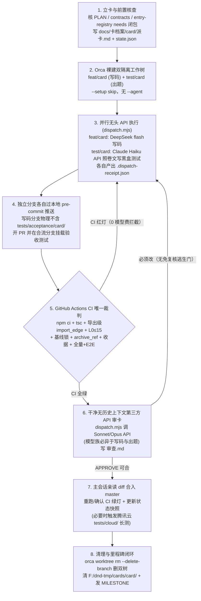

# 《无限原野》开工文件（Orca 多代理协作 + 抗失忆 + 全流程落地版）

- **代码与盘面基线**：`origin/master` 提交 `395986f01`（`chore/workspace-cleanup` 已合并至 `master` 并推送，全量单测 `2239/2239` 绿；已合入分支 `antigravity`，2026-11-25 伦敦时间）。
- **撰写角色**：Antigravity / Gemini（独立审核席，工作树 `F:/dnd-worktrees/dnd/antigravity`，分支 `antigravity`——固定做独立审核与架构把关，**不写业务代码**）。
- **继承与生效关系**：本文件**完整继承** `docs/gemini/diagnosis-1124.md`（七条病根与机械防线）与 `docs/gemini/rewrite-guide-1124.md`（主策略、资产处置、代码规则、开发规则、合入门槛、模型分工、阶段卡、A–F 复审门闩），一条不丢；所有因 11-24 夜【停工清理1124】、【亮圳原话更正1124】与接入 **Orca** 而产生的修订，均在第一章逐条标明「改了什么、为什么」。
- **配套附录**：给李白（Grok Bot）可直接复制粘贴的两套 Routine Prompt 见同目录独立文件 [`docs/gemini/libai-routine-prompt-1125.md`](./libai-routine-prompt-1125.md)。
- ~~**开工硬前提**：主会话按本文第八章「落地清单」施工完毕并推 PR 后，交回 `antigravity` 逐项复核；复审通过并开启 `master` 分支保护前，严禁开写任何阶段 1 业务代码（S1-1）。~~【作废，亮圳 11-25 09:47 原话「我是想让Gemini来做每天的独立全库审核，不是一段一段审。」，李白转】
- **会员额度期限（现行，亮圳 11-25 13:31 原话『后面恢复了之后不要用api用会员额度』，李白转）**：本文所有「写码/出题/审卡只走 API、禁会员额度、禁 agent launch 跑写审测」的写法（第一章 R3、2.5 节、3.2 节、3.4 节第 1 条、7.2 节 P4 等）只适用至 2026-11-26（周四）会员额度重置前；重置后的写审分工以 CLAUDE.md 第 3 节为准。
- **Gemini 职责（现行，取代本文所有「交回 antigravity 复审/复核、阶段 0B 复审、按需诊断、handoff 给 antigravity」的写法——见第一章 R2、2.5 节、2.6 节、2.7 节、3.3 节、4.3 节、5.2 节、5.5 节 L2 第③项与 L3、第八章执行说明与末节复核模板，均作废）**：Gemini 只做每天一次独立全库审核，由李白每日例程（伦敦约 22:30）开新会话发起；自 2026-11-26 会员额度重置起另审 Sonnet/Opus 写的卡（CLAUDE.md 第 3 节），其余单卡审核照 CLAUDE.md 第 3 节。

---

## 一、11-25 现状盘点与相对 11-24 指南的修订日志

### 1.1 11-24 夜至今的真实盘面（已亲核仓库与本机 Orca）

1. **已完成（已落盘 / 已推远端）**：
   - **F 盘清理完毕**（见 `archive/docs-status/cleanup-1124.md`）：163 个旧 worktree（134.6 GB）、旧 `F:/dnd-tmp`（21.9 GB，保留 3 个云机指纹/私钥文件）、`F:/temp`（3 GB）、`F:/dnd-backup`（1.1 GB）已清，全项目磁盘占用从 ~190 GB 降至 ~5 GB；不可变留底标签 `pre-rewrite-1124`（`ae71f231e`）与留底分支 `backup/pre-cleanup-1124`（`c4072b022`）已推 GitHub。
   - **仓库第一轮归档与删旧已合入 `master`（`395986f01`，全量 `2239/2239` 绿）**：467 MB `docs/统一底层设计/版本快照/`、343 MB `world/drafts/`、146 个 `world/design/` 旧脚本、`docs/probes/`、`logs/`、A3 残留已删；历史文档/旧本体/旧动作/旧测试及清理记录（`archive/docs-status/cleanup-1124.md`）已迁 `archive/`，使 `docs/` 顶层严格仅留允许清单；`CLAUDE.md`（35 行）、`AGENTS.md`、`docs/PLAN.md`（18 行）、`docs/问题.md`（32 行）、`docs/审查/现行有效裁定.json`、`使用说明.md` 已更新。
   - **Orca 环境已搭起**：仓库 `dnd`（`repoId: 7f3bd855-6dec-429f-941f-32a9fcf2e65e`，主克隆 `F:/dnd`，`worktreeBasePath: ../dnd-worktrees`）；常驻工作树 `main-session`（Claude Chat）、`antigravity`（Antigravity Chat）、`deepseek`（OpenCode）；`claude` 与 `antigravity` 已启用 Orca 状态钩子；插件 `tourbut.grokbot-notify` v0.6.0 已安装并处于 `running`。
   - **`origin/chore/step1-tooling` 分支已启动并暂停**：初版 `dispatch.mjs`、`archive_ref.mjs`、模型族校验、`tools/cloud/`、`tools/notify/` 已在分支上起稿，尚未合入且尚未过审。
2. **尚未完成（阶段 0 剩余硬缺口，进入第八章落地清单）**：
   - 旧残留 worktree `F:/dnd/.claude/worktrees/new-session-8e4637` 待移除，并确认 `main-session` 快进到 `origin/master`（`395986f01`）；
   - `.github/workflows/ci.yml` 未建、`master` 分支保护未开、`package.json` 未加 `typescript` 与 `tsc --checkJs`；
   - `docs/状态快照.generated.md` 与 `tools/gen-status-snapshot.mjs` 未建；`world/ontology/contracts.json` 未建；
   - `docs/派活卡头规矩.md` 仍为 142 行旧版，`tools/accept/lib/card-selfcheck.mjs` 仍被提交门禁加载；
   - `dispatch.mjs` 缺少**API 调用收据（`.dispatch-receipt.json`）**签发与派前 `needs` 闭包/三方模型族硬核；
   - Step 5（新 `server-plugin/kernel/` ≤15 文件拆出、旧 `server-plugin/` 归档 `archive/legacy-server/`、`baseline.json` 100% 锁定、零 mock E2E 红灯烟测桩 `tests/e2e/vertical-slice-smoke.test.mjs`）未执行；
   - **实测发现的 Orca 隐形雷区**：`orca repo list --json` 显示 `dnd` 仓库的 `hookSettings.scripts.setup` 当前配着 **`"pnpm install"`** 且 `setupRunPolicy: "run-by-default"`，但本仓是 **`npm` + `package-lock.json`**！不改或建工作树不传 `--setup skip` 会污染工作树。

### 1.2 相对 `rewrite-guide-1124.md` 的修订日志（改了什么、为什么）

| # | 修订项 | 11-24 原写法 | 11-25 修订后写法 | 修订原因（仓库与实测证据） |
|---|---|---|---|---|
| **R1** | **亮圳原话归因纠偏** | 把“禁预计算/可重建索引”“全字段强制现实文献出处”“11-30 全规模”归为亮圳/卷文既有教条 | **保留技术方案不变**（允许确定性可重建索引/烘焙层、出处机械分 `literature`/`design_spec`、11-30 收束为最小闭环），但修正归因：卷一:128、卷二:283/395、卷二十七:626 及亮圳 `设定值可编-1117` 原话本就允许投影与设定值，系执行层/校验器一刀切所致；**铁律：凡引用亮圳规矩必须附原话出处或标明转述/自定** | `docs/问题.md:13-31`、`docs/审查/现行有效裁定.json:782-790`（亮圳原话更正 1124） |
| **R2** | **独立顾问席位升级** | 独立顾问 Gemini 4 Neon 跑在外部李白 box 机 `/workspace/neon-advisor/` 每周一/四巡查 | 升级为 **Orca 常驻独立审核工作树 `F:/dnd-worktrees/dnd/antigravity`（分支 `antigravity`）**，通过 `orca orchestration send` 接收阶段门闩复审、跨卷根因诊断与重大设计审核，仍严守**只读代码、不写业务代码、只写 `docs/gemini/`** | 亮圳与主会话 11-25 启用 Orca 多代理架构，审核延迟从“等周一/四”降至按需直达 |
| **R3** | **多代理协作机制落入 Orca** | 11-24 仅设计 GitHub PR + 命令行脚本，未涉及 Orca | 明确 **Orca 管工作树/可见状态/跨代理消息/事件通知**，**`tools/dispatch/dispatch.mjs` 管无头 API 写码/出题/审卡与预算收据**；严禁 `orca agent launch`/`worker-start --agent claude` 跑写审测，避免偷烧 Claude Ultra 会员额 | 实测 `orca` CLI 与【裁定1124b】会员只给主会话调度冲突分析 |
| **R4** | **API 环境变量名兼容** | `CLAUDE.md` 写死 `ANTHROPIC_API_KEY`，批评 `run-card.sh` 用 `CLAUDE_API_KEY` | 统一规定：宿主机用户环境变量兼容读取 `ANTHROPIC_API_KEY || CLAUDE_API_KEY`（本机实为 `CLAUDE_API_KEY`，不强迫亮圳改 C 盘全局环境变量），由 `dispatch.mjs` 仅在子进程内映射为 `ANTHROPIC_API_KEY`；同步修订 `CLAUDE.md:18` 措辞防报错 | `docs/问题.md:9` 与 `chore/step1-tooling` 的 `dispatch.mjs` 实测现状 |
| **R5** | **两处过渡文件实读保留** | 11-24 建议整目录删 `world/design/`、整目录归档 `world/meta/` 与 `启动酒馆.*` | 承认 `chore/workspace-cleanup`（已合入 `master` `395986f01`）的实证保留：`world/design/opening-polity-hw.json`（4 处测试实读，其余 146 文件已删）、`world/meta/`（转换器与 2 测试实读，待 Step 5 切新骨架后再迁入 `archive/legacy-world-data/`）、`启动酒馆.*`（`tools/backup.mjs:15` 实读，待改清单后归档）、`docs/审查/6-22-材料候选清单.md`（`material-candidates.mjs` 实读，待 Step 5 随转换器迁出） | `docs/问题.md:3-4` 实测全量 `2239/2239` 绿灯约束 |
| **R6** | **留底标签名与时间锚点** | 原指南写 `pre-rewrite-20261124`、11-24 22:00 截止 | 仓库实际已打不可变标签为 **`pre-rewrite-1124`**（指向 `ae71f231e`）+ 备份分支 `backup/pre-cleanup-1124`（`c4072b022`），本文件以此实名生效；11-25 01:00 起剩余距 11-30 20:00 伦敦时间约 **5.8 天（139 小时）**，阶段 0 须在 **11-25 晚**完成落地与复审，否则立刻顺延交付日 | `archive/docs-status/cleanup-1124.md:9-10` 与当前真实时钟 |

---

## 二、完整继承：主策略、代码规则、开发规则、合入门槛、模型分工与阶段卡

> 本章将 `diagnosis-1124.md` 与 `rewrite-guide-1124.md` 的全部有效规则完整收拢于此，作为开工唯一技术总纲。

### 2.1 主策略：修正版「骨架重来，零件严审留用」

- **唯一主策略**：**冻结一切旧骨架修理卡（C8–C11、旧挡块 6 77 条）**；完成工作区整理与门禁/CI 落地后，重建极简无领域语义的 L0 新骨架与零 mock 玩家闭环，将现有 `server-plugin/` 整体迁入只读零件仓 `archive/legacy-server/`，**仅允许通过下方 6 条机械准入闸的旧零件按新骨架需要逐件搬回（降级入 `rules/` 或保留入 `kernel/`），其余一律按新骨架重写**。
- **明确否决**：
  - 否决「原地修」：旧 `kernel/` 吞掉全服务端 71.5% 文件（108/151）与 85.5% 行数（27,836/32,556），`state.created` 被全线拒收，`time` 事务死锁，`baseline.json` 积压 523 条未锁违例，原地修等于在倒置承重墙上刷漆。
  - 否决「全盘从零重写」：定点数学 `det-math.mjs` 与 366 KB `det-numeric.json`、`bytes.mjs`、`sample.mjs`、`ledger.mjs`、`textcore/`、`gate/`、`assets/`（24.8 MB 开源字体 + 94 SVG）、`world/geo/`、`world/people/`、`world/lore/` 均为高质量硬资产，必须留用。

#### 「零件」资格口径与 6 条机械准入闸

- **有资格申请搬入的 3 类零件**：① 无领域耦合纯 L0 算法/基座（`det-math.mjs`、`bytes.mjs`、`clone.mjs`、`errors.mjs`、`named-structs.mjs`、`named-struct-match.mjs`、`textcore/`、`gate/`、拆清权限后的 `ledger.mjs`/`rx.mjs`）；② 领域纯计算子算法（**降级进 `rules/`，永不回 `kernel/`**，如 `calendar.mjs`、`route-grid.mjs`、网格几何与材料纯公式，须剥离黑户假设与私有 `WeakMap`）；③ 世界数据与设计资产（`world/i18n/`、`world/rules/tables/`、`world/geo/`、`world/people/`、`world/lore/`、`assets/`）。
- **明确淘汰/必须重写的 4 类泥球**：20+ 跨领域静态 import 大泥球（`load/world.mjs`、`place.mjs` 1,740 行）；只查静态 `idIndex` 拒收 `state.created` 的存储/键/估值壳；全仓 0 生产调用者的孤岛模块（旧 `menu-entry.mjs`、旧 `world-create.mjs`）；带整文件豁免或基线债务的胶水代码。

| # | 机械准入闸 | 自动检查方式（CI 强拦，不靠 AI 记忆） | 不通过的处理 |
|---|---|---|---|
| 1 | **分层与体积红线** | 新 `server-plugin/kernel/files.json` 硬白名单（**≤ 15 个纯 L0 文件**）+ `import_edge.mjs` 导出级默认拒绝 | 任何业务代码进 `kernel/` 或跨组裸导私有符号，CI 非 0 拒合 |
| 2 | **静态类型与契约** | `npx tsc --noEmit --allowJs --checkJs` 零报错 | 类型/签名不符直接红灯，禁打补丁绕过 |
| 3 | **零黑户 & 零私有缓存** | AST 扫描：禁加载器外直查 `registry().idIndex.get`；禁 `kernel/memo.mjs` 外声明顶层状态 `WeakMap/Map`；禁加载器外调 `installVocab` | 必须改走 `kindOfEntity(state, id)` 与切片 `stateMemo` |
| 4 | **零基线债务迁入** | 新骨架所有文件在 `tools/accept/baseline.json` 违例必须为 **0**，且禁止在 `scanclasses.json` 挂整文件豁免 | 带 1 条旧违例即拒搬，须修净或重写 |
| 5 | **真实生产消费者可达** | 入口可达图校验：新导出必须在 `server-plugin/index.mjs` 依赖图内至少有 **1 处非测试调用者**，并被零 mock E2E 烟测覆盖 | 仅单测调用的孤岛代码禁入主线 |
| 6 | **干净容器行为单测 & 拒静默兜底** | GitHub Actions 干净容器 `npm ci` 跑过手算行为单测 + 缺依赖/显式 `null`/未知值负向测试 | 静默跳过校验或顶替未知直接失败 |

### 2.2 全仓五类资产处置承接表（11-25 实况对照）

| 仓库区域 | 处置口径 | 11-25（`master 395986f01`）现状 | 剩余动作（归属落地清单 / 阶段卡） |
|---|---|---|---|
| `docs/统一底层设计/版本快照/`（467 MB）、`world/drafts/`（343 MB）、`world/design/`（146 文件）、`docs/probes/`、`logs/`、A3 顶层 8 文件、`verbs.json`/`holdings.json` | **删除**（`pre-rewrite-1124` 留底） | **已完成**（`world/design/opening-polity-hw.json` 暂留供 4 测实读） | Step 5 随旧测试归档后将 `opening-polity-hw.json` 迁入 `world/people/` 或 `archive/` |
| 历史文档（`docs/当前状态.md`、`PLAN_已完成.md`、`卡回报/`、`卡档案/` 旧卡、`审查/` 1,553 份、`架构设计/` 23 份、`研究/` 70 份、`迁移体检/`、`归档/`、写卷草稿/脚本/素材）、旧数据/UI/模板/提示词/Schema/跑团资料 | **归档**至 `archive/` | **已完成**（`world/meta/`、`启动酒馆.*`、`6-22-材料候选清单.md` 因现行测试/转换器实读暂留） | 落地 `archive_ref.mjs` 禁引用防回潮；Step 5 转换器改显式源路径后迁出剩余 3 项 |
| `CLAUDE.md`、`AGENTS.md`、`docs/PLAN.md`、`docs/问题.md`、`docs/审查/现行有效裁定.json`、`使用说明.md` | **重写为单一真相源** | **已初版落地** | 修正 `CLAUDE.md:18` 环境变量兼容描述；新建 `docs/状态快照.generated.md` 与 `world/ontology/contracts.json`；重写精简 `docs/派活卡头规矩.md`（≤50 行） |
| `tools/accept/`、`tools/dispatch/`、`.githooks/`、仓库外 `cloud/`/`notify/`、`package.json` | **瘦身 + 统一入库 + 上 CI** | `chore/step1-tooling` 有半成品；无 `.github/workflows/ci.yml`、无 `typescript`、`card-selfcheck.mjs` 仍在加载、`baseline.json` 全未锁 | 落地清单 P1 一次性补全并合入 |
| `server-plugin/`（155 文件）与 `tests/kernel/`（146 文件） | **骨架重来，零件入只读仓** | **尚未拆仓**（仍在原位以保整理分支全量 2239/2239 绿） | 落地清单 P3（Step 5）：原 108 泥球与旧规则入 `archive/legacy-server/`、旧单测入 `archive/legacy-tests/`，新 `kernel/` 留 6 个纯 L0 零件 + 骨架桩（≤15 文件），落零 mock E2E 红灯桩 |
| `assets/`（24.8 MB）、`world/i18n/`、`world/geo/`、`world/people/`、`world/lore/`、`world/rules/tables/`、`world/ontology/dimensions/` | **保留 / 改后保留** | **已在位** | 阶段 1–2 按卡改造 `state-owners.json`（移出 4 个规则倒灌）、`person.json`（清占位钳位）、`derived-process.json`（消空壳）、`world/actions/`（重写）、桥接 `world/lore/` |

### 2.3 代码规则与架构红线（全部必须机械化）

1. **北极星四句（不可动摇底线，`docs/产品原则.md`）**：① 九省 31 郡全规模真实差异的中西合璧修仙世界（不为省事缩规模）；② 规则引擎唯一真相；③ 不依赖 AI 也能完整游玩全部玩法；④ 有 AI 时能接住玩家无穷想法（LLM 只提议与叙述，不越权写状态）。
2. **不准硬编码红线（亮圳原话，提交 `fd8d5bf2`，永久）**：
   - 严禁为某个意图单独写登记动作、单独加特例分支、单独写只在一种情况下成立的规则；任何修复必须落在规则层或原语层，让同一类情况一起被覆盖；一张卡只补一件东西直接判不合格。
   - 除世界设定外，一切数值、规则、种类放数据表，可单独替换；已有公共部件必须调用，缺能力则扩展公共部件本身，禁止另抄副本（彻底消灭 `primitives-runtime.mjs:49` 硬抄 `CATALOG`、`holdings.mjs:77` 硬写 `TEMPLATE_NAMES`、`state-owners.mjs:50` 硬写 `ENTITY_KINDS`）。
3. **五层单向依赖与 L0 内核硬天花板（`docs/架构设计/03-分层与玩法包.md`）**：
   - `L0 内核`（无领域语义）← `L1 本体与派生库` ← `L2 玩法包（rules/）` ← `L3 投影与缓存` ← `L4 接口（index.mjs / 菜单 / 存档 / 提示组装）`。依赖只向下，包间不互 import。
   - **`server-plugin/kernel/files.json` 硬上限 ≤ 15 个纯 L0 文件**；一切地理、足迹、物品、气候、生物、经济、文化、世界生成逻辑一律进 `server-plugin/rules/`；`state-owners.json#kernelApi.exports` 路径强制以 `kernel/` 开头，规则层共享出口走 `groupApi.exports`。
4. **解除四大结构死锁的强制架构契约（写入 `world/ontology/contracts.json`）**：
   - **消除 `state.created` 黑户**：`storage.mjs`、`dimensions.mjs`、`handles/keys.mjs`、`valuation.mjs` 全面切用兼容运行期新建实体的 `kindOfEntity(state, id)`，AST 禁止加载器外直查 `registry().idIndex.get(...)`。
   - **切片缓存与确定性可重建索引/烘焙层**：区分「权威状态（进 `saveDigest`）」与「确定性可重建索引/烘焙层（不进 `saveDigest`，可一键丢弃重建并验一致）」；`memo.mjs` 改为按顶层状态键切片失活，AST 禁止 `memo.mjs` 外声明顶层状态 `WeakMap/Map`；将 5,340 万区格郡级静态气候/海拔等合法烘焙，建随事务同步的衍生索引（`regionSubjects`/`instanceHolder`/`playerSeats`）；聚落内住区降为逻辑/细格亚区（恢复 19 栋私宅与 86 子站点层级）。
   - **解除 `time` 事务死锁**：`execute()` 单事务原子写状态与事件并提交，耗时动作经 `resolve()` 返回 `postCommit.advanceMinutes`，提交后由 `submitProposal` 外层调 `scheduler.advance()` 逐刻推进，既无嵌套事务又保 `replay_apply` 逐字节一致。
   - **启动完整性强断言 & 插件化加载**：`load/world.mjs` 改 `registerDomainValidator(kind, fn)` 插件口，`installVocab` 锁死仅 `load/world.mjs` 调用；`mountKernel` 尾部强断言 `saveEnv`、`unitOfPath`、`modifierSource`、`derived-process` 槽与 `systems.mjs` 完整装配，缺任一项启动即抛错，零静默兜底。
5. **解封世界内容与消除静默陷阱**：
   - **出处机械分级**：加载校验器严格区分 `literature`（现实物理/天文/材料基础量，核文献）与 `design_spec`（奇幻/修仙/文化/游戏内部刻度，校验指向仓库设计册路径或生效裁定号，不按 placeholder 误杀）。
   - **存档指纹拆分**：坚持「开发期不为旧存档做兼容」，但将 `saveDigest` 拆为 `engineRulesDigest`（引擎逻辑变化拒读）与 `dataPacksDigest`（支持只增内容包/调暂定标定）。
   - **第二物种解锁**：加载器统一提供过滤 `null` 键的只读 map 视图（根治 `death.mjs:77`/`body.mjs:172` 崩溃），解封多物种与 `world/lore/`（优先桥接 `cultures`/`deities`/`faith` 并实抛 `E-DEITY-CAP` 与 `E-NAME-BLOCKLIST`）。
   - **错误码活性与拒静默兜底**：`error-codes.mjs` 必须显式标注 `active`（必有非测试抛出点）或 `deferred`（绑未建卷），清零僵尸码；`rx.mjs` 合法放行显式 `null`（已知没有）；严禁遇缺依赖静默跳过校验（旧 `item.mjs:502`）或拿近似字段顶替未知（旧 `place.mjs:1383`）；`storage.mjs#writerOk` 补齐 `rewriteRows` 校验，`path_access.mjs` 补齐 `dated` 静态拒写。
6. **安全、原创与纯净环境红线**：
   - 绝不读取、打印、提交任何密钥或 `SillyTavern/data/*/secrets.json`；绝不在代码中写死 `F:/dnd-`、`119.45.*` 等本地路径或 IP；
   - 绝不复制小说《再生勇士》正文、人名、地名、组织名与情节（受 `world/i18n/blocklist.zh.json` 拦截）；未成年 NPC 严禁进入恋爱或亲密情节。

### 2.4 开发规则、六份单一真相源与合入五条硬门槛

#### 明确废除的四项有害旧规（严禁回潮）
1. **废除 9 项长文本正则自查表（`card-selfcheck.mjs` / `E-ACC-CARD-SELFCHECK`）与 `docs/卡回报/`**：改用物理分支隔离 + 模型族硬核 + CI 实证。
2. **废除「两轮后主会话亲读 diff 免第三方复核」逃生门**：凡审卡判「必须改」，修改轮**必须**经干净无历史上下文的第三方 API 复核 + CI 全绿。
3. **废除「勘误前复制整卷快照到 `版本快照/`」**：勘误只记前一个 commit SHA，CI 拦截 > 500 KB 快照副本。
4. **废除手写流水进度 `docs/当前状态.md` 与叠层规则**：`CLAUDE.md` 改规矩直接替换旧行（硬上限 **≤ 80 行**，CI 红线 **≤ 100 行**；`AGENTS.md` **≤ 25 行**；`docs/派活卡头规矩.md` **≤ 50 行**，CI 红线 **≤ 60 行**），禁出现「已过期」「取代下条」字样。

#### 全仓唯一「六份单一真相源」
1. **北极星**：`docs/产品原则.md`
2. **现行规矩**：`CLAUDE.md`（≤80 行）+ `AGENTS.md`（≤25 行）+ `docs/派活卡头规矩.md`（≤50 行）
3. **生效裁定**：`docs/审查/现行有效裁定.json`（废止即删，不追流水账；含原话出处或自定标注）
4. **实时进度**：`docs/状态快照.generated.md`（≤80 行，由 `tools/gen-status-snapshot.mjs` + CI 生成，严禁手写）
5. **契约与入口**：`world/ontology/contracts.json` + `tools/accept/entry-registry.json`
6. **现行设计**：`docs/统一底层设计/`（仅现行 29 卷 + 卷零 + 正式台账，0 快照 0 脚本）+ `docs/世界设计/` + `docs/架构设计/`（仅 01/02/03/13 四份原则卷）

#### 合入 `master` 的五条硬门槛（任一条不过，GitHub CI 拒合）
1. **真实玩家入口可达**：禁止无生产消费者的孤岛卡；新导出入口须在 `server-plugin/index.mjs` 可达依赖图内至少有 1 处非测试调用者；`dispatch.mjs` 派前自动核 `entry-registry.json` 的 `needs` 闭包无悬空 `file: null`。
2. **零 mock 端到端冒烟必过**：`tests/e2e/vertical-slice-smoke.test.mjs` 从真实 `server-plugin/index.mjs#init` 启动，完整走通 6 步零 mock 闭环（**新开局 → 运行期 `state.created` 新建实体并用 `writePath` 写另一实体 `ref` → 真实菜单入口发动作经 `submitProposal` 落事务与 `LogBook` → `postCommit` 推进时间 → 存槽 → 读档并 `replay_apply` 验 `saveDigest` 逐字节一致**）。（阶段 0B 时以明确标注的红灯/todo 桩就位，S1-3 首次转绿后永久锁死为硬必过。）
3. **远端 CI 与静态类型必绿**：唯一合并裁判为 `.github/workflows/ci.yml` + GitHub `master` 分支保护（干净 Linux 容器 `npm ci` → `npx tsc --noEmit --allowJs --checkJs` → 导出级默认拒绝 `import_edge` → L0 白名单冻结 ≤15 → 锁定 `baseline.json` 违例零净增 → 禁顶层状态 `WeakMap` 与禁加载器外直查 `idIndex.get` → `archive_ref.mjs` 禁引用 `archive/`/已废路径/本地盘符/断链 → `card-archive.mjs` 三方模型族 + API 调用收据校验 → 全量单测）；**取消合并提交免查**。
4. **旧零件搬入 6 闸**：从 `archive/legacy-server/` 搬回任何旧代码必须一次全过 2.1 节 6 条机械准入闸，否则重写。
5. **过程纪律**：不改测试降门槛、不用 `--no-verify`、不 force-push、不改写历史、测试期望按卷文公式手算、同一步失败两次先停下亲读文件:行查根因。

### 2.5 模型分工、额度铁律与资源统筹表

> 严格执行亮圳【裁定1124b】（原话：*『主会话仅调度 不允许派任何会员额度 让他用claude api和deepseek api』*，2026-11-24，李白转）与 5 元审批闸门（2026-11-09 长期授权，李白转述）。

| 任务类型 | 运行席位 / 入口 | 模型与额度来源 | 费用/预算机械硬锁 |
|---|---|---|---|
| **主会话调度**（拆竖切片、派卡、解冲突、读 diff 合 PR） | Orca `main-session` Chat | 主会话自选（Claude Opus，走 **Claude Ultra 会员额**） | 唯一允许用会员额的席位；禁亲自做批量写码/测试分析；靠 ≤80 行快照省上下文 |
| **独立审核与架构把关**（阶段 0B 复审、跨卷根因诊断、重大设计） | Orca `antigravity` Chat（不写业务代码） | **Gemini / Antigravity**（既有额度，不新增花费） | 不进入每张小卡日常流水线，专盯硬门闩、架构漂移与疑难根因 |
| **写码、批量数据转换、机械重构、文件比对** | 临时卡工作树，唯一入口 `tools/dispatch/dispatch.mjs` | **DeepSeek API（只许 `deepseek-flash`，严禁 `v4-pro`）**；`temperature` 读 `sampling.json`（code/test/review 恒 `0.0`） | 单卡约 ¥0.05–¥0.50；脚本强制清宿主 env、仅传 `DEEPSEEK_API_KEY`、产出 `.dispatch-receipt.json` |
| **独立出题（照卷文写黑盒验收测试）** | 独立隔离分支 `test/<card>`，经 `dispatch.mjs` | **Claude Haiku API**（`claude -p`，走独立 ~$200/月 Claude API 额） | 硬传 `--max-budget-usd 0.65`（约 ¥4.7 < ¥5 红线），超时/超额 CLI 自动断电 |
| **独立审卡（首轮 & 必须改复核轮）** | 干净无历史上下文，经 `dispatch.mjs` | 普通单卷卡：**Claude Sonnet API**；跨卷/内核难卡：**Claude Opus API** | **先过 GitHub CI 再审卡**（0 成本拦低级错）；硬传 `--max-budget-usd 0.65`；三方模型族由 `dispatch.mjs` + CI 双重校验互异 |
| **常规全量测试、门禁、`tsc`、零 mock 烟测** | **GitHub Actions**（干净 Linux 容器） | 无模型费（免费额度内） | `npm ci` 锁 `acorn`/`typescript` 根除缺依赖漂移 |
| **真实世界长测、九省性能基准、块验收** | **腾讯云 `dnd-runner`**（经 `tools/cloud/`） | 按量付费（单次 15–40 分钟约 ¥1–¥3 < ¥5） | 脚本自动开机 → `npm ci` → 跑 `tests/cloud/` → 回传 → **自动关机**；预估 > ¥5 先停报亮圳 |
| **开发盯盘、卡住叫醒、向亮圳增量汇报** | **Grok Bot（李白）** + Orca `tourbut.grokbot-notify` 插件 | 既有 Grok Bot（不新买云/服务） | Webhook 去噪 + 定时先跑零模型费本地只读命令，无增量绝不吵亮圳 |

### 2.6 阶段路线图与 11-30 20:00（伦敦时间）务实止损线

- **硬顺序红线**：① 阶段 0A（落地清单补齐）排在一切新写码前；② 阶段 0B（`antigravity` 复审通过并合入 `master`、开启分支保护）是开写 S1-1 的**硬门闩**；③ 阶段 1 四张强衔接竖切片卡**串行优先、零孤岛**。

| 阶段 / 卡号 | 核心目标与产出 | 前置依赖 | 机械完成标准 | 默认 API 三方分工（主会话只调度） |
|---|---|---|---|---|
| **阶段 0A：收尾落地** | 合并清理分支 + 按第八章落地清单补齐 CI/`tsc`/收据/快照/契约/Step 5 拆仓与红灯 E2E 桩 + 治理 Orca 钩子 | 无（即刻执行） | 第八章 `L-01`–`L-20` 验收命令全通过，PR 上 GitHub CI 绿灯 | 写 `deepseek-flash`，出题 `claude-haiku`，审 `claude-sonnet/opus` |
| **阶段 0B：独立复审（硬门闩）** | `antigravity` 按 2.7 节 A1–G3 逐项复审，零口头采信 | 0A PR CI 绿 | `antigravity` 落盘「复审通过」→ 合 `master` → 亮圳开分支保护 | `antigravity` 独立审核 |
| **S1-1：新 L0 核心底座与启动强断言** | `kernel/` ≤15 文件；消 `state.created` 黑户（切 `kindOfEntity`）；`memo` 按状态键切片；`postCommit.advanceMinutes` 解 `time` 死锁；`load/world.mjs` 改 `registerDomainValidator`；`mount.mjs` 启动完整性强断言；`error-codes.mjs` 活性清理；`rx.mjs` 放行显式 `null`；搬入 6 纯 L0 零件 + 改后保留基座 | 0B 门闩解锁 | `tsc` 0 错；`kernel/files.json` ≤15 且 `baseline.json` 0 违例；新建实体写 `ref` 可写可读；缺 `saveEnv`/`modifierSource`/`unitOfPath` 启动必抛；`postCommit` 时间推进 `replay_apply` 逐字节一致 | 写 `deepseek-flash`（复杂核心契约可切 `claude-sonnet` API，此时审卡必用 `claude-opus` API 保三方互异）；出题 `claude-haiku`；审 **`claude-opus`** |
| **S1-2：真实开局 + 最小领域包 + `submitProposal`/`time` 闭环** | 重写 `world-create.mjs`（删裸导 `runTransaction`，改经 `submitProposal`+`LogBook`）、`primitives-runtime.mjs`（读注入 `primitives.json`、删 `CATALOG`）、`systems.mjs`（核完整性）、烘焙版 `rules/place-core.mjs`；过 6 闸搬入 `calendar`/`species`/`body`（修 `null` 键）/`death`（修 `null` 键）/`life`/`position`/`opening-people` | S1-1 合 `master` | 河湾真实开局 `< 3 s`；第二物种带 `null` 组织键走通 `body`/`death` 绿灯；`submitProposal` 执行“新建实体写 `ref` + 耗时 30 分钟”落盘+日志+时钟推进 30 分钟；入口可达图无孤岛 | 写 `deepseek-flash`；出题 `claude-haiku`；审 `claude-sonnet`（改跨卷契约升 `opus`） |
| **S1-3：最小菜单动作表 + 真实入口 + 存档路由 + 零 mock E2E 首绿** | 重写 `world/actions/` 最小动作集（观、移、造/用物、休息推时、存/读档）、`menu-entry.mjs`、`index.mjs`（实装 `saveEnv`/`unitOfPath`/最小 `modifierSource`）；过 6 闸搬入 `textcore`/`gate`（补 `E-NAME-BLOCKLIST`）/`output-gate` | S1-2 合 `master` | **`tests/e2e/vertical-slice-smoke.test.mjs` 零 mock 首次全绿并锁死底线**；拔掉 `index.mjs` 任一接线必红；腾讯云跑 1 次 `real-world-load`（≤¥2，自动关机） | 写 `deepseek-flash`；出题 `claude-haiku`；审 `claude-sonnet`；李白核云机关机 |
| **S1-4：极简无 AI 浏览器菜单前端** | 复用 `assets/` 字体与 94 张 SVG，新建无框架 `client/index.html` + `client/app.mjs` 由 `index.mjs` 托管静态路由 | S1-3 合 `master` | CI 跑 `playwright-core` 无头冒烟（新开局→点 ≥2 动作→存档→刷新读档一致、0 控制台错）；`npm start` 10 秒内亮圳可亲自打开玩一局 | 写 `deepseek-flash`；出题 `claude-haiku`；审 `claude-sonnet` |
| **阶段 2（S1 全绿后按序叠加）** | **S2-1** 五文化圈/神灵/尊重三档（`world/lore/` 桥接 + `E-DEITY-CAP`）→ **S2-2** 九省 31 郡空间烘焙 + 聚落三层树 + 涉水 + `route-grid`（泡展开 `<100ms`）→ **S2-3** 日常经济与物品生态 → **S2-4** 多物种/真实动态修正管线/法术超自然 → **S2-5** 可选 AI 理解与叙述层 | S1-4 合 `master` 且亮圳试玩确认 | 每卡全程保持零 mock E2E 与浏览器冒烟全绿 | 同三方规则 |

- **11-30 20:00（伦敦时间）务实排期与止损线**（此刻 11-25 01:00，余 139 小时）：
  - **11-25 22:00**：阶段 0A 落地完毕 + **阶段 0B `antigravity` 复审通过**合入 `master`（**硬止损线**：若 11-25 22:00 前复审未过，**绝不砍复审硬开工**，如实报亮圳将 11-30 检查点顺延 1–2 天）；
  - **11-26 22:00**：S1-1 合入；**11-27 22:00**：S1-2 合入；**11-28 22:00**：S1-3 合入（零 mock E2E 首绿分水岭）；**11-29 20:00**：S1-4 合入；**11-30 全天**：缓冲修瑕疵 + 亮圳亲自浏览器试玩验收。
  - **明确放掉**：旧 C8–C11 与旧挡块 6 债务彻底作废；复杂经济/战斗/AI 叙述/5,340 万格精细演算全部排阶段 2（九省 31 郡数据与文化圈结构完整保留不缩水）。

### 2.7 阶段 0B 独立复审硬门闩勾选清单（A1–G3，完整继承 + Orca 增项）

> 任一 `[一票否决]` 未过即判「不通过」，禁合 `master`、禁开 S1-1。一切以命令输出、文件原文、GitHub CI 实跑为准；无仓库证据的口头说法一律标「主会话自称，未核」按未过处理。

- **A. 留底、删除与目录干净度**
  - [ ] **A1 `[一票否决]` 不可变留底存在**：`git rev-parse pre-rewrite-1124` 指向 `ae71f231e` 且已推 `origin`（+ `backup/pre-cleanup-1124` 可达），无 force-push。
  - [ ] **A2 `[一票否决]` 删除严格匹配批准清单**：核对 `pre-rewrite-1124..HEAD` 删除清单，无擅自多删，工作树体积（不含 `.git`/`node_modules`）`< 80 MB`。
  - [ ] **A3 `[一票否决]` `docs/` 默认路径清净**：`docs/` 顶层严格仅留允许清单（`产品原则.md`、`状态快照.generated.md`、`PLAN.md`、`问题.md`、`派活卡头规矩.md`；`cleanup-1124.md` 已在 `395986f01` 迁至 `archive/docs-status/cleanup-1124.md`），旧流水与历史文件全在 `archive/`。
  - [ ] **A4 `[一票否决]` `world/` 默认目录零死本体混放**：10 张零加载器旧本体已迁/删；除已登记过渡项外旧数据/UI/动作已迁 `archive/`。
- **B. 六份单一真相源与零自相矛盾**
  - [ ] **B1 `[一票否决]` 规矩短硬且零互殴**：`wc -l CLAUDE.md <= 80`、`AGENTS.md <= 25`、`docs/派活卡头规矩.md <= 50`；不含「已过期」「取代下条」「Sonnet 子代理」「E-ACC-CARD-SELFCHECK」「F:/dnd-」；含亮圳原话处均有出处或自定标注。
  - [ ] **B2 `[一票否决]` 手写进度已消灭**：不存在 `docs/当前状态.md`；`node tools/gen-status-snapshot.mjs --check` 通过，`docs/状态快照.generated.md <= 80 行`。
  - [ ] **B3 `[一票否决]` 裁定与机器契约合法**：`docs/审查/现行有效裁定.json` 与 `world/ontology/contracts.json` 合法 JSON，后者覆盖诊断 5 处死锁契约；`docs/审查/` 无 280 KB 旧流水。
  - [ ] **B4 `PLAN.md`、`问题.md`、`使用说明.md` 干净无旧壳**：无块 4/C8–C11/A3 残留与死命令。
- **C. 机械门禁与远端 CI 实效**
  - [ ] **C1 `[一票否决]` 远端 CI 实跑绿灯 + `master` 分支保护**：存在 `.github/workflows/ci.yml` 并在整理 PR 上有真实 GitHub Actions 绿灯（干净容器 `npm ci` 含 `acorn`+`typescript`）；取消合并提交免查；`master` 已开启分支保护（未开前不解锁 S1-1）。
  - [ ] **C2 `[一票否决]` `tsc --checkJs` + 导出级默认拒绝实效**：`npm run typecheck` 返回 0；负向单测验证跨组裸导私有符号或向 `kernel/` 新增未登记 `.mjs` 必非 0 拒提。
  - [ ] **C3 `[一票否决]` 三方模型族硬核 + 物理隔离**：负向单测验证“写 Sonnet + 题 Haiku + 审 Sonnet”必拒；`feat/` 改 `tests/acceptance/` CI 必拒；无免复核逃生门。
  - [ ] **C4 `[一票否决]` 基线 100% 锁定 + 防回潮 `archive_ref.mjs`**：`baseline.json` 全行 `locked === true` 且新 `server-plugin/` 违例为 0；`scanclasses.json` 无整文件豁免；`archive_ref.mjs` 实测拦 `archive/`、`docs/卡回报/`、`F:/dnd-` 与断链 Markdown。
  - [ ] **C5 `[一票否决]` 防黑户 & 防私有缓存 AST 规则**：负向单测验证 `memo.mjs` 外顶层 `new WeakMap()` 或加载器外 `registry().idIndex.get(...)` 必报非 0。
- **D. 派卡唯一入口、防误耗会员额与外部脚本收编**
  - [ ] **D1 `[一票否决]` 唯一入口 `tools/dispatch/dispatch.mjs` 就位**：彻底删除 `compose-card.mjs:12` 旧投毒尾巴；兼容 `ANTHROPIC_API_KEY || CLAUDE_API_KEY`；DeepSeek 锁死 `deepseek-flash` + 温度 `0.0`；Claude API 锁死 `--max-budget-usd 0.65`；派前自动核 `needs` 闭包与三方模型族互异。
  - [ ] **D2 `[一票否决]` API 调用收据闭环**：`dispatch.mjs` 自动产出 `.dispatch-receipt.json`（模型族、端点、时间戳、费用、`git diff`/prompt 哈希），`card-archive.mjs` 与 CI 核验 PR 带齐三方有效收据。
  - [ ] **D3 `[一票否决]` 零仓库外漂浮脚本与零密钥泄露**：全仓（不含 `archive/`）无硬编码 `F:/dnd-`、`119.45.*` 或真实密钥；`tools/cloud/`（含自动开关机）与 `tools/notify/` 已版本化入库。
- **E. 新骨架目录与零 mock 烟测桩**
  - [ ] **E1 `[一票否决]` 新 `server-plugin/kernel/` ≤ 15 文件且无业务语义**：原 108 泥球与旧规则完整移入 `archive/legacy-server/`。
  - [ ] **E2 `[一票否决]` 首批 6 纯 L0 零件过检查**：`bytes`/`clone`/`det-math`/`errors`/`named-structs`/`named-struct-match` 均 0 基线违例、过 `tsc`、单测 CI 全绿。
  - [ ] **E3 `[一票否决]` 零 mock 端到端烟测桩真实有效**：`tests/e2e/vertical-slice-smoke.test.mjs` 直导 `server-plugin/index.mjs#init`，覆盖 6 步完整闭环，零内部函数 mock。
- **F. 防“假整理 / 换皮搬砖”专项核查**
  - [ ] **F1 `[一票否决]` 无换皮偷渡旧泥球**：`server-plugin/rules/` 无未改造的 `place.mjs`/`world.mjs`/`world-create.mjs` 改名版。
  - [ ] **F2 `[一票否决]` 未删弱门禁断言凑绿灯**：核对 `tools/accept/` 与 `tests/accept/` diff。
  - [ ] **F3 `[一票否决]` `archive/` 彻底脱离编译与默认测试 glob**，且被 `archive_ref.mjs` 禁止反向引用。
  - [ ] **F4 `[一票否决]` 旧队列彻底停机**：无旧骨架在途分支/后台进程继续烧额度。
  - [ ] **F5 亮圳拍板项已落入 `docs/审查/现行有效裁定.json`**。
- **G. Orca 工作区与协作机制核查（11-25 新增）**
  - [ ] **G1 `[一票否决]` Orca `dnd` 仓库无错误 `pnpm install` 污染**：已修正项目 setup 钩子或在全部派卡脚本/规矩中硬性传入 `--setup skip`，建工作树不生成 `pnpm-lock.yaml`。
  - [ ] **G2 `[一票否决]` 残留旧工作树已清净**：`F:/dnd/.claude/worktrees/new-session-8e4637` 已合入并删除；`orca worktree list --json` 中仅存规范常驻工作树与 ≤ 4 个在途临时工作树。
  - [ ] **G3 跨代理消息与李白 Routine 已实测连通**：`main-session` ↔ `antigravity` 跑通一次 `orca orchestration send` 交接；李白（Grok Bot）已配置 Routine A + Routine B 且完成一次只读体检演练。

---

## 三、Orca 多代理协作架构：真实机制、高效用法与禁区边界

### 3.1 实测确认的本机 Orca 运行盘面（绝不虚构命令）

基于 11-25 现场执行 `orca --help`、`orca agent installed --json`、`orca worktree list --json`、`orca worktree ps --json`、`orca agent hooks status --json`、`orca plugin list --json`、`orca repo list --json`、`orca automations list --json`、`orca bot list --json` 与 `orca skills get orca-cli / orchestration` 确认：

- **已安装代理**：`claude`（默认）、`codex`、`opencode`、`antigravity`。
- **已启用 Orca 状态钩子**：仅 `claude` 与 `antigravity`（`managedHooksPresent: true`）；其余均 `not_installed`。
- **已运行插件**：`tourbut.grokbot-notify` v0.6.0（监听 `agent.status.changed`，将 `done`/`waiting`/`blocked` + 去噪 `tail` POST 到 Grok Bot 李白 webhook，默认 `remindMinutes = 0`）。
- **Orca 内置 Bot 与 Automations**：当前均为 `[]`（未开启 Orca Cloud Bot 连接器，不新开云服务、不新花钱）。
- **核心架构判断**：`main-session`（Claude）与 `antigravity`（Antigravity）都是 **Orca 结构化 Chat 会话**（`kind: "chat"`，`liveTerminalCount: 0`），**没有传统 PTY 终端句柄**；通信与查看进展必须走官方 `orca agent list/show/read` + `orca orchestration send/reply`，不能用旧式 `orca-helm read/send t:<handle>`。

### 3.2 角色 × Orca 席位 × 额度映射表

| 参与者 | Orca 中的形态与路径 | 职责边界 | 额度来源 |
|---|---|---|---|
| **主会话（Claude Opus）** | Orca 常驻 Chat：`F:/dnd-worktrees/dnd/main-session`（分支 `main-session`） | 唯一调度者：拆卡、建/删卡工作树、调 `dispatch.mjs`、解冲突、亲读 diff 合 PR | **Claude Ultra 会员额**（全场唯一） |
| **独立审核（Antigravity / Gemini）** | Orca 常驻 Chat：`F:/dnd-worktrees/dnd/antigravity`（分支 `antigravity`） | 独立审核、阶段 0B 硬门闩、重大跨卷根因诊断、设计评审文档（**永不写业务代码，只写 `docs/gemini/`**） | 既有 Gemini / Antigravity 额度 |
| **写码 / 出题 / 审卡子代理** | **不在 Orca 里启动交互 Agent**；只在主会话用 `orca worktree create --setup skip`（无 `--agent`）建出的隔离工作树中，由 `node tools/dispatch/dispatch.mjs` 无头调用 | 写码（`feat/<card>`）、独立出题（`test/<card>`）、干净审卡 | DeepSeek API（`deepseek-flash`）+ Claude API（`claude -p`，单项 ≤ $0.65） |
| **李白（Grok Bot）** | 运行于 Grok Bot 的外部监督 Bot；收 `tourbut.grokbot-notify` webhook + 定时运行本机 `orca`/`git`/`gh` 只读与发信 | 盯盘、核真假、卡住叫醒/纠偏、管云机开关机、向亮圳做增量短报（**不写代码、不越级派底层写码卡**） | 既有 Grok Bot |
| **亮圳（产品经理）** | 只看效果与关键拍板，通过李白短报或打开 Orca 侧边栏/浏览器试玩 | 定北极星、拍板 >5 元/删资源/拓权/放宽硬规则/方向、亲自试玩验收 | 人 |

### 3.3 高效发挥 Orca 优势的 6 条实战用法（全部经 CLI 验证）

1. **用 Orca 裸建并管理隔离卡工作树（告别 134 GB 野生 worktree）**：
   主会话派一张卡时，用 `orca worktree create`（**不传 `--agent`**，必传 `--setup skip`）建出受 Orca 托管的并行工作树（自动落入 `F:/dnd-worktrees/dnd/<short>`，继承主会话父子层级）：
   ```powershell
   orca worktree create --repo name:dnd --name feat-s1-1 --branch feat/s1-1 --base-branch origin/master --setup skip --parent-worktree active --comment "[S1-1] 写码中 | ds-flash" --json
   orca worktree create --repo name:dnd --name test-s1-1 --branch test/s1-1 --base-branch origin/master --setup skip --parent-worktree active --comment "[S1-1] 独立出题 | haiku-api" --json
   ```
   合入 `master` 后，立刻用 Orca 销毁并清分支：
   ```powershell
   orca worktree rm --worktree branch:feat/s1-1 --delete-branch --json
   orca worktree rm --worktree branch:test/s1-1 --delete-branch --json
   ```
2. **用 Orca Worktree 元数据做全局可视化看板（`worktree set`）**：
   每推进一个阶段，主会话更新对应工作树的看板列、注释和 PR 链接，亮圳、李白、以及压缩失忆后的主会话打开侧边栏或跑一行 `orca worktree ps --json` 就能一眼看清全盘状态：
   ```powershell
   orca worktree set --worktree branch:feat/s1-1 --workspace-status in-review --pr 42 --comment "[S1-1] CI绿 | 待Opus-API审卡 | 累计$0.31" --json
   ```
   看板状态固定映射：`todo`（刚立卡待派）→ `in-progress`（写码/出题/修返工）→ `in-review`（PR 开出待 CI/审卡/复审）→ `completed`（已合待删，合入后 10 分钟内必须 `worktree rm`）。
3. **跨代理结构化通信（动态寻址 + `--body-file` 零转义错）**：
   `main-session` 与 `antigravity` 之间、以及李白叫醒任一席位时，**严禁写死 UUID**，固定两步：
   ```powershell
   # 第 1 步：动态查当前活跃会话 ID（按 workspace == "antigravity" 或 "main-session" 取 orcaSessionId）
   orca agent list --json
   # 第 2 步：长文本先写 UTF-8 文件，禁止 PowerShell heredoc (<<)
   orca orchestration send --to orca_session_id:<查到的ID> --type handoff --subject "阶段0B复审请求" --body-file F:/dnd-tmp/handoff-0b.md --json
   ```
   - 消息 `--type` 严格规范：
     - `handoff`：正式移交阶段复审或重大诊断（如主会话请 `antigravity` 复审，或 `antigravity` 交回开工/复审结论）；
     - `question`：卡住需要对方明确答复，收到方用 `orca orchestration reply --id <msg_id> --body-file <file> --json` 回复；
     - `status`：单向状态同步或李白叫醒提醒（不要求新开任务）；
     - `merge_ready`：独立审核方确认阶段门闩通过、通知主会话可以合入。
4. **无侵入式只读体检（给李白与主会话自检用）**：
   - `orca worktree ps --json`：一眼看全盘工作树、分支、看板状态、comment、活代理状态与 `updatedAt`；
   - `orca agent show orca_session_id:<id> --json` & `orca agent read orca_session_id:<id> --limit 10`：直接读取对话历史（不启动代理、不打断运行、不消费信箱）。
5. **用 Orca 内置浏览器直观验收 S1-4 无 AI 菜单前端**：
   S1-4 上线后，主会话或 `antigravity` 可在对应工作树内用 `orca tab create --url http://127.0.0.1:8080/ --json`、`orca snapshot` 直接查看与交互验证（常规自动化仍以 CI `playwright-core` 为准）。
6. **事件通知自动推送李白**：
   依靠 `orca agent hooks`（`claude`/`antigravity` 已装）→ `agent.status.changed` → `tourbut.grokbot-notify` 插件自动把 `done`/`waiting`/`blocked` 推送到 Grok Bot 李白 Routine A，免去人工报信。

### 3.4 Orca 的明确边界与「6 个不该用 Orca 的场合」

| # | 禁止用法 | 为什么绝不能这么用 | 正确替代方式 |
|---|---|---|---|
| **1** | **严禁用 `orca agent launch --agent claude` 或 `orca orchestration worker-start --agent claude` 跑写码/出题/审卡** | 启动的是交互 Claude 会话，默认吃宿主 **Claude Ultra 会员额**，直接违背亮圳【裁定1124b】，且绕过 `--max-budget-usd 0.65` 预算锁与 `.dispatch-receipt.json` 收据签发 | 一律用 `orca worktree create --setup skip`（无 `--agent`）建空工作树，再调 `node tools/dispatch/dispatch.mjs` 走 API |
| **2** | **严禁不传 `--setup skip`（或在未修正 repo hook 前）建 `dnd` 工作树** | 当前 Orca `dnd` 仓库 `hookSettings.scripts.setup` 配着 `pnpm install`，会与本仓 `npm` + `package-lock.json` 冲突并制造脏文件 | 落地清单先修 Orca 仓库 setup 脚本，且所有命令默认显式加 `--setup skip` |
| **3** | **严禁把 `orca_session_id` 写死在脚本或长期文档里** | 重开对话、重启 Orca 或切换会话后 UUID 会变，写死即断联 | 每次发消息前先调 `orca agent list --json` 按 `workspace` 名动态解析 |
| **4** | **严禁对 Chat 模式代理用 `orca-helm read/send t:<handle>` 或 `orca terminal send`** | `main-session` 与 `antigravity` 都是 Chat 模式（`liveTerminalCount: 0`），无 PTY 句柄，终端命令会报错或找不到目标 | 用 `orca agent read` 读历史、用 `orca orchestration send --to orca_session_id:<id>` 发消息 |
| **5** | **严禁写轮询脚本循环跑 `orca orchestration check`** | `check` 会消费未读信箱，导致 Orca 无法再唤醒目标会话（`orchestration` 技能明文警告）；且静默/超时不等于进程已死，不得擅自强杀 | 等 Orca 主动唤醒；只读查信箱用 `orca orchestration inbox` 或 `check --peek` |
| **6** | **严禁在未配 Orca Bot/Cloud 的情况下折腾 `orca automations create` / `watch-pr`** | 本机 `orca bot list` 为空，Orca Cloud 连接器未配且不新开云服务；强建会直接失败或 `won't fire` | 盯盘与定时兜底统一由现成的 **Grok Bot（李白）Routine A + B** 与 **GitHub Actions CI** 承担 |

---

## 四、工作区管理、文件落位、沟通协议与单卡全生命周期

### 4.1 工作树与分支生命周期治理

#### （一）常驻工作树（固定 3 个，另有 1 个待拍板去留）

| 路径 | 分支 | 角色与铁律 |
|---|---|---|
| `F:/dnd` | `master` | **唯一正式主克隆**（内含正在用的 `SillyTavern/` 与 `secrets.json`）。**铁律：永不在 `F:/dnd` 直接写代码或切换开发分支**，只作只读锚点与 `git fetch`/快进同步。 |
| `F:/dnd-worktrees/dnd/main-session` | `main-session` | **主会话常驻调度席**（Claude Opus Chat）。只做拆卡、派卡、合入、更新非业务管理文档；写完一张卡合入 `master` 后及时 `git merge --ff-only origin/master` 保持同步。 |
| `F:/dnd-worktrees/dnd/antigravity` | `antigravity` | **独立审核常驻席**（Antigravity/Gemini Chat）。**永不写业务代码**，只读仓库核查，产出文档只放 `docs/gemini/`；每次接审核任务前先 `git fetch origin` 并基于最新待审提交/分支复核。 |
| `F:/dnd-worktrees/dnd/deepseek`（待拍板） | `deepseek` | 现状挂着 `opencode` 且停在旧提交 `ae71f231e`。因流水线统一走 `dispatch.mjs`（带温度/预算/收据硬锁），**建议由亮圳拍板删除或冻结**，避免双轨失控。 |

#### （二）临时卡工作树（严格受控，绝不堆积）
- **位置**：全部由 `orca worktree create` 统一建在 `F:/dnd-worktrees/dnd/<short>`（彻底废止 `F:/dnd-wt/`）。
- **分支与工作树命名规范**：
  - 写码分支：`feat/<card-id>`（如 `feat/s1-1-l0-core`），工作树名：`feat-<card-id>`；
  - 出题分支：`test/<card-id>`（如 `test/s1-1-l0-core`），工作树名：`test-<card-id>`（**物理隔离：写码分支绝不含 `tests/acceptance/<card>/`**）；
  - 纯工具/整理分支：`chore/<slug>`（如 `chore/step1-tooling`），对应出题分支 `test/<slug>`；
  - 紧急修主线（仅限主线 CI 红灯救火）：`fix/<slug>`。
- **并发与销毁硬红线**：
  - 全仓同时存活的临时卡工作树**硬上限 ≤ 4 个**（约等于同时最多 2 张无文件冲突的卡各自拥有写码+出题两棵树）；
  - 任何 PR 合入 `master` 后 **10 分钟内**（最晚不超过 24 小时），主会话必须执行 `orca worktree rm --worktree branch:<name> --delete-branch --json` 销毁本地 worktree 与已合入分支，并同步删远端已合入分支（`git push origin --delete <branch>`），由李白定时巡查 S5 兜底监督。

### 4.2 全盘与仓库内文件落位总表

| 存放内容 | 唯一允许路径 | 治理铁律 |
|---|---|---|
| 北极星、规矩、排期、阻断项、机器状态快照 | `docs/产品原则.md`、`CLAUDE.md`、`AGENTS.md`、`docs/派活卡头规矩.md`、`docs/PLAN.md`、`docs/问题.md`、`docs/状态快照.generated.md` | `docs/` 顶层不再新增杂项；`状态快照.generated.md` 禁止手改 |
| 生效裁定 | `docs/审查/现行有效裁定.json` | 推翻即删，绝不追加流水账 |
| 独立审核报告、开工文件、专题诊断 | `docs/gemini/`（如 `diagnosis-1124.md`、`rewrite-guide-1124.md`、`kickoff-1125.md`、`review-0b-1125.md`） | 仅由 `antigravity` 写入，主会话只读不改 |
| 现行设计卷与世界设定 | `docs/统一底层设计/`、`docs/世界设计/`、`docs/架构设计/`（仅 01/02/03/13） | 勘误只记前 commit SHA，严禁再建 `版本快照/` |
| 新骨架精简卡档案与断点状态 | `docs/卡档案/<card>/`（含 `派卡.md`、`出题.md`、`审查.md`、`state.json`、`.dispatch-receipt.json`） | 砍掉 9 项形式自查表与 `docs/卡回报/`；`state.json` 供抗失忆秒恢复 |
| 历史只读归档与旧零件仓 | `archive/`（含 `archive/legacy-server/`、`archive/docs-*` 等） | 物理隔离；`archive_ref.mjs` 禁生产代码与现行文档反向引用 |
| 腾讯云密钥与按卡临时文件 | `F:/dnd-tmp/` | **长期只留 3 个云机文件**（`kh_tc`、`tc_dnd_patrol`、`tc_dnd_patrol2`）；按卡临时 prompt/log 统一放 `F:/dnd-tmp/cards/<card>/`，**合卡即整目录删除**；跨代理消息临时文件放 `F:/dnd-tmp/msg-*.txt` 覆盖复用 |
| 测试临时目录 | 系统 temp 下的隔离清理目录 | 测试 `after()` 必须清理自建 temp 目录，禁止像此前在 `F:/temp` 遗留 75,556 个僵尸目录 |

### 4.3 多方沟通协议矩阵（谁给谁发、用什么通道、什么格式）

| 发送方 → 接收方 | 通道 | 格式与内容 | 触发时机与防噪规则 |
|---|---|---|---|
| **主会话 → API 子代理**（写码/出题/审卡） | `node tools/dispatch/dispatch.mjs`（无头子进程） | 1 屏精简卡文（`派活卡头规矩.md` + 目标 + 卷:行原句 + 目标文件片段 + 公共部件 + 验收命令） | 派卡前脚本自动核 `needs` 闭包与三方模型族互异，不合格拒派 |
| **主会话 ↔ Antigravity** | `orca orchestration send --to orca_session_id:<动态ID> --body-file <file>` | `--type handoff / question / merge_ready`；附分支名、commit SHA、PR 链接、≤200 字摘要、需核清单 | 仅在阶段门闩复审、连续两次同因失败根因诊断、跨卷架构冲突时触发 |
| **Orca → 李白（Grok Bot）** | `tourbut.grokbot-notify` 插件（自动 Webhook） | JSON `agent.status.changed`（`done`/`waiting`/`blocked` + 去噪 `tail`） | 仅路由 `dnd` 仓库；插件自动去重、过滤启动屏噪声 |
| **主会话 → 李白**（结构化事件） | `tools/notify/`（3 种 JSON：`MILESTONE` / `BLOCKED` / `COST_OR_CLOUD`）或 Orca 状态触发 | 必带可核 SHA / PR / 费用预估 / 备选方案与代价 | 仅 3 种事件，**严禁发 `/compact` 压缩核对通知与手写流水汇报** |
| **李白 → 主会话 / Antigravity** | `orca orchestration send --to orca_session_id:<动态ID> --body-file <file>` | `--type status / question`；必带「盘面三件套」（最新 master SHA、卡点证据、恢复第一步） | 仅在裁定答复、流程纠偏或卡住兜底叫醒时发送；同一卡点 60 分钟内最多叫醒 1 次 |
| **李白 → 亮圳** | Grok Bot 对话 | **「痛快！」开头** + 伦敦时间 + 中文大白话 2–4 句一段 + 可点击链接 + 编号拍板项 | 仅在 4 类实质增量时发（里程碑合入 / 需拍板 / 停滞超 2h / P0 事故）；无增量不发，夜间静默 |

### 4.4 一张卡从派发到合入的 8 步标准流程



**流程硬要点**：
- **防偷看测试（物理隔离）**：第 3 步中，`feat/<card>` 树里根本不存在 `tests/acceptance/<card>/`；CI 校验 `feat/<card>` 提交若触碰 `tests/acceptance/` 直接红灯。
- **先过 CI 再审卡（极度省钱）**：第 5 步 CI 免费把语法、类型、门禁、单测、黑盒验收全部拦完，**绝不把红灯半成品喂给昂贵的 Sonnet/Opus API 审卡**。
- **修改轮纪律**：若审卡判「必须改」，修改轮只改指出的问题（不加新设计），改完重跑第 5 步 CI 与第 6 步**干净第三方 API 复核**；同一步连续失败 ≥ 2 次必须暂停盲试，转交 `antigravity` 查根因。

### 4.5 三方分离与四层验收体系

1. **三方模型族硬隔离**：写码（默认 `deepseek-flash`）、出题（默认 `claude-haiku` API）、审卡（默认 `claude-sonnet` 或 `claude-opus` API）三方归一化模型族必须完全不同，由 `dispatch.mjs`（派前）+ `card-archive.mjs` & CI（合前）双重机械拦截。
2. **四层验收防线**：
   - **第一层 · 派卡前门禁（`dispatch.mjs`）**：核 `needs` 闭包、模型族互异、单次预算 ≤ `$0.65`、DeepSeek 型号锁 `deepseek-flash` + 温度 `0.0`、签发收据。
   - **第二层 · 本地快速预检（`.githooks/`）**：`pre-commit`（`pre_commit` 门禁）+ `commit-msg`（卡档案与角色校验）+ `pre-push`（防 `--no-verify`），几秒内挡低级错误省 CI 排队。
   - **第三层 · 远端 CI 唯一合并裁判（`.github/workflows/ci.yml` + `master` 分支保护）**：干净 Linux 容器 `npm ci` + `tsc --checkJs` + 全部 AST/导出/基线/防回潮/收据校验 + 全量单测 + 零 mock E2E + Playwright 冒烟（S1-4 起），**取消合并提交免查**。
   - **第四层 · 腾讯云性能长测台（`dnd-runner`）与 `antigravity` 阶段硬门闩**：推进世界长测与九省全规模性能基准（首读 `< 3 s`、20 人泡展开 `< 100 ms`）统一经 `tools/cloud/` 自动开机跑 `tests/cloud/` 后自动关机；阶段里程碑与疑难跨卷冲突由 `antigravity` 独立把关。

---

## 五、抗失忆与长期可持续运行机制（默认所有 AI 都会忘事）

> **设计前提**：把“主会话、独立审核席、李白在长对话压缩或重开后**一定会忘掉所有口头约定与过程上下文**”当作 100% 必然事件来设计，**绝不依赖任何 AI 的会话记忆维持系统运转**。

### 5.1 核心铁律：磁盘与 Git 是唯一状态真相

- 任何未落盘进 `git`（或 Orca 元数据 / `docs/卡档案/<card>/state.json`）的结论、排期、审批、状态，**一律视为不存在**。
- 禁止维护人工长篇状态流水账（`docs/当前状态.md` 已永久废止）；所有宏观进度只由机器生成到 `docs/状态快照.generated.md`（≤80 行）。

### 5.2 四类角色压缩/重启后的「第一件事只读恢复入口」

| 角色 | 压缩/重启后第一件事读什么（硬限 ≤3 文件） | 紧接着跑哪 2 条只读命令（10 秒找回盘面） | 严禁做什么 |
|---|---|---|---|
| **主会话（`main-session`）** | ① `docs/产品原则.md`<br>② `CLAUDE.md`（≤80 行）<br>③ `docs/状态快照.generated.md`（≤80 行）<br>*(若恢复某张在途卡，加读 `docs/卡档案/<card>/state.json`)* | ① `git fetch -q origin && git log -n 5 --oneline origin/master`<br>② `orca worktree ps --json` | 严禁翻旧聊天记录回忆、严禁凭记忆猜分支状态、严禁读 `archive/` |
| **独立审核（`antigravity`）** | ① `docs/产品原则.md`<br>② `docs/gemini/kickoff-1125.md`（或最新复审清单）<br>③ `docs/审查/现行有效裁定.json` | ① `git fetch -q origin && git status -sb`<br>② `orca orchestration check --peek --format --json` | 严禁听信主会话口头转述、严禁修改业务代码 |
| **API 子代理（写码/出题/审卡）** | **天生零历史上下文**：只读 `dispatch.mjs` 拼出的单屏卡文（含 `docs/派活卡头规矩.md` + 本卡目标 + 卷:行原句 + 必要代码片段） | 无（完全无状态单卡执行） | 写码方物理无权访问 `tests/acceptance/<card>/` |
| **李白（Grok Bot）** | ① `docs/状态快照.generated.md`<br>② `docs/审查/现行有效裁定.json`<br>③ `docs/PLAN.md`（仅 18 行） | ① `orca worktree ps --json && orca agent list --json`<br>② `git -C F:/dnd fetch -q origin && gh pr list -R Liangzhen-Chen/infinite-world --state open` | 严禁把 Webhook `tail` 当事实直接报亮圳 |

### 5.3 单卡极简交接文件格式（`docs/卡档案/<card>/state.json` + Orca Comment）

主会话每推进一张卡的状态（立卡 / 写码完成 / 出题完成 / CI 结果 / 审卡轮次 / 阻断），必须同步覆盖写 `docs/卡档案/<card>/state.json`（≤ 30 行 JSON）并用 `orca worktree set --comment` 写一行摘要：

```json
{
  "card": "s1-1-l0-core",
  "phase": "review_r1",
  "updatedAt": "2026-11-26T14:20:00Z",
  "branches": { "code": "feat/s1-1-l0-core", "test": "test/s1-1-l0-core" },
  "pr": 42,
  "parties": {
    "code": { "family": "deepseek", "model": "deepseek-flash", "receipt": "code-r1.json", "costUsd": 0.04 },
    "test": { "family": "claude-haiku", "model": "claude-haiku-5-5", "receipt": "test-r1.json", "costUsd": 0.18 },
    "review": { "family": "claude-opus", "model": "claude-opus-5-5", "receipt": "review-r1.json", "costUsd": 0.52 }
  },
  "ci": { "status": "pass", "runUrl": "https://github.com/Liangzhen-Chen/infinite-world/actions/runs/..." },
  "failCount": 0,
  "blocker": null,
  "nextAction": "等 Opus API 首轮审卡结果；若 APPROVE 则亲读 diff 合入 master 并删双 worktree"
}
```

配套 Orca 侧边栏单行 Comment 模板：
`[<card>] <phase> | PR#<n> | CI:<pass/fail/pending> | 累计$<usd> | 下一步:<≤20字>`

### 5.4 定期自动自检机制（不靠人记）

1. **每次合入 `master` 自动刷新快照**：CI（或合入步骤）运行 `node tools/gen-status-snapshot.mjs` 更新 `docs/状态快照.generated.md`，并校验 `--check` 无手工篡改。
2. **规则与脚本一致性测试**：`tests/accept/dispatch-consistency.test.mjs` 随每次 PR 跑，确保 `CLAUDE.md`、`docs/派活卡头规矩.md`、`tools/dispatch/dispatch.mjs`、`tools/accept/lib/card-archive.mjs` 四者口径绝不漂移。
3. **李白定时兜底自检（Routine B）**：日间每 30 分钟自动巡检工作树数量、PR/CI 滞留、代理静止时长、云机状态，彻底兜住“主会话压缩后发呆”或“流程漏一步”。

### 5.5 卡住判定矩阵与四级升级阶梯

| 级别 | 卡住信号（量化阈值） | 责任方与处理动作 |
|---|---|---|
| **L1 自愈** | 单次 `dispatch.mjs` 失败、首次 CI 红灯、审卡首轮「必须改」 | **主会话**按日志与审卡意见修一轮，更新 `state.json`；**不吵李白与亮圳**。 |
| **L2 李白叫醒/纠偏** | ① 主会话 `done`/`idle` 且有未完卡超 **45 分钟**无动静；② 任一代理 `working` 静止超 **25 分钟**；③ `antigravity` 接 `handoff` 超 **30 分钟**未回；④ 临时 worktree > 4 个或合入超 24h 未删 | **李白（Routine B）**查清盘面后，动态解析 `orca_session_id` 发 `--type status/question` 叫醒并附「盘面三件套」（同一卡点 60 分钟最多叫醒 1 次）。 |
| **L3 升级独立诊断** | ① 同一卡/同一步连续失败 **≥ 2 次**；② 同一 PR 的 CI 红灯超 **60 分钟**未解；③ 疑似卷文矛盾或架构死锁 | **立即叫停盲试！** 主会话（或李白督促主会话）把失败日志与文件:行经 `orca orchestration send --type handoff` 交给 **`antigravity`** 做独立根因诊断与改法裁决。 |
| **L4 升级报亮圳** | ① 李白叫醒 2 次仍无进展（停滞 **≥ 2 小时**）；② 触发亮圳审批闸门（>5 元、删资源、扩权限、放宽硬规则、交付/方向拍板）；③ `main-session` 与 `antigravity` 发生李白无法裁定的原则冲突；④ **P0 紧急事故**（云机开机超 45 分钟未关、API 失控烧钱、疑似密钥暴露） | **李白**以「痛快！」开头向亮圳发精简中文短报（事实 + 2 备选 + 代价 + 推荐）；仅 P0 允许突破伦敦时间 23:00–09:00 夜间静默窗。 |

---

## 六、李白（Grok Bot）的角色定位、盯盘规则与 Routine Prompt

### 6.1 李白的定位与铁律边界

- **是什么**：运行在 **Grok Bot** 上的项目监督与桥梁 Bot，帮亮圳盯《无限原野》的开发全盘——**对上（亮圳）只报真实可核的效果与拍板项，对下（主会话/`antigravity`）在停滞或走偏时兜底叫醒与纠偏**。
- **管什么**：① 接收 `tourbut.grokbot-notify` 的工作区变动提醒并去噪分流；② 定时巡查抓静默卡死、CI 红灯滞留、工作树堆积、云机忘关机；③ 5 元以内常规技术与管理裁定（写明理由事后告知亮圳）；④ 核实主会话汇报真伪（绝不把“主会话自称，未核”当成进展报给亮圳）。
- **不管什么（越界红线）**：不直接写业务代码、不绕过主会话直接指挥底层写码/出题/审卡 API 子代理、不代亮圳拍板 >5 元/删资源/扩权限/放宽硬规则/方向变更、不凭感觉发无增量催命报。

### 6.2 两套互补 Routine 的触发条件与定时设计

| Routine | 触发方式 | 精确触发条件 / 定时 | 核心分工 |
|---|---|---|---|
| **Routine A：`infinite-world-orca-events`** | Webhook（事件驱动） | Orca `tourbut.grokbot-notify` 插件监听 `agent.status.changed`（`states = done,waiting,blocked`，`remindMinutes = 0`，面板 `Routes` 仅勾选 `dnd`） | **即时响应**：过滤非 `dnd` 与重复 `eventId` → 只读查 `orca`/`git`/`gh` 核真伪 → 权限内阻断直接裁定并回信主会话 → 触审批闸门或真里程碑合入则报亮圳 |
| **Routine B：`infinite-world-watchdog`** | Schedule（定时兜底） | **日间（伦敦 09:00–23:00）**：`*/30 9-23 * * *`（`Europe/London`，每 30 分钟）；<br>**夜间（伦敦 23:00–09:00）**：`0 1,3,5,7 * * *`（每 2 小时静默巡查，**非 P0 严禁发消息打扰亮圳**） | **防静默失速**：专抓 `grokbot-notify` 不推的 6 类问题（S1 主会话空转 >45m、S2 `working` 假死 >25m、S3 审核滞留 >30m、S4 连续失败 ≥2 次或 CI 红 >60m、S5 临时 worktree >4 个、S6 云机开机 >45m 未关机），自动叫醒或升级 |

### 6.3 什么才报亮圳、怎么报（铁律）

- **只在这 4 种情况发消息给亮圳**：① 真实里程碑合入 `master` 且 CI 全绿（或浏览器可点开试玩），附可点开链接；② 触发亮圳审批闸门（>5 元、删资源、充值、拓权、放宽硬规则、方向/口径拍板）；③ 连续叫醒无效、停滞 ≥ 2 小时或需亮圳介入的架构分歧；④ P0 费用/安全事故（唯一允许夜间突破静默窗的类别）。
- **怎么报**：必以 **「痛快！」** 开头；中文大白话；标伦敦时间；2–4 句一段；不带模板标题与 AI 腔；不报期限焦虑与额度流水；凡未在 `git`/CI 亲核的一律标「主会话自称，未核」。
- **可直接复制粘贴的完整两套 Prompt**：见同目录附录 [`docs/gemini/libai-routine-prompt-1125.md`](./libai-routine-prompt-1125.md)（含 Grok Bot 配置表、完整 Routine A/B Prompt、正反汇报示例）。

---

## 七、现实边界与「需亮圳拍板」清单

### 7.1 零新增花费与红线自证

- **零新花费**：本方案全部使用既有工具与额度——Claude Ultra 会员（只给主会话调度）、既有 ~$200/月 Claude API（经 `claude -p` 且锁 `--max-budget-usd 0.65`）、既有 DeepSeek API（只用 `deepseek-flash`）、既有 Antigravity/Gemini 独立审核席、既有 Grok Bot（李白）与已安装的 `tourbut.grokbot-notify` 插件、免费 GitHub Actions、按需自动开关机的腾讯云 `dnd-runner`（单次 ≤ ¥3）。
- **不碰 C 盘全局设置与密钥**：不改 `C:/Users/RobertC/` 全局环境变量、不读不印 `SillyTavern/data/*/secrets.json`、不把云机私钥或 API key 写入仓库（`dispatch.mjs` 兼容本机已有 `CLAUDE_API_KEY`）。

### 7.2 需亮圳拍板的 6 件事（单列，不拍板亦有安全降级）

| # | 需亮圳拍板事项 | 建议方案 | 若暂不拍板的保守降级 | 花费 / 风险 |
|---|---|---|---|---|
| **P1** | **开启 GitHub `master` 分支保护** | 在 GitHub 仓库 Settings → Branches 为 `master` 开启保护：要求 PR 合并、要求 `.github/workflows/ci.yml` 全绿、禁止直接 push `master` 与 force-push | 主会话仅靠本地 `.githooks/pre-push` 自律，但无法彻底防止失忆或异常绕过（**强烈建议批准**） | ¥0；需仓库管理员手动点开 |
| **P2** | **修正 Orca 项目 `dnd` 的 `setup` 钩子** | 在 Orca 项目设置中将 `dnd` 的 `hookSettings.scripts.setup` 从 `pnpm install` 改为 **`npm ci --prefer-offline`**（或留空改由 `dispatch.mjs` 建树后自动跑 `npm ci --prefer-offline`）。实测新建 worktree 若无 `node_modules`，`.githooks/pre-commit` 会因找不到 `acorn` 直接报 `ERR_MODULE_NOT_FOUND` 无法提交 | 每次 `orca worktree create` 必须带 `--setup skip`（避免误跑 `pnpm install` 生成 `pnpm-lock.yaml`），随后手工在 worktree 内补跑 `npm ci --prefer-offline` | ¥0；改 Orca 单项目设置，不碰 C 盘全局 |
| **P3** | **确认 11-30 20:00（伦敦）交付口径与 5 处待判卷文行** | 确认 11-30 检查点收束为「新 L0 极简骨架 + CI 保护 + 零 mock 最小闭环 + 浏览器点开试玩（保留九省 31 郡数据、解锁第二物种）」，阶段 2 在 12 月叠加；同步确认 `docs/问题.md:26-31` 所列 5 处卷文行按 `literature`/`design_spec` 分级与可重建烘焙层落地 | 若仍要求 11-30 交全玩法，物理工期必然无法达成；若 5 处卷文不拍板，S1-2/S2-1 校验器将再次卡停 | ¥0；产品与范围拍板 |
| **P4** | **主会话防误耗会员子代理的可选项目级收窄** | 决定是否在项目内 `.claude/settings.local.json`（已忽略不入库）收窄主会话内置写码子代理权限，仅允许其经 Bash 调 `dispatch.mjs` | 不改宿主设置，仅靠 `CLAUDE.md` + CI 强制校验 `.dispatch-receipt.json` 收据在合入关口拦下（但合入前可能先误烧一点会员额） | ¥0；可选加固 |
| **P5** | **旧工作树 `deepseek`（`opencode`）的去留** | 建议删除 `F:/dnd-worktrees/dnd/deepseek` 与本地 `deepseek` 分支（停在旧提交 `ae71f231e`），全部 DeepSeek 写码统一收口到 `dispatch.mjs` 保证预算/温度/收据闭环 | 保留但不用于正式卡开发，由李白巡查确认其不往主线乱提代码 | ¥0；防双轨失控 |
| **P6** | **手动删除 `F:/codex-tmp`（3.06 GB）** | 见 `archive/docs-status/cleanup-1124.md:38`，自动化因安全保护无法删除，由亮圳自行决定是否手动清理释放 3 GB 空间 | 留在 F 盘不动，不影响本项目运行（F 盘尚余 386 GB） | ¥0；仅磁盘整洁 |

---

## 八、主会话落地清单（供主会话照单施工 & Antigravity 逐项复核）

> **执行说明**：主会话按 P0 → P4 顺序逐项落地，**全部做完、自验通过并推 PR 后**，通过文末命令通知 `antigravity` 做阶段 0B 逐项核对；全部 `[一票否决]` 项核过且 `master` 保护开启后，才正式开工 S1-1。

### P0：先合清理基线与清掉旧工作树雷区

| 编号 | 目标文件 / 配置 | 施工要求 | 机械验收方法与期望 | 复核权重 |
|---|---|---|---|---|
| **L-01** | `master` 与 `chore/workspace-cleanup` | **已于 `395986f01` 完成合入并推送 `origin/master`（全量 `2239/2239` 绿）**；复核阶段仍须确认留底标签 `pre-rewrite-1124` 与留底分支 `backup/pre-cleanup-1124` 仍在远端且未被改写，且后续落地分支基于 `395986f01` | `git rev-parse pre-rewrite-1124` 指向 `ae71f231e`；`git merge-base --is-ancestor 395986f01 origin/master` 返回 0 | `[一票否决]`（已达成，复核保留） |
| **L-02** | `F:/dnd/.claude/worktrees/new-session-8e4637` | 彻底移除该旧会话残留工作树，并让 `main-session` 快进到 `origin/master`（`395986f01`） | `orca worktree list --json` 与 `git worktree list` 中不再出现 `new-session-8e4637` | `[一票否决]` |
| **L-03** | Orca `dnd` 仓库 `setup` 钩子 & `tools/dispatch/` | 若亮圳拍板 P2，将 Orca `dnd` 的 `setup` 脚本由 `pnpm install` 改为 `npm ci --prefer-offline`（或留空改由 `dispatch.mjs` 建树后自动执行 `npm ci --prefer-offline`，防止新 worktree 缺 `node_modules` 触发 `.githooks/pre-commit` 报 `ERR_MODULE_NOT_FOUND: acorn`）；未改前所有脚本强制传 `--setup skip` 再跑 `npm ci --prefer-offline` | 试建一个测试 worktree，确认未生成 `pnpm-lock.yaml` 且 `node tools/accept/commit-hook.mjs` 可正常运行，随后删除该测试 worktree | `[一票否决]` |

### P1：防回潮工具、统一派卡收据与 GitHub CI 闭环（收编并补全 `chore/step1-tooling`）

| 编号 | 目标文件 / 配置 | 施工要求 | 机械验收方法与期望 | 复核权重 |
|---|---|---|---|---|
| **L-04** | `package.json`、`package-lock.json`、`jsconfig.json`（或 `tsconfig.json`） | `devDependencies` 加入 `typescript` 并更新锁文件；配置排除 `archive/` 与 `SillyTavern/` 的 `--allowJs --checkJs --noEmit`；新增 npm 脚本 `typecheck`、`test:e2e`、`test:all` | `npm ci && npm run typecheck` 返回 0；确认 `archive/` 不在检查范围内 | `[一票否决]` |
| **L-05** | `.github/workflows/ci.yml` | 新建远端 CI：干净 Linux 容器执行 `npm ci` → `npm run typecheck` → `node tools/accept/run.mjs pre_commit` → `card-archive`（核三方模型族 + 收据 + 禁写码分支改 `tests/acceptance/` + 取消合并提交免查）→ `gen-status-snapshot --check` → `node --test` 全量单测 | 在落地 PR 上存在至少 1 次真实 GitHub Actions **绿灯**运行 URL | `[一票否决]` |
| **L-06** | `tools/dispatch/dispatch.mjs`、`compose-card.mjs`、`paths.json` | 合并并完善 `chore/step1-tooling` 的 `dispatch.mjs`：① 彻底删除旧 `TAIL_BODY`；② 兼容 `ANTHROPIC_API_KEY || CLAUDE_API_KEY`；③ DeepSeek 锁 `deepseek-flash` + 温度 `0.0`；④ Claude API 锁 `--max-budget-usd 0.65`；⑤ **补齐**派前核 `entry-registry.json` `needs` 闭包 + 核三方模型族互异；⑥ **补齐**自动输出 `.dispatch-receipt.json`（模型族、端点、时间、`total_cost_usd`、prompt/diff 哈希） | 跑 `tests/accept/dispatch.test.mjs` 与 `dispatch-compose.test.mjs` 全绿；故意传同模型族或 `budget=0.70` 或悬空 `needs` 均非 0 拒派 | `[一票否决]` |
| **L-07** | `docs/派活卡头规矩.md`、`CLAUDE.md`、`tools/accept/lib/card-archive.mjs`、`card-selfcheck.mjs` | 将 `docs/派活卡头规矩.md` 精简重写至 **≤ 50 行**（砍掉 9 项长文本自查表与 4 字空话正则，改读新精简卡档案 + 三方模型族 + 收据）；删除 `card-selfcheck.mjs` 与 `card-selfcheck.test.mjs`；更新 `CLAUDE.md:18` 注明兼容本机 `CLAUDE_API_KEY` 并保持 ≤80 行 | `wc -l CLAUDE.md <= 80`、`AGENTS.md <= 25`、`docs/派活卡头规矩.md <= 50`；`card-archive.test.mjs` 测“写 Sonnet + 题 Haiku + 审 Sonnet”必拒、缺收据必拒 | `[一票否决]` |
| **L-08** | `tools/accept/detectors/archive_ref.mjs` 与一致性测试 `tests/accept/dispatch-consistency.test.mjs` | 落地并挂入 `pre_commit` + CI：禁默认目录（豁免 `archive/` 与 `docs/gemini/` 独立审核史料）引用 `archive/`、`docs/卡回报/`、`E-ACC-CARD-SELFCHECK`、`F:/dnd-`、硬编码 IP/密钥与断链 Markdown；校验 `CLAUDE.md` ≤100 行且无「已过期/取代下条」；拦截 >500 KB `.md` 快照副本 | 负向用例（故意写 `archive/`、`docs/卡回报/`、`F:/dnd-`、断链）全部非 0 拦截 | `[一票否决]` |
| **L-09** | `tools/accept/detectors/import_edge.mjs`、`typed_pos.mjs`、`decl_cmp.mjs`、`path_access.mjs`、`call_edge.mjs`、`lib/ast-rules.mjs`、`run.mjs` | ① `import_edge` 改导出级默认拒绝；② `run.mjs` 增 L0 内核白名单冻结（≤15 文件）；③ `ast-rules.mjs` 增禁 `memo.mjs` 外顶层状态 `WeakMap/Map`、禁加载器外 `registry().idIndex.get`、禁加载器外 `installVocab`；④ `typed_pos` 接 `tsc`；⑤ `decl_cmp` 删 `UNIMPLEMENTED` 桩；⑥ `path_access` 补 `dated` 静态拒写 | 每项补 1 条故意违规负向单测，跑 `node tools/accept/run.mjs pre_commit` 与 `tests/accept/*.test.mjs` 全绿 | `[一票否决]` |
| **L-10** | `tools/cloud/` 与 `tools/notify/` | 收编 `chore/step1-tooling` 的无密钥版本入库，确保零硬编码 IP/盘符/密钥；验证 `tools/cloud/` 封装“开机→`npm ci`→测→自动关机”，`tools/notify/` 仅发 `MILESTONE`/`BLOCKED`/`COST_OR_CLOUD` 三种 JSON | 全仓（不含 `archive/`）`grep -rnE "F:/dnd-|119\.45\.|sk-[A-Za-z0-9]"` 为 0 命中 | `[一票否决]` |

### P2：抗失忆真相源与工作区交接模板

| 编号 | 目标文件 / 配置 | 施工要求 | 机械验收方法与期望 | 复核权重 |
|---|---|---|---|---|
| **L-11** | `tools/gen-status-snapshot.mjs` 与 `docs/状态快照.generated.md` | 新建状态快照生成脚本（来源：`git log -n 10`、`entry-registry.json` 接通率、`baseline.json` 违例数、CI 状态、当前挂起 `state.json` 卡片），支持 `--check` 供 CI 校验防手改；输出严格 ≤ 80 行 | `node tools/gen-status-snapshot.mjs && node tools/gen-status-snapshot.mjs --check` 返回 0 且 `wc -l docs/状态快照.generated.md <= 80` | `[一票否决]` |
| **L-12** | `world/ontology/contracts.json` | 新建机器可读跨卷契约表，先收口诊断 5 处死锁契约（`postCommit.advanceMinutes`、`checkVolumeCells` 归开局绑种子、`tissueFractions` 过滤 `null` 视图、聚落住区逻辑/细格亚区、出处分 `literature`/`design_spec`）并附加载/校验单测 | `node -e "JSON.parse(require('fs').readFileSync('world/ontology/contracts.json','utf8'))"` 通过且单测绿 | `[一票否决]` |
| **L-13** | `docs/审查/现行有效裁定.json` | 将亮圳本次拍板结论（P1–P5 结果）写入并标明原话出处；清理任何仍标 `uncertain` 的冲突条目（如 Q-14/Q-15 明确废除 9 项形式表、保留物理隔离+模型族+收据） | JSON 合法，无 `uncertain` 与旧规矩互殴项 | 普通（含 F5 核查） |
| **L-14** | `docs/卡档案/_template/state.json` | 建立本文 5.3 节标准 `state.json` 模板与简短字段校验（由 `card-archive.mjs` 可选核对） | 模板 JSON 合法，含 `phase`/`branches`/`parties`/`ci`/`failCount`/`nextAction` | 普通 |

### P3：新骨架空仓就位（Step 5）与零 mock E2E 红灯桩

| 编号 | 目标文件 / 配置 | 施工要求 | 机械验收方法与期望 | 复核权重 |
|---|---|---|---|---|
| **L-15** | `server-plugin/` → `archive/legacy-server/` | 将旧 108 文件大泥球与旧规则层整体 `git mv` 进 `archive/legacy-server/`；新 `server-plugin/kernel/` 只留首批 6 纯 L0 零件（`bytes`/`clone`/`det-math`/`errors`/`named-structs`/`named-struct-match`）+ 极简骨架接口桩，`kernel/files.json` 条目数 **≤ 15**；新 `server-plugin/rules/` 为空目录；同步迁出 `world/meta/`（转换器显式指源路径）、`启动酒馆.*`（改 `tools/backup.mjs`）、`opening-polity-hw.json` 与 `6-22-材料候选清单.md` | `kernel/files.json` 长度 `<= 15`；6 零件过 `tsc` 与单测；`server-plugin/rules/` 无换皮旧泥球 | `[一票否决]` |
| **L-16** | `tests/kernel/`、`tests/acceptance/` → `archive/legacy-tests/` | 旧骨架绑定单测与旧卡黑盒验收归档至 `archive/legacy-tests/`；`tests/kernel/` 只保留首批 6 纯 L0 零件与新骨架单测；`tests/acceptance/` 清空仅留新骨架卡 | `npm run test:all` 在 CI 全绿且不扫 `archive/` | `[一票否决]` |
| **L-17** | `tools/accept/baseline.json`、`scanclasses.json`、`entry-registry.json` | 重置并 100% 锁定 `baseline.json`（全行 `locked: true`，新 `server-plugin/` 违例为 **0**）；清空 `scanclasses.json` 整文件豁免；清空 `entry-registry.json` 349 条旧 `file: null` 壳，只登记新骨架真实入口 | 脚本核验 `unlocked.length === 0` 且新目录违例数 `=== 0` | `[一票否决]` |
| **L-18** | `tests/e2e/vertical-slice-smoke.test.mjs` | 新建零 mock 端到端烟测桩：直导 `server-plugin/index.mjs#init`，写死 6 步完整闭环（开局→`state.created` 写 `ref`→真实菜单动作→`submitProposal`+`LogBook`→`postCommit` 推时→存槽读档 `replay_apply` 验 `saveDigest`），零内部函数 mock；在阶段 0B 标为显式待转绿桩（独立 CI 观测 job，不阻塞 0B 绿灯，S1-3 切入必过主 job） | 审读原文无 mock、无假通过，运行明确报未实现的红灯阶段点 | `[一票否决]` |

### P4：治理闭环验证（GitHub 保护 + 李白 Routine 演练）

| 编号 | 目标文件 / 配置 | 施工要求 | 机械验收方法与期望 | 复核权重 |
|---|---|---|---|---|
| **L-19** | GitHub `master` 分支保护 | 亮圳拍板 P1 后开启 `master` 分支保护（PR + CI 必过，禁直推与 force-push） | `gh api repos/Liangzhen-Chen/infinite-world/branches/master/protection` 返回有效保护规则 | `[一票否决]`（开工 S1-1 硬前提） |
| **L-20** | 李白（Grok Bot）Routine A + B 与 Orca 面板验证 | 确认 Orca `Grok Bot` 面板已将 `dnd` 路由指向李白 Routine A；将 `docs/gemini/libai-routine-prompt-1125.md` 的 Routine A 与 Routine B 粘贴上线；跑 1 次只读巡查演练确认李白能动态查 `orca agent list` 并读 `状态快照.generated.md` | 李白成功回传 1 条自检确认（或通过 `orca orchestration send` 与主会话完成 1 次互通测试） | 普通（开工前建议完成） |

### 落地完成后交回 `antigravity` 复核的指令模板

主会话完成 `L-01`–`L-20` 并将整理/落地 PR 跑绿 GitHub CI 后，先把交接内容写入 `F:/dnd-tmp/handoff-0b-review.md`（含 PR URL、CI 绿灯链接、逐条 `L-01`–`L-20` 自验命令末行、亮圳拍板结果），再动态查询 `antigravity` 的 `orcaSessionId` 并发送：

```powershell
# 1. 动态取 antigravity 会话 ID
orca agent list --json
# 2. 发送阶段 0B 硬门闩复审请求
orca orchestration send --to orca_session_id:<antigravity_session_id> --type handoff --subject "阶段0B落地完成请复审" --body-file F:/dnd-tmp/handoff-0b-review.md --json
```
