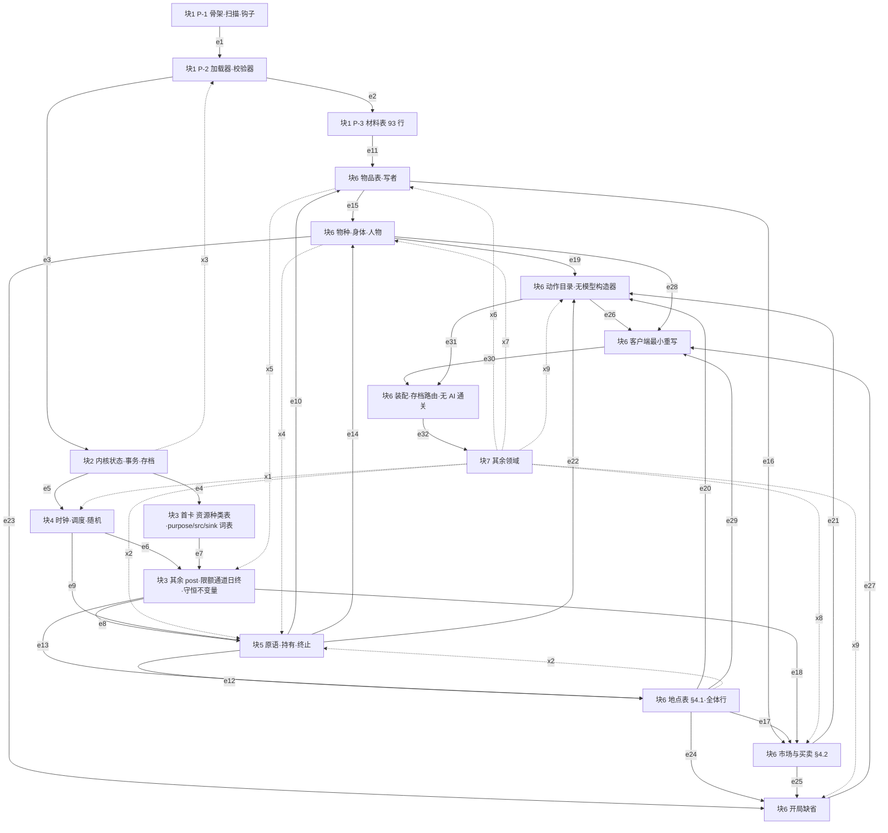

# 新底子方案 v0.1（纸面方案，不含代码与卷文改动）

> **v0.1（11-17，主会话 claude-opus-5-5 medium 改）**：按亮圳 13:38、13:39 与李白 11-17 裁定（审查/李白裁定-1117.md 末附）改四处：① 不护旧版，直接在 master 上做，每块验收后即替换旧代码（§0 第 1、2 条，§5.1）；② 旧价格只作对照，亮圳已确认（§5.2）；③ 测试在哪跑、勘误时机、三向对照、M12-9/12/13 按李白定（§7）；④ 新增 §3.4 并行排期：依赖图、排期表、并行前提，取代 §3.2"同时最多一路改"。v0 原文见提交 3f8918ac。§3.4 按亮圳 13:40 重做，出处逐条标注；新增 §3.5 卷文矛盾与未写到之处（交李白裁定）。

起草：claude-opus-5-5 medium，2026-11-17。依据亮圳 11-17 13:09 定案（docs/PLAN.md:3404）与李白派工。
基线提交：a45090dc（本 worktree 起点）。下文行数一律 `wc -l` 实测；卷文引用写"卷名 §节（:行）"，行号取本提交。
查不到的写"未查到"。本方案只出纸面，卷文勘误、代码、脚本标注都另开卡。

北极星对照（docs/产品原则.md）：本方案每条取舍按三条判——"规则引擎是唯一真相"（一.3）、"派生优先、不按 ID 特判"（二.1）、"最小完整改动，删除优先"（三.3）。新底子不搬任何"双写、对账、旧存档兼容"代码，理由即三.3。

---

## 0 总的做法（一页）

1. **新底子写在设计卷给的路径上**（`server-plugin/kernel/**`、`textcore/`、`input/` 等，卷二 §2.7 模块组；卷一 §5.1 目标路径 :479），**直接在 master 上做，不开长期分支**（v0.1；亮圳 13:38：没有存档、旧版没人真玩过，不护旧版，由主会话按最简单办法定）。旧代码已打标签 `old-final-1117`（e1a4bb6d），只从标签读（AGENTS.md 已有 `snapshot-20261010` 先例）。试点 P-1 把旧 `server-plugin/` 与 `extension/` 的代码文件整体删掉，此后 master 只有一套结构，不出现新旧并存（卷十一 §1.3 第 1 条的思想，:88）。每张卡在自己的 worktree 分支上改，只核放行后合进 master。
2. **每块验收通过即合进 master**（v0.1，亮圳 13:38）：不等 AI 叙述回来，也不另留旧版可玩分支。P-1 合入后到块 6 之前 master 不可玩，块 6 后是无 AI 的菜单版，AI 叙述随块 7 波 4"卷九余"回来。
3a. **卷一 §5 只部分退役**：§5.1 的目标路径（:479）与骨架去向、§5.2 的重做目标照用；只退役 §5.1 表里的"文件:行"锚点列与 §5.4 退役清单（§2.2 R2）。
3. **搬模块 = 从标签拷出、按卷文改、在新路径落地**，同卡写测试；不留旧文件名、不留适配器。
4. **门禁从零基线起步**：新底子里写死、读文字、越权写、散落常数的计数一开始就是 0，任何命中即拒（卷十二 §1.3 第 4 条"门禁是拦，不是报"，:108）。卷一 §6.3/§6.4 那套"B0 → 逐阶段只降"的机器全部用不上（见 §2 退役表）。
5. **世界内容（`world/`）不是代码，仍要转换**：按卷二 §6（:2126 起）"从现有数据迁移"的数据口径，用 `tools/` 下的离线脚本逐表转换，表的首卡合入后才写该表内容（开工排期-v1定稿 §3-5 的口径保留）。
6. **旧测试整套不要**（亮圳 11-17）。只保留守恒类不变量的意图，在块 3、块 4、块 5 按新代码重写（§3）。

---

## 1 搬哪些旧模块

口径：结论只取三值——**原样搬**（只改路径与 import）、**改了搬**（保留算法或数据，按卷文改形状）、**不搬**（重写或删除；旧文件可作对照读）。"依据"引卷文；"改哪里"写到行。

### 1.1 李白点名的六项

| # | 模块 | 路径 | 行数 | 结论 | 依据 | 改哪里 / 不搬的原因 |
|---|---|---|---|---|---|---|
| 1 | 账本 | server-plugin/ledger.mjs | 277 | **改了搬** → `kernel/ledger.mjs` | 卷一 §5.1 账本行（:463）与目标路径（:479）；卷六 §4.1 规则 1–7、13（:353–384）；卷二 §2.6 三条写路（:491）；kernelApi 登记 `kernel/ledger.mjs#transfer`（卷二 :582–584） | **留**：三元键 `accountKey/parseAccount`（:19–27）；批次先进先出与"原始事实不被覆盖"（`takeLots/mergeLots`，:121–144）；`auditLedger` 守恒式写法（:267–276）作不变量测试参照。文件本身零 import，适合进 kernel。**改**：① 单腿 `transfer` 改为多腿 `post`，按 `L − S + K = 0` 整笔核对（卷六 §4.1 规则 2，:356）；② 删 `declareLedgerWriter` 的每写者日预算熔断（:42–56、:174–180），改读资源种类行 `sources/sinks` 与 `budgetMode` 两通道（规则 3、6，:361、:374–377）；③ 存储由文档根 `ledger` 分区改为 `accounts`、`ledgerTotals`、`outflowTotals`（卷六 §4.1.1，:347；卷二 :723 sys.economy 行）；④ 加 `transferable/counterpartRX`、`issuerBacked` 核对（规则 7、8）；⑤ 删 `LEDGER_COIN='coin_river'`（:9，实例字面量，卷一 R-6、V-1）；⑥ 中文报错改错误码（卷二 §4.3）；⑦ 删 `globalThis.__LEDGER_TRACE__`（:217）。**删**：双写漂移补差 `src:drift` 与 `tallyDrift/driftCounts/stampDriftReport`（:183–191、:248–266，只为双写期存在，卷一 §6.5 母卡退出条件 ①，:581）；包升级折算 `registerUpgradeBooking/bookUpgrade`（:221–238，卷一 R-8 不做旧存档兼容）；按旧字段开账的 `registerLedgerOpening` 机制改由卷十开局缺省以 `src_genesis` 入账（卷六 §4.22 规则 3，引自 :367） |
| 2 | 物品登记 | server-plugin/items.mjs | 539 | **不搬** | 卷三乙 §3.3 唯一写者（:428 起）；卷六 §4.1 规则 10、11（实体行不存数量字段，:381–382） | 文件靠旧字段 `bagPath`、`itemInstances` 与中文状态 `status==='持有'`（:22）判持有；import 双写入口 `bookStock/moveStock/registerLegacyStock`（:4）。新物品写者按卷三乙 §3.3 重写 |
| 2a | 物品数据 | world/meta/items.json；world/drafts/**/item_*.json | 105（32 件）；约 540 文件（卷二 :2128） | **改了搬（数据）** | 卷二 §6.1 逐维迁法（:2130–2153）；离线脚本放 `tools/migrate/`（:2128） | 按 §6.1 表逐维转换；`categoryKind` 由规则推出、行上不写（:2138）；名称匹配候选只作人工核对参考（:2136）。转换脚本是一次性数据工具，不进 server-plugin |
| 3 | 原语契约 | server-plugin/primitive-schema.mjs | 79 | **改了搬** → 原语契约 | 卷九 §4.2.1 指它为现行契约（:624）；卷二 M2-12a（:2251） | **改**：`ajv` 调用收进 `kernel/validate/narrow.mjs`（卷二 :778 import 矩阵只许该文件用 ajv）；补 `transform` 行（卷九 :641）；`learn` 必填改为 `subject、skill、source、minutes、difficulty`（M9-23，:1556）；动作定义 schema 里 `label、narration、synonyms` 显示文字字段移语言包（卷二 §1.9，R-2） |
| 3a | 原语执行器 | primitives.mjs；primitives-runtime.mjs；legacy-primitives.mjs；primitives-body/effects/learning/movement/checks.mjs | 275；932；436；155/367/158/105/91 | **不搬** | 卷九 §4.2.2 唯一入口 `execute`（:652）、R9-2.3 一次事务、R9-2.4 适配器按原语分（:658–659）；卷九 :526、M9-2 删 legacy-primitives（:1535）；卷零 §4 行 0.6（primitives-effects.mjs:294 中文正则） | runtime 有 40 余个 import（含 money、stock、legacy-primitives）；primitives.mjs 把回执写进 `records`（:233、:256）。执行器在块 5 按卷九重写 |
| 3b | 本体表 | world/ontology/*.json（12 个文件） | 合计 4366（primitives 197、verbs 520、resources 253、holdings 1524、statuses 10、offenses 211、tags 1116 等） | **改了搬（数据）** | 卷一 §5.1 本体表行（:464）；卷九 §4.2.1 原语目录仍在 `world/ontology/primitives.json`（:624） | primitives → 原语目录（补 transform）；resources → 资源种类行（卷六 §2.1）；verbs → verb 族（卷二十四表 B）；holdings → 卷十八持有种类表；statuses → 卷二 §1.11 状态容器；offenses → offense 表（卷八b）；tags → 词表族（卷二 §1.9）。各文件 `note`、`label` 中文移语言包 |
| 4 | 材料属性表 | world/meta/mechanics/material-props.json | 1763 | **改了搬（数据）** → `material.json` | 卷二 §6.2（:2155–2161）；卷三甲 §3.4（:273–279）、§7 M3a-5、M3a-6（:969–970）；全集 93 行（卷三甲 §4.5，:488） | `classes`、`physical.classes`、`physicalMetal.classes` 并为一张，precedence 拆两组（卷二 :2157）；`nameWords/forms/modifiers/tailForms/excludeTags` 删除不搬（:2158；M3a-5）；`appearance[].term` 进语言包（:2159）；单值 `density` 迁入 20℃物态那一栏（M3a-6）；按卷三甲 §4.5 补到 93 行。**试点用这张表**（§4） |
| 4a | 材料派生算法 | server-plugin/item-class.mjs | 635 | **改了搬（只搬 :279–343）** | 卷二 §6.2 "`kcalPerSatiety`、`memberDeviationThreshold` 规则保留"（:2159）；卷三乙 §3.4 `materialProps()` → `materialView`（:484） | 搬 `memberValues/deriveFromSources/memberDeviations/rowValue`（:294–343）的出处推算；常数进规则表。**删**：`metalClass/metalProps/validatePhysicalMetal`（:492–524，卷二 :2158，M3a-2）；`householdUsage`（:118，卷二 §6.1 改 `usageClass`）；其余类别解析读 `item-use-tags.json`（31 行）改按卷三乙 §4.3 |
| 5 | entity-view | server-plugin/entity-view.mjs | 590 | **不搬**（实现）；导出名清单作读者对照 | 卷二 §2.1 现状列（:413、:418、:419）；§2.2 Fact/View 形状（:440–447）；§2.3 `declareInputs`（:457–475）；卷一 :469 `personOccupation` 退出规则层 | import 15 个领域状态模块；40 行含中文；返回值不是 Fact。22 个 view 按卷二 §2.1 逐表写，随各表首卡上线 |
| 6 | canAct | server-plugin/action-capacity.mjs | 76 | **不搬**（实现重写）；保留"三档能力"与"拘禁制度 allows 白名单"两个思想 | 卷二 §2.5 `can/awake/capacity/terminated`（:485–487）；卷四 M4-37（:1439）：年龄线 :34–38 → 卷八b §4.4，羁押 :65–74 → 卷八b §4.12 | 现实现 :32 比较中文状态 `['死亡','昏迷','失能']`（R-2）；:36 写死 12/16（R-6）；:36 回退链（A-7）。新 `can` 读 `bodyView().dims.body.*` 与 `rules.capacity`，块 5 写 |

### 1.2 查到的其他候选

| # | 模块 | 路径 | 行数 | 结论 | 依据 | 改哪里 / 原因 |
|---|---|---|---|---|---|---|
| 7 | 受限表达式 RX | server-plugin/rx.mjs | 200 | **改了搬**（小改）→ `kernel/rx.mjs` | 卷一 §5.1 RX 行（:471）；卷二 :1224 `evaluateRX` 唯一定义在 `kernel/rx.mjs`；:1316 定点标度 `SCALE=10⁴` 与 rx.mjs 一致；卷零 §4 行 0.7"四类 grep 为 0" | 零 import。补 `compileRX(text, profile)` 数据档/显示档两档与 `slot/mod/broader` 变体（卷二 :1178） |
| 8 | 定点数学 | server-plugin/det-math.mjs | 161 | **改了搬**：内核新写 `kernel/det-math.mjs`；旧实现改作 tools 组离线生成表的脚本 | 卷二 :593–595 登记 kernelApi 导出 `kernel/det-math.mjs#fixedExp/fixedPow/fixedLn`；卷二十七 M27-9（:850）"库归入 kernel 组"、自带指数实现删除；R27-5.2（:568–574）运行时只读表插值，表由 tools 离线生成；卷二 §1.10 exp 表（:319） | 新 `kernel/det-math.mjs` 按查表插值写，含卷二 §1.10 的 exp（`fixedExp`）、`fixedPow`、`fixedLn`。旧文件的 160 位 BigInt 现算与表插值算法不同，不进 kernel，改作离线生成 `fnTables` 与 exp 表的脚本；`PRICE_DENOMINATOR`（:141）进规则表（M27-9） |
| 9 | 存储与哈希 | server-plugin/storage.mjs | 841 | **改了搬（部分）** | 卷一 §5.1 哈希行（:475）；卷二 §2.6 `readPath/writePath` 在 `kernel/storage.mjs`（:493）；卷二 :985 kernel 不 import `node:crypto`；卷二十七 R27-4.1/4.5/4.6（:495–510） | 搬 `canonical`（:5）、`applyPatches/diffPatches`（:108、:140）、`atomicJSON`（:57）、`stateMemo`（:271，卷二 §2.3 示例 :467 直接用它）、`canonicalEqual`（:360，通用比较，从下述删除段单独挑出）。`digest`（:14）改经 `textcore/digest.mjs` 注入的摘要能力。**删**：`withLegacyUndefinedActivity`（:22–55，R-8）、records 索引一族（:325–476 除 :360 外，records 旁路 A-10）。`CampaignStorage`（:580）按事件日志加快照、分片重写 |
| 10 | 调度器 | server-plugin/scheduler.mjs | 316 | **改了搬** → `kernel/scheduler.mjs` | 卷二十 :495 `tick_stage`"沿用现调度器六段"；文件头自述 L0、只依赖 node:crypto（:2–4）；卷一 I31 | 搬阶段、全序键、`ScheduleHeap`、反应队列。**改**：`diceKey` 的 `createHash`（:7）改走注入摘要（卷二 :985）；`CONTEST_RULES` 缺省表进规则表（R-6）；中文 `preconditionFailure` 改错误码 |
| 11 | 推进登记 | server-plugin/advance-registry.mjs；world-clock.mjs | 583；92 | **不搬**（实现）；块 4 新写 `kernel/advance-registry.mjs` | 卷二 :578 登记 kernelApi `kernel/advance-registry.mjs#registerAdvanceHook`（规则层调用、交入钩子）；卷二 M2-40（:2286）写"原样移入 kernel/"，但它是迁移路线的搬迁行（`relocate_only`），随 §2.2 R2、R3 退役 | 不照 M2-40 原样搬的原因：文件有 68 行 import，直接 import high-nobility、education、medicine、labor-market、transport 等领域模块；新底子里这些模块不存在，原样移入即无法加载，且内核 import 规则层违反"钩子由规则层登记交入"的写法（卷二 :578 登记方向）。块 4 只写登记函数 `registerAdvanceHook` 与推进框架，算法（`runAdvance/catchUpLocal/nextFromScheduleHeap`）对照旧文件改写。world-clock import weather、facility-state，同不搬 |
| 12 | 持有存储 | server-plugin/holdings.mjs | 404 | **改了搬**（块 5） | 卷十八 §4.1 持有种类表；卷二 §2.6 开关边次序（:507）；文件头 L0、只 import storage（:10） | **改**：`HoldingRejected` 中文 reason（:18–20）→ 代号；**删** 双写对账与升级（`recordHoldingDrift/holdingsDrift/resyncHoldings/bookHoldingsUpgrade`）；实体结束改走卷二 §2.6 终止协议 |
| 13 | 持有适配器与种类注册 | holding-sources.mjs；holding-kinds.mjs | 827；115 | **不搬** | holding-sources 文件头"绞杀式双写"（:1–3）；卷十二 R12-5.3 各模块自带加载期校验是旧物（:787） | holding-kinds 自读 world 文件做形状校验（node:fs），改由统一加载器与校验器做 |
| 14 | 货币、库存与账户适配 | money.mjs；stock.mjs；currency.mjs；group-account.mjs；primitive-accounts.mjs | 245；327；155；59；70 | **不搬** | money/stock 文件头"绞杀式双写"（money :1–2、stock :2–3）；卷一 §6.5（:581）；卷六 §4.1 规则 10、11 | 账户构造函数表（purse、granary、cargo……）由资源种类行与用途族取代；stock.mjs 的 `accrueStock/logisticStock` 增长算法留给块 7 卷五对照 |
| 15 | 派生槽 | server-plugin/derived.mjs | 273 | **不搬**（实现） | 卷一 §5.1 派生槽行（:470）要求升级为卷二 §3.3 九步管线；卷二 :1316 引 derived.mjs:244–250 口径 | :244–250"无修正返回基值"口径照用；其余按卷二 §3.3 重写（:1314 起） |
| 16 | 种子键 | seed-keys.mjs；world/rules/tables/seed-keys.json | 192；686 | **不搬** | 卷十二 M12-5 扫描部分移 tools（:1326）；卷二十七 §4.8 键表核对 | 键表条目全是旧文件调用点（json `entries[].file`），对新代码重建 |
| 17 | 摘要排除表 | digest-exclude.mjs；world/rules/tables/digest-exclude.json | 50；19 | **不搬** | 卷一 §5.1（:475）、§8.3：排除表由 state-owners 的 display 集合生成 | 手写排除表退役 |
| 18 | 通用再生律 | server-plugin/renewable.mjs | 146 | **改了搬**（块 7，卷五） | 卷一 §5.1（:473）；文件头"无资源或地点 id"（:1–3） | import stock、det-math 改为 `kernel/ledger` 的 `post`（来源 `src_regrow`）与内核 `detfn` |
| 19 | 特性词表 | server-plugin/traits.mjs | 159 | **不搬** | 卷一 §5.1 特性词表行（:468）：TERRAIN 退役、`fromCharCode` 改代号；A-18 代码内封闭枚举 | 词表内容进卷二 §1.9 词表族 |
| 20 | 效果登记 | server-plugin/effect-registry.mjs | 17 | **不搬** | 卷二 §3.9 效果族表（:1439） | `EFFECT_SOURCES` 封闭常量与按来源分派被效果族表取代 |
| 21 | 目录查询 | server-plugin/catalog.mjs | 45 | **不搬** | 卷零 §0.5 S1 补充口径（:36、:47）禁按 id 前缀判型 | 现实现 `id.split('_')[0]` 判型 |
| 22 | 组合根 | engine.mjs；index.mjs | 1317；347 | **不搬** | 卷二 §2.9 边界入口登记 | engine.mjs 101 个 import、151 行含中文 |
| 23 | 旧存档兼容 | server-plugin/legacy/、compat/、migrations/（5 个文件） | — | **不搬** | 卷一 §5.4 M1-7（:508–513）；R-8 | — |
| 24 | 客户端 | extension/（33 个代码文件，卷一 :566） | 未逐个量 | **不搬**（按卷二十九重写） | 卷一 §5.2 输入边与审查行（:489）；卷二十九 §7（:976） | 未逐个核哪些布局可参照，块 6 开卡时由执行者只读盘点 |

**小计**：点名六项拆成 10 行：改了搬 6 行（账本、物品数据、原语契约、本体表数据、材料表数据、item-class 的出处推算一段），不搬 4 行（物品登记 items.mjs、原语执行器一族、entity-view、canAct 实现）。其他候选 18 项：改了搬 6（rx、det-math 去 tools、storage 部分、scheduler、holdings、renewable），不搬 12。没有一项"原样搬"：rx.mjs 最接近，也要补两档编译。

---

## 2 设计卷怎么处理

### 2.1 照用的卷

照用（正文不动，只按 §5.3 列的点做勘误）：卷二（§6.11 除外）、卷三甲、卷三乙、卷四至卷十、卷十三至卷二十九的 §0–§6 与 §8。它们写的是"世界怎样运转、表长什么样、入口与规则是什么"，与旧代码怎么迁无关。卷十二 §1–§4.6、§4.9–§4.14 照用。卷一 §0–§4、§5.1 与 §5.2 的目标设计（§5.1 目标路径 :479 是新底子目录的依据）、§7–§12 照用；卷一 §5 只退役 §5.1 表的"文件:行"锚点列（:461–477 第二列）与 §5.4（:495–518），§5.3 是旧代码改造顺序，作对照。

### 2.2 退役清单（逐项）

"退役"指：正文留作历史，不再作为派卡、验收或排期的依据；勘误时在该处加一行退役说明（见 §5.3）。"留的检查思想"写落点。

| # | 退役对象 | 位置 | 退役原因 | 留不留检查思想；落到哪 |
|---|---|---|---|---|
| R1 | 卷十一整卷 | 卷十一-迁移路线与卡清单.md（§0.1 :12–28） | 全卷回答"统一底层设计怎样落到现有代码上"，前提已作废 | 留四条：① 卡的对象是一张表的全体行（已在卷一 §6.6 第 1 条 :588，照用）；② 两次不过即停（已在卷十二 R12-9.10 :988）；③ 期望值由规则推出（已在卷十二 R12-6.12 :836）；④ "同卡删旧"转成"不搬过渡设施"，写进本方案 §0 第 3 条，不另落卷 |
| R2 | 迁移表（各卷"迁移与退役清单"） | 各领域卷 §7（行号见 §5.3 表）；卷一 §5.4（:495–516） | 迁移行是"旧锚点 → 新落点"，新底子没有旧锚点 | 不留机器用法；作搬模块时的对照资料（执行者开卡前只读本卷 §7 相关行，看旧实现有哪些坑） |
| R3 | 文件级迁移表 | 卷二 §6.11 的文件搬迁部分（:2208 起）；卷十一 R11-3.11（:477） | 旧文件不搬迁 | 留"每个代码文件恰属一个模块组"——已在卷二 §2.7 与 E-FILE-UNASSIGNED，照用。§6.11 里"哪些字段是显示字段、迁语言包"的部分是数据口径，**不退役**，数据转换时照用 |
| R4 | 过渡设施 | 卷十一 R11-1.9（:380）、R11-5.5（:565）、M11-3（:828） | 新底子没有旧处理器外壳与适配器 | 不留；"新底子不得出现第二种写法"已由卷一 A-11、A-19 覆盖 |
| R5 | 账本母卡 LEDGER-1 与适配器过渡期例外 | 卷一 §6.5（:579–584） | 新账本一开始就是唯一写者 | 母卡退出条件 ④⑤（钱物读者只读账本、I1/I2/I15 进 CORE）并入块 3 验收（§3） |
| R6 | 末阶段 R11-5.8 | 卷十一 :568 | 条件是"基线降到 0、过渡设施 0、三个旧目录不存在" | 并入卷一 §12.5 全书收口（:794–796），那里已有同义各条；"旧目录不存在"在 P-1 合入 master 即成立 |
| R7 | 卡账工具 | docs/统一底层设计/脚本/卷十一/gen-card-ledger.mjs（1443 行）及同目录其余 29 个 .mjs（合计 4826 行，含 gen-card-ledger） | 只服务迁移卡账 | 不留。留着不删、标停用（§6） |
| R8 | 卡账 v0 与卡族表 | 审查/脚本输出/卡账-v0.json、卡账-v0-摘要.md；卷十一附录甲（:910） | 同上 | 不留 |
| R9 | 乙-8 脚本与输出 | 脚本/全书/乙8-入口名候选.mjs（528 行）；审查/脚本输出/乙8*（共 13 份） | 为迁移行补落点入口名 | 不留 |
| R10 | 门禁卡 G-1 | 卷一 §6.3（:546–549、:560）；审查/G-1-必填字段草案.md | 建卡账写者 `tools/migrate/card-ledger.mjs`、汇总器、补文件级迁移表，都是迁移设施 | G-1 里"五项扫描进 CORE"（:548 ①–⑤）**不退役**，拆进试点卡 P-1 与块 2（§3） |
| R11 | 门禁卡 G-2 | 卷一 :550–551；审查/G-2-必填字段草案.md | 卡号与"门禁卡"身份退役 | **内容全留**：校验器、继承、声明表合并器就是试点卡 P-2 与块 2 的活（卷一 :560 的设施清单照用） |
| R12 | 门禁卡 G-3 | 卷一 :552–556；审查/G-3-必填字段草案.md | "基线补齐"（tools、extension、中文枚举逐行人工判读；294 常数重算；L74 逐行登记；B0 登记锁定）都是给旧代码数基线 | 执行器 `tools/accept/run.mjs`、登记器 `register.mjs`、提交钩子**留**，进 P-1（卷十二 §2.11 设施登记照用）；云门禁改造按 M12-14 视需要另卡 |
| R13 | 基线元组 B0 与阶段只降公式 | 卷一 §6.3 B0 两段（:553–564）、§6.4 退出五条（:568–577）；卷十二 R12-8.3、R12-8.4 后半（锚点内外分流）、8.7、8.8（:931–936）；R12-8.2 只退役"按文件搬迁表重定位"一句 | 新底子 B0 全为 0，无"逐阶段下降"可言 | 留"任一分量 > 0 即拒"——即卷十二 R12-8.4 首句与 I43 的零基线特例；R12-8.2 行键格式（不含行号）与卷十二 §2.6 逐行清单**照用**，用于报告与改名漂移 |
| R14 | 卷零迁移相关列 | 卷零 §0.6 锚点（:49–50）、§0.8 机读导出中 `migBackfill` 一段（:86）、§2 各表"改前"列、§3.5 逐处处置（:826 起，151 个 spotKey）、§4 41 项核查栏（:1129–1131） | 改前锚点与逐处处置描述的是旧代码 | "改后三列"（维度齐、入口一、写死零，:141）**留**，回填来源改为新底子各块验收；§4 硬条件 ③"维度表达不出来就升级为纳入并报李白"**留**，作新底子开卡通则（写进 §3 卡模板说明） |
| R15 | 卷十二卷零覆盖核对里的回填机器 | 卷十二 §4.7（:868 起）中读 `migBackfill` 的部分 | 同 R14 | 留"三列全是才算一行收口"的核对，改读块验收结果 |
| R16 | 卷十二迁移清单 | 卷十二 §7 M12-1 至 M12-20（:1322–1341） | 多数是旧工具的去向 | 其中 M12-9（题集保留）与 M12-12/13（文稿检测器收编）属文稿侧，可单独另议；其余不留 |
| R17 | 测试重推口径与旧套件对照 | 卷十一 §4.6（:590）；审查/分阶段测试方案-v1定稿.md 的 T0、"对照按子测名"、旧失败分类 | 旧测试整套不要（亮圳 11-17） | 留三条：§3-5 "只加一行不改代码"七步（= 卷十二 R12-6.2，:826，照用）；§3-6 **北极星三向对照**（只改材料／只改技能档／只改意图，各让产物变）——现只写在测试方案里，建议勘误补进卷十二 §4.6，排在 R12-6.5（:829）之后；§3-4 "not_run 与 blocked 算不过"（= 卷十二 R12-10.7，照用） |
| R18 | 冻结状态 `ruling_hold`、`gate_pending` | 卷十一 §4.8（:676 起）；卷一 §6.7（:595–597） | 冻结是为迁移排序设的 | 不留；新底子的放行条件就是各块验收 |
| R19 | 开工排期 v1 定稿 | 审查/开工排期-v1定稿.md | 被本方案取代 | 留"世界内容随表首卡推进、不先于首卡写内容"（§3-5），照用 |
| R20 | 确定性模板、自动扫描 | 卷十二 §2.8（:385–418）、§4.1–4.4 | **不退役**，列出只为说明 | 照用；新底子从第一张卡起按零基线执行 |

退役共 19 项（R1–R19；R20 只是说明不退役）。

---

## 3 新底子分块与先后

### 3.1 卡模板（各块通用）

- 每卡写：卷名与节号、要建的文件（落在卷二 §2.7 模块组路径）、要搬的旧文件与行段、验收条目（卷十二登记格式）。
- 卡的对象是一张表的全体行或一个系统登记项整体（卷一 §6.6 :588、:592），文件上限 25 个 `.mjs`（同节 :591）照用。
- 维度表达不出来、玩法离不开写死的，停卡报李白（卷零 §4 硬条件 ③）。
- 一路改（Sonnet 中档）、一路只核（Opus 5.5 中档）；跨三卷以上、动内核协议或加载器的用 Opus 改（docs/当前状态.md 分工节）。
- 验收除卡上条目外，每卡必过：零基线扫描（块 1 起逐步加全）、校验器零 error、已重写的不变量全过。

### 3.2 分块表

估算假设（试点后按 §4 修正）：每卡 0.5–1 天（含只核一轮、测试一次往返），天数 = 卡数 × 0.5 至 卡数 × 1；每卡耗周额度 2–4 个百分点。本表"天"列是**串行**口径（作对照）；v0.1 起按 §3.4 排期执行：依赖与并行逐条按卷文出处，只有 §3.4.3 判定可并行的几处开两路，同时最多 2 路改。"最小集"一律指少做几张表，每张做的表仍做全体行（卷一 §6.6 :588）。

| 块 | 做什么 | 依赖 | 验收（卷十二检查 + 重写的守恒不变量） | 卡 | 天 |
|---|---|---|---|---|---|
| **1 试点：材料竖切片** | P-1 骨架：删旧代码文件、建 `server-plugin/kernel/`、`tools/accept/` 执行器与登记器最小版、提交钩子；接入 S1（实例 id 与前缀判型）、S4（规则表直接 import、白名单外数值）、V-17 版本分叉、import 矩阵（卷二 §2.7 :778）四项扫描。P-2 统一加载器与校验器 L0–L3（卷二 §4.1 :1484–1491）、继承展平（卷二 §1.3）、词表与单位表（§1.9、§1.4）、`onUnknown`（§1.6），全部按表头通用写，不认材料。P-3 `material.json` 按卷三甲 §4.5 落 93 行（数据转换脚本读 material-props.json 并核对卷三甲表值），`materialView` 只读手填与继承值（卷三乙 §3.1 :419；修正管线留块 2） | 无 | 扫描四项计数 0；卷二 A2、A4、A5、A7（校验器两次输出逐字节同）；卷三甲 §3.5 AP-1 至 AP-6（:285–290）为 0（AP-5 查本卷表头与卷文，用卷十二 §4.12 文稿扫描；AP-6 需同时载入卷二十五 `plant_part` 词表族）；卷三甲 §6 EA-1、EA-2、EA-6、EA-5（:947–953）按卷十二 R12-6.2 七步跑。**对卷三甲 §7 退出标准（:974）的覆盖**：第三项"全集 93 行加载无错"全部；第二项"§4 各节三类断言"只覆盖加载期部分（§4.5.3 列的 M-2、M-6–M-8、M-11、M-13–M-18 逐行校验）；第一项见下。**不在块 1**：AP-7（规则层按材料 id 分支、读出处文字）要等有规则层读者，落块 6（卷三乙物品规则上线时）；§4 各节的行为类与跨卷扩展性断言（EA-3 需卷四食性 T-4、EA-4 需卷三乙 `producedBy`、EA-7 需卷三乙谷物与成堆判定）落块 6 与块 7 对应卷。退出标准写"五项"而 §3.5 实有七项，已记 docs/问题.md，块 1 按七项中前六项验收 | 3 | 1.5–3 |
| **2 内核状态、事务与存档** | `kernel/types`、句柄生成（`StatePath`、`V`、`E`）；`state-owners.json` 与声明表合并器；`readPath/writePath`（卷二 §2.6 :493–497）；事务与整笔拒写（:499–503）、`kernel/report.mjs`；`textcore/digest.mjs` 摘要注入；`kernel/save.mjs` 事件日志加快照（卷二十七 R27-4.1、4.4–4.8）；求值管线九步（卷二 §3.3）；`rx.mjs` 搬入；带类型的读文字扫描 S2（卷二 §2.8）与越权写扫描 S3 | 块 1 | 卷二 A1（本块已有表）、A8、A10；S2、S3 计数 0；`det_save_load`、`det_same_seed`（卷十二 §2.8）；事务中途拒写后状态逐位不变（卷二 §2.6 第 1 条，作性质测试） | 5 | 2.5–5 |
| **3 账本** | `kernel/ledger.mjs`（§1.1 第 1 行的改法）；资源种类表、`purpose/src/sink` 词表（卷六 §2.1）；批次元数据（卷三乙 §4.4）；限额通道日终分配（卷六 §4.1 规则 6） | 块 2 | 重写守恒不变量（见 §3.3 I1′、I2′、I15′）；卷六 A6-1.2 中账本部分（守恒式、非负、`L−S+K=0`、分段推进逐位相同、打乱同日申请次序分配不变，:399）；A6-1.3 新资源种类行不改代码即可开户转移（:400）；扫描：读 `transferable` 等四字段的模块只有 `kernel/ledger.mjs`（A6-1.1，:398） | 3 | 1.5–3 |
| **4 时钟、调度与随机** | `kernel/scheduler.mjs`（搬 scheduler.mjs，§1.2 第 10 行）；`tick_stage` 与同刻全序（卷二十 §4.1）；到期堆与推进钩子登记：新写 `kernel/advance-registry.mjs#registerAdvanceHook`（卷二 :578；§1.2 第 11 行），领域钩子由规则层交入；骰值键与 `sample()`（卷一 §8.2、卷二 §1.10）；`detfn` 表与离线生成脚本（卷二十七 R27-5.2） | 块 2 | 重写同刻全序 I31′（§3.3）；`det_split`、`det_order`、`det_probe`；卷二十七 R27-5.1 状态里无非有限值（E-DET-NONFINITE 为 0） | 4 | 2–4 |
| **5 原语、持有与终止** | 原语契约（§1.1 第 3 行）与执行器 `execute`（卷九 §4.2）；持有写者（§1.2 第 12 行，卷十八 §4.1）；终止与复生（卷二 §2.6 :509–521）；状态谓词 `can/awake/capacity/terminated`（卷二 §2.5，需最小 `bodyView`）；效果族表与 `effects()`（卷二 §3.9） | 块 3、块 4 | 重写事件主写 I16′（§3.3）；E-TERM-RESIDUE 不变量（卷二 :515）；R9-2.3 一次事务恰一条原语事件；终止时账户分流守恒（卷六 §4.1 规则 9 + I1′） | 6 | 3–6 |
| **6 第一个可玩竖切片（无 AI、菜单）** | 物品表与物品写者（卷三乙 §4.2–4.4）；物种、身体图、人物三张表（卷四，各做全体行）；地点表（卷五，全体行）；市场与买卖（卷六 §4.2）；动作目录与无模型构造器（卷九 §4.1、§4.5）；开局缺省（卷十 §4.12）；对应各表的内容转换。**真能玩另需三件**：① 新装配文件 `server-plugin/index.mjs`，按卷二 :958 与 import 矩阵 :785 只调 `createRouterCaps`、`mountKernel`、`createWallTimer`、`mountMenuEntry`、`mountSaveRoutes`、`registerSystems`、`createDigestCap`，把内核挂进 SillyTavern；② 存档四路路由（存、读、导出、导入，卷二 §2.9 第 0 条；卷二十七 §4.4）；③ 客户端最小重写（卷二十九显示层组与 host，菜单、状态面板、存读档入口；extension/ 旧文件不搬） | 块 5 | 无 AI 通关：AI-05 §7.1 P-01…P-12 中本块覆盖的子集（卷一 V-21，:776；子集由块 6 首卡登记，未覆盖的报 `not_run`）；V-30 空 labels 可玩；`det_lang`；在 SillyTavern 里经菜单完成开局、买卖、推进、存档、读档一轮（人工试玩一次）；推进 30 日守恒 I1′ 不破；各已上线表"只加一行不改代码"与北极星三向对照。**本块不含 AI 叙述**：有 AI 叙述的版本要等块 7 波 4"卷九余"（§4.10 叙述投影、§4.14 档位、§4.19 输入边与守门）才回来 | 12–18（按 §3.4.3 八段加总） | 6–18 |
| **7 起 其余领域** | 按卷一 §11.2 波次（:722–735）去掉已做部分：波 1 余（卷二十、二十六、二十七）→ 波 2（卷六余、二十一、二十五、十四、十九、十八）→ 波 3（七→八→八b，十三、十五、十六、十七）→ 波 4（九余、十余、二十二、二十四、二十三、二十九余）→ 卷二十八 | 块 6 | 各卷 §6 扩展性测试与 §4 各节三类断言；每表首卡合入后开该表内容卡 | 40–60 | 20–60 |

合计（天数一律按每卡 0.5–1 天算）：到第一个可玩竖切片（块 1–6）**33–39 卡、16.5–39 天**；全书 **73–99 卡、36.5–99 天**（串行口径；按 §3.4 排期为 15–34 天、35–94 天）。卡数下界取"每表首卡 1 张"（22 张表、约 16 个系统登记项，开工排期-v1定稿 §1 粗估依据），上界加每卷 1 张后续卡；不含真实提示栈试玩与 `build:release`。

额度折算：73–99 卡 × 每卡 2–4 点 = 146–396 个周额度百分点。按 CLAUDE.md 累计 80% 封顶，每周可用约 80 点，合 **1.8–5.0 个周额度、即至少 2–5 周**；每天上限约 80 ÷ 7 ≈ 11 点，够每天 2.5–5 卡，工期瓶颈是卡的先后与测试往返，不是额度；按 §3.4 排期后仍是如此，见 §3.4.4。本周额度：李白 11-17 定"按节奏用到周四 10:00 刚好用完"，卷十一退役卡与试点 P-1 本周开工。

### 3.4 并行排期（v0.1 重做，亮圳 13:40：依赖与并行逐条按卷文出处；主会话出，另一 Opus 只核，李白审）

口径：边"A → B"表示 B 依赖 A、A 先做。出处写"卷名 :行"，行号取本提交实测；"§0.2"指该卷"依赖与被依赖"节。依赖种类四种：**读**（读对方的 view 或状态）、**调**（调对方的入口）、**表**（本卷的表 ref 对方的族或行、或向对方的表登记行）、**声明**（经对方的登记设施声明）。出处优先级按亮圳 13:40：某卷 §0.2 ＞ 交互小节 ＞ 卷二 kernelApi 登记与 import 矩阵 ＞ 卷一 §11.2 图。查不到出处的边不画；查不到依赖也不等于可并行，可并行须过下面第 1、2 条，并在判定表写出查过哪些出处。块的划分沿用 §3.2，不改；块 3 拆成"首卡"与"其余"两段只是块内卡的先后。

#### 3.4.1 并行的前提与共用文件

1. **两边都查不到依赖**：§3.4.2 的边表与回边表里没有连通两者的边，并在判定表（§3.4.3）写出查过的出处。卷二 import 矩阵只管组与组之间：kernel 行对 kernel 本组是"是"（卷二 :778），即内核组内文件可以互相 import，**矩阵证不了两张内核卡互不依赖**；内核卡之间只能按各卷 §0.2、交互小节与 kernelApi 登记（卷二 :567–631）判。
2. **要写的文件与状态路径不相交**：判定表逐对写出各自的 world/ 表文件（卷二 :35–43 文件布局）、kernel 文件（kernelApi 登记的文件名）与状态顶层键（所在卷维度节）。服务端、客户端两张矩阵（卷二 :774、:788）分属两个进程，七组、两份共享库与装配文件在文件级不相交（卷二 :822）；这只说明文件不重叠，不说明没有依赖（客户端的依赖见边 e26–e29）。
3. **共用文件**（卷二、卷十二实情）：
   - 闭集清单：`server-plugin/kernel/files.json`（kernel 组成员文件清单是闭集，卷二 :564）；`state-owners.json` 里的 `kernelApi`（逐个导出名的闭集，卷二 :567）与 `assembly.calls`（卷二 :565）；装配文件 `server-plugin/index.mjs` 只许调这份清单，且与矩阵、kernelApi 三处一致（卷二 :958）。
   - 单文件登记：`world/ontology/state-owners.json`（系统声明表，卷二 :56）、`world/rules/registry.json`（每张规则表一行，卷二 :55）、`world/ontology/dimensions/_vocab.json`（受控词表，卷二 :37）、`_effects.json`（卷二 :39）、`world/i18n/labels.<lang>.json`（卷二 :44）。
   - 卷十二 §2.11 存法登记（卷十二 :459–473）：`tools/accept/` 下各登记文件的写者只有登记器（:463–467、:473），`baseline.json`、`hits.json` 的写者只有执行器（:468、:470）。
   卷二、卷十二都没写多路同时开工时这些文件谁能改（§3.5 第 16 条，交李白）。裁定前按主会话的三条办（不是卷文）：① 闭集清单与 `index.mjs` 同一时段只许一路改，另一路要加的行写进交付说明，主会话合入后补；② 单文件登记各路只追加本卡自己的行、不改别人的行，主会话按合入顺序 rebase，合入后重跑加载器与校验器，零 error 才算合上；③ 卷十二 §2.11 各文件只经登记器写，rebase 冲突不手工合，合入后重跑登记器。
4. **合入串行**：各路在自己的 worktree 分支改，只核放行后由主会话逐个 rebase 合进 master；推进世界的测试攒到块验收在腾讯登记台跑（审查/李白裁定-1117.md :97）。
5. **每路一改一核**：Sonnet 中档改（内核、加载器、跨三卷以上用 Opus 5.5 中档），另一 Opus 5.5 中档只核。
6. **路数**：按卷文判下来，代码卡能并行的只有三处，每处两路（§3.4.3 判定 J1、J3、J4），所以同时最多 2 路改；某路挡封或打回两次即停该路。

#### 3.4.2 依赖图

实线是有出处的依赖边（e1–e32），虚线是有出处、但方向与 §3.2 块序相反的"回边"（x1–x9：后做的块被先做的块需要），回边全部进 §3.5 交李白。两节点之间没有边，不等于可并行（例如 P-3 与块 2，见判定 J5）。

**边表**（实线 32 条；"种类"见口径）：

| 编号 | 边 | 种类 | 出处（卷 :行） | 要点 |
|---|---|---|---|---|
| e1 | P-1 → P-2 | 表 | 卷二 :564、:778 | P-2 的 `kernel/load`、`kernel/validate` 文件须登入 kernel 组闭集清单；`node:fs` 只许 `kernel/load/*`——清单与矩阵扫描由 P-1 建 |
| e2 | P-2 → P-3 | 调 | 卷三甲 :39 | 卷三甲依赖卷二 §1.2–§1.8、§4.1/§4.3（表格式与校验机制） |
| e3 | P-2 → 块2 | 调 | 卷二 :494、:471 | 句柄 `P` 构造函数"加载期按 `pathTypes` 每条模式生成"；`uses` 传递闭包在加载期算 |
| e4 | 块2 → 块3首卡 | 声明 | 卷六 :24 | 卷六依赖卷二 §2.1–§2.9（入口、写者、声明表） |
| e5 | 块2 → 块4 | 调、读 | 卷二十 :516、:496 | 刻级回退"`kernel/transaction.mjs` 只提供回退能力"；钩子位次读 `state-owners.json` 的 `phase`、`sortKey` |
| e6 | 块4 → 块3其余 | 调、读 | 卷六 :376、:377、:399、:347、:29 | 限额通道"在世界日结算步里一次分配"；预算按世界日计；A6-1.2 要求分段推进逐位相同；`ledgerTotals` 带 `day`；卷六 §0.2 依赖卷二十 §4.1。日终步是推进钩子（卷六 :1462 `settleTrade` 等），登记入口 `registerAdvanceHook` 在块 4（卷二 :578） |
| e7 | 块3首卡 → 块3其余 | 表 | 卷六 :361、:378 | 来源、去处代号必须在资源种类行的 `sources`/`sinks` 内；`transferable` 在 `post` 内核对 |
| e8 | 块3其余 → 块5 | 调 | 卷二 :512；卷九 :662、:669 | 终止第 3 步"经账本转移"分流余额；R9-2.7 增减只能是 `transfer`；执行器交互列卷六 §4.1 |
| e9 | 块4 → 块5 | 调 | 卷二 :514、:520 | 终止第 5 步"由内核经卷二十的 `cancel` 撤销"到期项；复生窗口登记到期项 |
| e10 | 块5 → 物品 | 调 | 卷三乙 :43 | 卷三乙依赖卷二 §2.1–§2.9（含 §2.6 终止协议）、§3.8、§3.9（效果族） |
| e11 | P-3 → 物品 | 读 | 卷三乙 :41 | 依赖卷三甲 §2.1–§2.3、§4.5，"本卷只读、不抄、不改" |
| e12 | 块5 → 地点 | 调 | 卷五 :22 | 卷五依赖卷二 §2.1–§2.9（统一入口，含 §2.6） |
| e13 | 块3其余 → 地点 | 调 | 卷六 :388 | "卷五 §4.7（存量账户由其唯一写者经 `post` 写）" |
| e14 | 块5 → 物种身体人物 | 调、表 | 卷四 :33、:34 | 依赖卷二 §2.6 `terminate`、`revive`；§3.9 效果族 |
| e15 | 物品 → 物种身体人物 | 读 | 卷四 :36 | 依赖卷三乙 §4.2：尸体是物品实例、负重读物品重量 |
| e16 | 物品 → 市场 | 读 | 卷六 :428、:26 | 市场交互列卷三乙 §4.16（估值、稀缺度）、§4.17 |
| e17 | 地点 → 市场 | 读 | 卷六 :28 | 依赖卷五 §4.7–§4.10 |
| e18 | 块3其余 → 市场 | 调、读 | 卷六 :351、:406 | 改变数量只有 `post`；市场读账户余额 |
| e19 | 物种身体人物 → 动作目录 | 读 | 卷九 :34 | 依赖卷四 §4.3、§4.11、§4.9 |
| e20 | 地点 → 动作目录 | 读 | 卷九 :35 | 依赖卷五 §4.13、§4.2 |
| e21 | 市场 → 动作目录 | 表 | 卷六 :428；卷九 :601 | "买、卖、议价是动作目录行"；各领域卷向目录登记动作行 |
| e22 | 块5 → 动作目录 | 调 | 卷九 :601 | 动作目录交互首列卷二 §2.5 `can()` |
| e23 | 物种身体人物 → 开局 | 调 | 卷十 :33、:900 | `instantiatePerson`；卷四 §4.12 出生地菜单 |
| e24 | 地点 → 开局 | 读 | 卷十 :34、:900 | `placeView`、`openStocks`；卷五 §4.1 |
| e25 | 市场 → 开局 | 调 | 卷十 :35 | `demand`、`shopView`、`post` |
| e26 | 动作目录 → 客户端 | 读 | 卷二十九 :41 | `affordances()`、`constructorTree()`、`sceneCard()` |
| e27 | 开局 → 客户端 | 读 | 卷二十九 :42 | `genView`、`gen.open` |
| e28 | 物种身体人物 → 客户端 | 调 | 卷二十九 :38 | 身份键、`chargenOptions`、`createCharacter` |
| e29 | 地点 → 客户端 | 读 | 卷二十九 :39 | `placeView` 的 `tree`、`coord` |
| e30 | 客户端 → 通关 | 调 | 卷二 :792；卷九 :601 | host 经 SillyTavern 挂接；菜单由卷二十九 §4.3 渲染 `affordances()` |
| e31 | 动作目录 → 通关 | 调 | 卷二 :958、:623 | 装配文件调 `mountMenuEntry`（`kernel/transport/menu-entry.mjs`） |
| e32 | 块6 → 块7 | 读、调 | 卷二十 :28–30；卷七 :35–37 | 块 7 各卷读卷三、四、五、六的 view 与账本（举两卷，其余卷 §0.2 同） |

**回边表**（虚线 9 条，后做的块被先做的块需要；全部进 §3.5）：

| 编号 | 需要方 ← 提供方 | 出处（卷 :行） | §3.5 |
|---|---|---|---|
| x1 | 块4 ← 卷二十七 `advancePlan`（块 7） | 卷二十 :527；卷二 :949 | 第 6 条 |
| x2 | 块5 执行器 ← 卷五 `perceiveEvent`（块 6）、卷十四 `gainSkill`、卷十六 `proposeTransform`（块 7） | 卷九 :665、:663、:669 | 第 9 条 |
| x3 | P-2 加载器 ← `compileRX`（块 2） | 卷二 :1172、:190 | 第 7 条 |
| x4 | 块5 谓词 ← 卷四 `bodyView`（块 6） | 卷二 :485 | 第 8 条 |
| x5 | 块3 批次元数据 ← 卷三乙 §4.4（块 6） | 卷六 :347 | 第 5 条 |
| x6 | 物品 ← 卷二十 §4.5 温度（块 7） | 卷三乙 :44 | 第 10 条 |
| x7 | 物种身体人物 ← 卷六 `living`（块 7 卷六余） | 卷四 :37、:39 | 第 11 条 |
| x8 | 市场 ← 卷六 §4.21、§4.3、§4.4（块 7 卷六余） | 卷六 :428 | 第 13 条 |
| x9 | 动作目录 ← 卷二十七 §4.1；开局 ← 卷二十七 §4.2/§4.7/§4.8、卷十八 §4.2、卷二十 §4.2（块 7） | 卷九 :601；卷十 :900 | 第 12 条 |

块 7 内部不画边：卷级 §0.2 图同波互依、逆波依赖都有（判定 J9），波次不能当实现依赖序，须按表或节切卡后逐对判（§3.5 第 15 条）。

#### 3.4.3 排期表

**并行判定表**（10 对：可 4，否 6）。"查到"写出处即不可并行；"可"须同时写查过的出处与两边的文件、状态路径。

| 判定 | 两边 | 结论 | 查到的依赖 / 查不到的说明 | 查过的出处 | 两边要写的文件与状态路径 |
|---|---|---|---|---|---|
| J1 | 块3首卡 ∥ 块4 | **可** | 查不到：卷六规则 1、3、7（:355、:361、:378）只核资源种类行字段，不读时钟；卷二十 §4.1 规则（:491–518）只读 `state-owners` 的 `phase`、`due_kind` 的 `rank`，不读资源种类行。卷二十 §0.2 依赖卷六 §4.1（:30）是全卷口径（水循环入账，:791），§4.1 交互（:522–538）只提卷六合同到期（:534，卷六 §4.16，不在块 3） | 卷六 :21–35、:345–400；卷二十 :24–35、:479–550；卷二 :567–631、:778；全书概念台账 :76、:79 | 块3首卡：`world/rules/tables/economy/resources.json`（卷六 :108），`_vocab.json` 里 `purpose`/`src`/`sink` 族（卷六 :347），无状态键，不加 kernel 文件。块4：`kernel/scheduler.mjs`、`kernel/advance-registry.mjs`、`kernel/sample.mjs`、`kernel/det-math.mjs`（卷二 :621、:578、:572、:593），状态 `clock.*`、`due.*`（卷二十 :483、:487），`_vocab.json` 里 `due_kind`、`reaction_priority` 族（卷二十 :483）。共用 `_vocab.json`、`registry.json`，按 §3.4.1 第 3 条② |
| J2 | 块3其余 ∥ 块4 | **否**（推翻亮圳 13:39 第 6 条"块 3 和块 4 可以并行"与 v0.1） | 查到块 3 依赖块 4：边 e6（卷六 :376、:377、:399、:347、:29）。反向（块 4 依赖块 3）查不到，同 J1。所以块 4 先，块 3 其余后；只有块 3 首卡能与块 4 同时做 | 同 J1 | — |
| J3 | 物品 ∥ 地点 §4.1 | **可** | 查不到：卷三乙 §0.2（:39–45）与 §4.2 交互（:913–921）不列卷五；卷五 §0.2（:19–23）只列卷一、卷二与台账，§4.1 交互（:437–438）不列卷三乙。查到的一处不在本对：卷三乙被卷五 §4.8 依赖（:46），所以地点卡只做 §4.1 包含树与全体行，§4.8 取用律不进这张卡 | 卷三乙 :37–47、:911–921；卷五 :17–24、:435–438 | 物品：`dimensions/item.json`（卷二 :40），状态 `itemInstances`（卷三乙 :2105）。地点：`dimensions/place.json`（卷二 :40），状态 `placeProgress`（卷五 :661）。共用 `state-owners.json`、`_vocab.json`、`labels`，按 §3.4.1 第 3 条② |
| J4 | 物种身体人物 ∥ 市场 §4.2 | **可** | 查不到：卷四 §0.2（:29–37）对卷六只引 `living`（:37、:39，家户消费，不是 §4.2）；卷六 §4.2 交互（:428）不列卷四；卷六 §0.2 依赖卷四 §4.6 负重（:27）是全卷口径，§4.2 维度（:406）不读它 | 卷四 :27–41；卷六 :19–35、:402–428 | 物种身体人物：`species.json`、`body_plan.json`、`person.json`（卷二 :40），卷四运行态键（卷四 §2.6 :325 起）。市场：规则表 `market.json` 与过程槽 `process.price`（卷六 :406），本节无运行态键。共用同 J3 |
| J5 | P-3 ∥ 块2 首卡（v0.1 有） | **否** | 证不了无关：块 2 的句柄 `V`、`E`、`P` 同在 `kernel/handles/generated.mjs`、由加载期生成（卷二 :494、:600–602），P-3 的 `materialView` 是否要用，卷三甲、卷三乙没写到能判的程度 | 卷三甲 :34–44；卷二 :494、:600–602；卷三乙 §3.1 `materialView` 一段未逐行核 | — |
| J6 | 块2 内两路（存储·事务·存档 ∥ RX·求值管线·S2/S3）（v0.1 有） | **否** | 查到耦合：求值管线定点标度与 `rx.mjs` 同（卷二 :1316）；`kernel/memo.mjs#stateMemo` 两边共用（卷二 :573）；加载器在加载期编译 RX（卷二 :1172） | 卷二 :1314–1381、:567–631 | — |
| J7 | 块5 内两路（执行器·效果族 ∥ 持有·终止·谓词）（v0.1 有） | **否** | 查到：执行器交互列卷十八 §4.1 持有（卷九 :669）；R9-2.3 一次事务逐个交给各通道适配器（卷九 :658）；终止第 4 步处理持有边（卷二 :513） | 卷九 :620–680；卷二 :505–521；卷十八 :451、:536–538 | — |
| J8 | 客户端提前到块 3–5（v0.1 有） | **否** | 查到：卷二十九 §0.2 依赖卷九 `affordances()`（:41）、卷四（:38）、卷五（:39）、卷十 `genView`（:42）、卷二十（:45） | 卷二十九 :32–50 | — |
| J9 | 块7 波内 3 路（v0.1 有） | **否**（暂按一路） | 卷一 :737"波只是写卷顺序，不兼作迁移依赖序"。同波互依：卷七 :38 依赖卷八、卷八 :38 依赖卷七；卷八 :41 依赖卷十三、卷十三 :48 依赖卷八；卷十六 :43 依赖卷十三（以上波 3）；卷六 :30–31 依赖卷二十一、卷十九，卷十八 :42 依赖卷六（以上波 2）。逆波：卷四 :37 依赖卷六（波 1 依赖波 2）；卷二十六 :31 依赖卷九（波 1 依赖波 4）。卷级图有环，波内哪几张卡能同时做只能切卡后逐对判 | 卷一 :720–737；卷四、卷六、卷七、卷八、卷十三、卷十六、卷十八、卷二十六 §0.2 | — |
| J10 | 勘误批 ∥ 块 1 | **可** | 依据是李白裁定（审查/李白裁定-1117.md :98"其余各卷标'仅对照'的勘误，在块 1 期间一批做完"），不是卷文。勘误只给各卷 §7 加"仅对照"说明、给卷十二 §4.6 补三向对照，不改块 1 验收所引条文的内容（卷三甲 §3.5、§6、§7 退出标准 :974） | 方案 §2.2、§5.3 | 勘误：`docs/统一底层设计/**`；块 1：`server-plugin/**`、`tools/**`、`world/**`，不相交 |

**排期表**（"槽"＝一路做一张卡的时间，每槽 0.5–1 天；并行段的槽数取较长的一路）：

| 块 / 段 | 依赖（边） | 可与谁并行（判定） | 路 × 每路卡数 | 槽 | 天 |
|---|---|---|---|---|---|
| 勘误批（文档） | 卷十一退役卡（李白裁定 :98） | 块 1（J10） | 1 × 1–2 | 不占关键路径 | — |
| 1 试点 P-1→P-2→P-3 | e1、e2 | 无（J5） | 1 × 3 | 3 | 1.5–3 |
| 2 内核状态、事务、存档 | e3 | 无（J5、J6） | 1 × 5 | 5 | 2.5–5 |
| 4 时钟调度随机 ∥ 3 首卡 | e5；e4 | J1 | 2 路：4 卡；1 卡 | 4 | 2–4 |
| 3 其余 | e6、e7 | 无（J2） | 1 × 2 | 2 | 1–2 |
| 5 原语、持有、终止 | e8、e9 | 无（J7） | 1 × 6 | 6 | 3–6 |
| 6 段一 物品 ∥ 地点 | e10–e13 | J3 | 2 路：2–3；1–2 | 2–3 | 1–3 |
| 6 段二 物种身体人物 ∥ 市场 | e14–e18 | J4 | 2 路：2–3；1–2 | 2–3 | 1–3 |
| 6 段三 动作目录与无模型构造器 | e19–e22 | 无 | 1 × 2–3 | 2–3 | 1–3 |
| 6 段四 开局缺省 | e23–e25 | 无 | 1 × 1 | 1 | 0.5–1 |
| 6 段五 客户端最小重写 | e26–e29 | 无（J8） | 1 × 2–3 | 2–3 | 1–3 |
| 6 段六 装配、存档路由、无 AI 通关 | e30、e31 | 无 | 1 × 1 | 1 | 0.5–1 |
| **到可玩竖切片小计** | | | **33–39 卡** | **30–34** | **15–34** |
| 7 其余领域 | e32 | 无（J9，暂按一路） | 1 × 40–60 | 40–60 | 20–60 |
| **全书合计** | | | **73–99 卡** | **70–94** | **35–94** |

算术自核：卡数 3 + 5 + 5（块 4 的 4 卡与块 3 首卡）+ 2 + 6 = 21；块 6 八段 (2–3)+(1–2)+(2–3)+(1–2)+(2–3)+1+(2–3)+1 = 12–18；到可玩 21 + 12–18 = 33–39，全书再加 40–60 = 73–99。槽数 3 + 5 + 4 + 2 + 6 = 20；块 6 (2–3)+(2–3)+(2–3)+1+(2–3)+1 = 10–14；到可玩 30–34，全书 70–94。天 = 槽 × 0.5 至 槽 × 1。

对照串行（§3.2，同一卡数）：到可玩 16.5–39 天 → 按卷文排期 15–34 天；全书 36.5–99 天 → 35–94 天。按卷文判下来能同时做的地方很少，排期只比串行省 3–5 个槽；v0.1 的 9–19 天、17–43 天依赖的几处并行（块 3∥4 整块、块 2 与块 5 块内两路、客户端提前、块 7 波内三路）都没有出处或被卷文否定（J2、J5–J9）。§3.5 里若有回边经李白裁定改了块序（例如第 4、9 条），按新块序重算本表。

#### 3.4.4 额度与工期取较大者

- 总额度：每卡 2–4 点，加一成调度与合并开销。到可玩 33–39 卡 × 2–4 = 66–156 点，加一成 **73–172 点**（约 0.9–2.2 个周额度）；全书 73–99 卡 × 2–4 = 146–396 点，加一成 **161–436 点**（约 2.0–5.5 个周额度，按每周约 80 点）。
- 额度天数：每天约 11 点（CLAUDE.md 节奏，80 ÷ 7；李白 11-17 本周另定"用到周四刚好用完"）。到可玩 73–172 ÷ 11 = 6.6–15.6 天；全书 161–436 ÷ 11 = 14.6–39.6 天。
- **工期取排期与额度两者较大者**：到可玩 max(15, 6.6)–max(34, 15.6) = **15–34 天**；全书 max(35, 14.6)–max(94, 39.6) = **35–94 天**。两端都是排期决定，额度不是瓶颈。只在两路同开、卡又都靠 4 点上限时（一天 2–4 卡 × 4.4 点 = 8.8–17.6 点）单日会超 11 点，那几天按节奏让第二路等。
- 试点后按 §4.3 用实测每卡天数 d 与额度 q 重算本表；两路同开时另量"合并等待"（主会话串行合入的排队时长），超过每槽 0.25 天即退回一路。

### 3.5 卷文矛盾与未写到之处（交李白裁定）

本卡不补、不改卷，只列两边原文与对排期的影响。"方案"指本文 §3.2 的块划分。

| # | 涉及两处（卷 :行） | 一边原文 | 另一边原文 | 对排期的影响 |
|---|---|---|---|---|
| 1 | 卷六 :351 ↔ 卷二 :582–584（及 :491） | 卷六："写：`post`（及其简写 `transfer`）、`openAccount`" | 卷二 kernelApi 只登 `kernel/ledger.mjs#moveCoins`、`#moveStock`、`#transfer`；:491"账本转移（`moveCoins/moveStock/transfer`…）" | 块 3 登记哪几个导出名定不下；kernelApi 是闭集（卷二 :567），名字不一致过不了门禁 |
| 2 | 卷二十 :487 ↔ 卷二 :567–631 | 卷二十："其他模块只能调用 `schedule(...)` 与 `cancel(handle)` 两个内核 API" | 卷二 kernelApi 里 `kernel/scheduler.mjs` 只登 `createWallTimer`（:621），未登 `schedule`、`cancel` | 块 4 与所有调 `schedule` 的卷（卷八 :45、卷八b :57 等）无登记入口可用 |
| 3 | 卷九 :652 ↔ 卷二 :585 | 卷九："写：`execute(engine, state, primitives, cause)`，只在 `primitives-runtime.mjs`" | 卷二 kernelApi："`kernel/primitives.mjs#applyPrimitive`" | 块 5 执行器的文件名、导出名与所在组（规则层还是 kernel）定不下 |
| 4 | 卷六 :376、:399 ↔ 方案 §3.2 块 3"依赖 块 2" | 卷六：限额通道"在世界日结算步里一次分配"；A6-1.2"分成任意多段推进…逐位相同" | 方案块 3 含"限额通道日终分配"，依赖只写块 2 | 块序错：已按边 e6 排成块 4 先、块 3 其余后（J2）；请李白确认，或把限额通道与 A6-1.2 移出块 3 |
| 5 | 卷六 :347 ↔ 方案 §3.2 块 3 | 卷六："批次元数据（品质、腐坏、赃物份额、表象）归卷三乙" | 方案块 3 含"批次元数据（卷三乙 §4.4）"，而卷三乙物品在块 6 | 块 3 做批次要用块 6 的物品；请定批次随块 3 还是随块 6 物品卡 |
| 6 | 卷二十 :527、卷二 :949 ↔ 卷二十七 :217、:263 | 卷二十："调度器每次推进先取 `advancePlan(...)` 的结果"；卷二：provider 由规则层经 `registerAdvancePlan` 登记 | 卷二十七：`advancePlan` 由本卷 `sim-advance.mjs` 写（块 7 波 1 余）；卷文未写没有 provider 时调度器怎样推进 | 块 4 的 `det_split`、分段不变验收没有计划可取；要么块 4 带最小 provider，要么卷二十七 §4.1 部分提前，须定 |
| 7 | 卷二 :1172、:190 ↔ 方案 §3.2 块 1、块 2 | 卷二：数据侧 RX"由 `kernel/load` 在加载期 compileRX 为 `rxTree`" | 方案 P-2 做加载器与 L0–L3，`rx.mjs` 搬入排在块 2 | P-2 遇到 `rx` 类型列无法编译；`rx.mjs` 提前到 P-2，或 P-2 暂不收含 `rx` 列的表 |
| 8 | 卷二 :485 ↔ 方案 §3.2 块 5 | 卷二：`can` 等谓词"读 `bodyView().dims.body.*`、`rules.capacity` 阈值表" | 方案块 5 写"需最小 `bodyView`"，而卷四 `bodyView` 在块 6；卷文没有"最小 bodyView"的口径 | 块 5 谓词验收要么等块 6 物种身体人物，要么卷二定一个最小口径 |
| 9 | 卷九 :665、:663、:669 ↔ 方案 §3.2 块 5、块 6、块 7 | 卷九：`emit` 适配器调卷五 `perceiveEvent`；`learn` 交卷十四 `gainSkill`；`transform` 调卷十六 `proposeTransform` | 方案执行器在块 5，卷五地点在块 6，卷十四、卷十六在块 7 | 块 5 执行器三个适配器无对方可调；请定适配器随对方卷上线，还是地点 §4.2 前移 |
| 10 | 卷三乙 :44 ↔ 方案 §3.2 块 6 | 卷三乙依赖"卷二十 §4.5（所在处温度…待卷二十登记）" | 方案卷二十余（§4.5）在块 7 波 1 余 | 块 6 物品的物态、腐坏读不到温度；要么卷二十 §4.5 前移，要么块 6 物品不验物态腐坏 |
| 11 | 卷四 :37、:39 ↔ 方案 §3.2 块 6 | 卷四："生活水准 `living`：卷六定义，由家户消费推出" | 方案家户消费（卷六余）在块 7 波 2 | 块 6 人物两条曲线（卷四 §4.4）缺输入；卷四 :39 写交来未知 Fact 时不以常数代替，未写块 6 期间怎么验 |
| 12 | 卷九 :601、卷十 :900 ↔ 方案 §3.2 块 6 | 卷九动作目录交互列"卷二十七 §4.1（三层模拟运行矩阵）"；卷十开局列卷二十七 §4.2/§4.7/§4.8、卷十八 §4.2、卷二十 §4.2 | 方案这几卷都在块 7 | 块 6 动作目录与开局缺四卷的入口；须定前移哪几节，块 6 卡数随之增加 |
| 13 | 卷六 :428 ↔ 方案 §3.2 块 6"市场与买卖（卷六 §4.2）" | 卷六 §4.2 交互：§4.21（路由）、§4.3（费与税）、§4.4（日需求） | 方案只列 §4.2，卷六其余节在块 7 波 2 | 市场卡要么连带三节，要么验收只到不含税费与需求的价格 |
| 14 | 卷二 :958、:785 ↔ 方案 §3.2 块 6 ① | 卷二装配文件封闭清单十一个调用，含 `mountOutput`、`mountNarration`、`mountAi`；显示名拼装只在 outputGate（:816） | 方案块 6 装配只列七个调用，不含 outputGate | 菜单版要出显示名就要 outputGate；块 6 至少另加 outputGate 卡（未计入 12–18） |
| 15 | 卷一 :737 ↔ 方案 §2.2 R1（卷十一退役） | 卷一："波只是写卷顺序，不兼作迁移依赖序；迁移阶段由卷十一 R11-7.1 从数据派生" | 卷十一整卷已退役，R11-7.1 不再用；各卷 §0.2 同波互依、逆波依赖（J9） | 块 7 没有可用的实现依赖序，本表暂按一路排（20–60 天）；请定块 7 是按表或节切卡后逐对判并行，还是另给次序 |
| 16 | 卷二 :55、:56、:564、:567 与卷十二 :463–473 ↔ 卷文未写 | 卷二：声明表、规则表登记、kernel 文件清单、kernelApi 都是单文件或闭集；卷十二：登记文件写者只有登记器 | 未查到多路同时开工时这些文件谁能改的规定 | §3.4.1 第 3 条三点是主会话暂行做法，请确认 |

### 3.3 守恒类不变量的重写（只写意图与新口径）

旧测试只读意图（tests/invariants/ 五个文件合计 674 行）。新测试用块 1–5 新代码写，输入用真实游戏动作或登记场景产生（卷十二 R12-5.6，:790），不写某实例应是多少。

| 新编号 | 意图（取自旧文件头） | 新口径（依据） | 落块 |
|---|---|---|---|
| I1′ 守恒 | i01（53 行）：每笔价值变化是账户到账户的转移；逐资源 Σ账户 = Σ源 − Σ汇 | 卷六 §4.1 规则 4（:362）与单笔 `L−S+K=0`（规则 2）；去掉旧版"每步旧字段总量变化 = 源净流入 − 汇流出"一半（旧字段不存在）；反例测试：改坏一份存档，审计必须抓住 | 3 |
| I2′ 非负 | i02（54 行）：任何账户任何时刻不为负，透支用义务表达 | 卷六规则 2 "任一腿使余额为负，整笔拒绝"；旧版"不足计入漂移上报"一半删除（漂移机制不搬） | 3 |
| I15′ 单一账户 | i15（53 行）：同一实体同资源同用途只有一个账户；组织公库不等于首领私囊 | 卷六规则 1 三元键（:355）；"公库兼私囊"改为按用途族与持有人种类判，不按 id | 3 |
| I16′ 事件主写 | i16（67 行）：每个状态变化恰对应一个事件；快照加日志可重建；被拒动作不留事件 | 卷九 R9-2.3（:658）；卷二十七 R27-4.5 重跑恢复（:504）；比较用 `det_save_load` 模板，不自写比较程序（卷十二 R12-6.7） | 5 |
| I31′ 同刻全序 | i31（447 行）：同存档同输入两次推进事件序列逐字节相同；打乱注册顺序不变；逐日与一次推进相同 | 卷二十七 R27-5.3、5.6（:575、:578）；`det_same_seed`、`det_order`、`det_split` | 4 |
| 附 终止残余 | 无旧测试 | 卷二 §2.6 不变量（:515）：已终止实体无余额、无持有边、无状态实例 | 5 |

公库（"聚落公库、组织公库不凭空增减"）不单列：新设计里公库就是组织名下 `treasury` 类用途账户（卷六规则 1），由 I1′ 覆盖。

---

## 4 试点

### 4.1 选什么

**同意李白选材料**，但试点块要含两张底卡（P-1 骨架与扫描、P-2 加载器与校验器），因为材料表不经加载器和校验器就无法验收。理由：

1. 材料表没有运行期写者、没有状态路径（卷三甲 §3.3，:269–271），试点不牵动账本、事务、存档，失败面最小。
2. 它是依赖图的根（卷三甲只被别卷读，卷一 §11.2 波 1 卷三在首位），后面物品、配方、建筑、身体都读它，先做不返工。
3. 它恰好检验新底子最核心的一套做法：表头驱动的通用校验器 + 继承 + 扩展性测试"只加一行不改代码"（卷三甲 §6 七条都是只改数据）。这套做法在块 2 以后每张表都要重复，试点量出来的速度最有代表性。
4. 数据现成：卷三甲 §4.5 已列 93 行取值，material-props.json 有旧值可对照。

不选账本作试点：账本要先有事务与存储（块 2），试点会变大；选材料能在 3 张卡内量出"卷文 → 代码"的速度。

### 4.2 量什么、怎么量

每张试点卡在 docs/PLAN.md 该卡条下记一行，不另建证明文件（AGENTS.md"不写证明性质的长段落"）：

| 量 | 怎么量 |
|---|---|
| 墙钟用时 | 卡开工提交时刻到合入提交时刻（`git log` 时间） |
| 会话数与轮数 | 执行会话几个、只核几轮、打回几次 |
| 额度 | 主会话派卡前、收结果后各读一次周额度百分点（CLAUDE.md 的 get_usage），差值记本卡 |
| 代码量 | 新增 `.mjs` 行数（`wc -l`），其中从旧标签搬来的行数 |
| 卷文覆盖 | 本卡实现的错误码个数、规则条数、验收条目个数（按卡上清单数） |
| 测试往返 | 测试提交到拿到结果的时长（在哪跑见 §7 待定第 2 条） |
| 返工点 | 只核指出的偏离卷文条数；卷文自身矛盾、需勘误的条数 |

### 4.3 修正规则

1. 设试点 3 卡实测平均每卡天数为 d、额度为 q。块 2–7 的估算天数统一乘 d ÷ 0.75（0.75 是本方案假设的每卡天数中值），额度同理乘 q ÷ 3。
2. 块 2 的卡数按"P-2 实现的规则条数 ÷ P-2 卡数"折算每卡能吃下的条数，再按块 2 涉及的卷二条数重切；只许拆卡，不许放宽验收。
3. 若 d 超过 1.5 天或某张试点卡打回 2 次，停下报李白：先查是卷文不清还是卡切得太大，不直接按比例外推。
4. 试点中发现的卷文矛盾逐条记 docs/问题.md，每条写卷名、节号、行号、矛盾两边原文；不在试点卡里自行改卷。
5. 修正后的估算写回本文 §3.2，版本号升为 v1。
6. **材料是最好做的一块**：没有运行期写者、没有状态、不碰事务。拿它外推块 2（事务、存档）、块 3（账本）、块 5（原语、终止）会偏低。修正方向：这三块在第 1 条之外再乘 1.5；块 2 第一张卡合入后，用它的实测重估块 2、3、5，取代这个 1.5。

---

## 5 风险

### 5.1 不可玩多久

- **master 从 P-1 起不可玩**（v0.1）：亮圳 13:38 定不护旧版（没有存档、旧版没人真玩过），旧代码只留标签 `old-final-1117`。P-1 合入到块 6 验收之间 master 不可玩，按卷文出处排期约 15–34 天（§3.4.3；串行对照 16.5–39 天，§3.2）。
- **到能玩**：块 1–6 估 15–34 天，试点后修正；§3.5 回边若裁定前移若干节，还要加卡。这段时间 master 只有自动测试，没有可试玩的界面。块 6 能玩的也只是菜单版，AI 叙述要到块 7 波 4 才有，全书估 35–94 天。
- **旧存档不能带过去**：卷一 R-8 不做旧存档兼容；新底子读档时 `rulesDigest` 不等即拒（卷二十七 R27-4.3，:502）。亮圳 13:38 说明现在没有存档，此条无实际损失。AGENTS.md 规定不得操作原存档，新底子不碰它们。

### 5.2 经济细节要不要重调

要。原因三条：① 新账本的预算从"每写者每日熔断"改为"物理律通道不限额、限额通道日终按比例分"（卷六 §4.1 规则 6），开局与边界供货的节奏会变；② 价格改由材料与物品维度推出（卷六 §4.2、卷三乙 §4.16），旧手调价格不再直接用；③ 旧价格校准只能作对照报告，登记为 `report_only`，不作通过判据（卷十二 R12-6.13，:837）。建议：块 6 竖切片可玩后，开一张"经济对照报告"卡，把旧价格档与新推出值并排列给亮圳看，由他定哪些偏差要回头改维度数据（不改规则写特例）。**亮圳 13:38 已确认**：旧价格只作对照，新价格按材料和物品属性推算，结果列给他挑哪些要回头调。

### 5.3 已封卷需勘误的点（本卡不做勘误）

做法统一：每卷改前先追加一份"勘误前"快照（`版本快照/<卷>-封卷-勘误前-<批号>.md`），不覆盖旧快照，不升版本号，修订记录只追加不回改；同类改动一卷一次改清。

| 卷 | 需勘误的点 | 方向 |
|---|---|---|
| 卷零 | §0.1 第 2 句"卷十一每张卡写本表行号"（:11）；§0.6 锚点（:49–50）；§0.8 `migBackfill` 一段（:86）；§2 表头说明里改后三列的回填来源（:141）；§3.5 逐处处置（:826 起）；§4 41 项核查栏开头（:1131） | 锚点与逐处处置标"仅对照"；改后三列改由新底子块验收回填；§4 硬条件 ③ 改写为新底子开卡通则 |
| 卷一 | §5.1 表的"文件:行"锚点列（:461–477）与 §5.4（:495–518），§5.1 目标路径（:479）与 §5.2 照用；§6.3（:542–566）；§6.4（:568–577）；§6.5（:579–584）；§6.6 消费者模块组拆分两句（:589–590）；§6.7（:595–597）；§9 V-8 分阶段 P0…Pn（:681）；§11.2 末句"迁移阶段由卷十一派生"（:737）；§12.1 V-1、V-2、V-3、V-9 的"基线"列（:753–756）；§12.4 V-7、V-16（:792） | §5.1 锚点列与 §5.4 标"仅对照"；§6.3–6.5、6.7 退役（保留五项扫描与校验器条文）；基线列改为"零基线"；V-8 分期改按新底子块 |
| 卷二 | §2.4 基线句"只降不升"（:481）；§6 首段"三段是同一张卡"（:2128）；§6.11 文件搬迁部分（:2208 起）；§6.12 表头"改前 → 本卷卡完成后"（:2300）；§七 G 组"阶段门"口径（:2353）；M2-x 迁移行（如 M2-12a :2251） | 基线改零；§6 改为纯数据转换口径；§6.11 只留显示字段迁出的数据规则；M2 行标"仅对照" |
| 卷三甲 | §7（:957–974） | 标"仅对照"；退出标准（:974）改作试点验收引用 |
| 卷三乙 | §7（:2021） | 标"仅对照" |
| 卷四 | §7（:1250，含 M4-37 :1439） | 同上 |
| 卷五 | §7（:1221） | 同上 |
| 卷六 | §7（:1503）；§4.1 规则 11"双写清零由 LEDGER-1 负责"（:382） | §7 标"仅对照"；规则 11 只留终态句 |
| 卷七、卷八、卷八b | §7（:1805；:1453；:1314） | 标"仅对照" |
| 卷九 | §7（:1528） | 同上 |
| 卷十 | §7（:1006） | 同上（§4.12 开局缺省照用） |
| 卷十一 | §0.1 范围（:12–28）；§1.3 三条总则（:86–90）；附录甲（:910）；附录待补清单（:883） | 卷首加"整卷退役"勘误一段，写明留下的四条思想去向（§2.2 R1）与卡账工具停用 |
| 卷十二 | §2.5 基线分量 B0（:307 起）；§2.11 设施登记的 `gateCard` 列（G-1、G-3）；§4.7 回填机器（:868 起）；§4.8 R12-8.2 的搬迁重定位一句、8.3、8.4 后半、8.7、8.8（:930–936；R12-8.2 行键格式照用）；§4.9 R12-9.1 `phase_exit` 的"阶段"含义（:976）；§4.6 R12-6.5 之后补"北极星三向对照"一条（:829）；§7（:1314–1341） | 零基线；`phase_exit` 改为"块验收"；补三向对照；§7 标"仅对照"（M12-9、M12-12、M12-13 另议） |
| 卷十三至卷二十九 | 各卷 §7：十三 :1502、十四 :1358、十五 :1269、十六 :1086、十七 :878、十八 :1411、十九 :1124、二十 :1180、二十一 :1279、二十二 :1003、二十三 :773、二十四 :884、二十五 :851、二十六 :1269、二十七 :836、二十八 :825、二十九 :976 | 标"仅对照"，一卷一行勘误；正文不动 |

另：写卷须知、审卷须知里要求"迁移节加编号列、targetObject"（卷十一 C11-5 :793）的条目不是封卷文件，可直接改，不走勘误。

### 5.4 其他风险

1. **卷文体量大、细节多**（卷二 875,023 字节），实现时会碰到卷文内部不一致。对策：试点按 §4.3 第 4 条记问题；同一处两次实现不过即停（卷十二 R12-9.10）。
2. **带类型的读文字扫描（卷二 §2.8）工作量大**，若拖后，代码会先长出违例。对策：块 2 必须做完 S2 才开块 3；块 1 只有内核与数据加载代码，不含规则层，风险可控。
3. **内容转换量大**（world/ 下 7829 个 json，物品约 540 文件）。对策：按表首卡逐表转换，转换脚本离线、一次性；内容卡走第 10 章审核（开工排期 §3-5）。
4. **多路并行的合并冲突**（v0.1 取代原"两套代码长期分叉"一条，直接在 master 上做后不再有长期分叉）：对策是 §3.4.1 第 2 条文件与状态路径不相交、第 3 条共用文件规则（闭集清单一路独占，单文件登记只追加本卡行）、第 4 条主会话串行合入。
5. **额度**：全书约 161–436 点（含一成调度开销），约 2.0–5.5 个周额度；按 §3.4.4 额度天数短于排期天数，排期是瓶颈，只在两路同开、卡都靠上限时单日超节奏。对策：同时最多 2 路，单日超 11 点时第二路等。

---

## 6 半截分支与卡账工具

| 对象 | 现状 | 处置 | 建议标注位置（本卡不改） |
|---|---|---|---|
| `wip/kernel-1117b-K1K6-partial`（本地与 origin 都有；头 13135e1b，docs/交接-1117.md:14） | 只改了 gen-card-ledger.mjs 与卡账输出，未自验、未只核 | 留着不删，不合 master，标已停用 | ① docs/PLAN.md 新路线条下加一行"两条 wip 分支与卡账工具已停用，不删"；② docs/当前状态.md 交接表同一行；③ 可选：给两个分支头各打一个附注标签 `stopped/kernel-1117b-*`，标签说明写"11-17 新路线后停用"，不往分支上加提交 |
| `wip/kernel-1117b-1117-stopped`（origin；3598136c，docs/PLAN.md:3403） | 只重跑了三份输出，脚本与卷十一未改 | 同上 | 同上 |
| 卡账工具 `docs/统一底层设计/脚本/卷十一/`（30 个 .mjs，合计 4826 行；主文件 gen-card-ledger.mjs 1443 行） | 卡账 v0 = 6a14ad3d（docs/当前状态.md） | 留着不删，标已停用 | ① 卷十一卷首退役勘误里写一句（§5.3 卷十一行）；② 将来允许改脚本时，gen-card-ledger.mjs 文件头加一行"11-17 停用，见 docs/新底子方案-v0.md §2.2 R7" |
| 乙-8 脚本 `脚本/全书/乙8-入口名候选.mjs`（528 行）与 `审查/脚本输出/乙8*` | 乙-8 合并卡已封 | 同上 | 同卡账工具第 ① 条，在同一勘误里一并点名 |
| 门禁卡草案 `审查/G-1/G-2/G-3-必填字段草案.md`、`G-1与G-3-卷文勘误建议稿.md` | 未转 ready | G-1 草案停用；G-2 草案作试点 P-2 的参考；G-3 草案里执行器、登记器、钩子三项作 P-1 参考 | docs/PLAN.md 同一行 |

---

## 7 需李白或亮圳定的事

> **v0.1：第 1–6 条均已定**（审查/李白裁定-1117.md 末附）：① 不开长期分支，直接在 master 上做，每块验收即合入，不护旧版（亮圳 13:38；§0）；② 秒级、不推进世界的小单项（校验器、加载器、纯函数）可在本机 F 盘跑，推进世界的、块验收、守恒不变量一律在腾讯登记台跑、攒到块验收一次跑，开关机先报李白（李白第 1 条）；③ 旧价格只作对照（亮圳 13:38）；④ 勘误：试点前只写卷十一退役说明，其余"仅对照"在块 1 期间一批（李白第 2 条）；⑤ 三向对照补进卷十二 §4.6，随那批勘误（李白第 3 条）；⑥ M12-9/12/13 块 1 后再议（李白第 4 条）。以下为 v0 原文，留作记录。

1. **新底子放长期分支，何时合回 master**（§0 第 1、2 条）。请亮圳定两件：① 块 6 竖切片只有菜单玩法，合回即 master 失去 AI 叙述玩法，要不要等块 7 波 4 卷九余做完再合回；② 按 R-8 现有战役读不进新底子，合回后不能接着玩现有战役，旧版是否另留一条可玩分支或标签。方案默认：块 6 后不合回，等 AI 叙述回来并经亮圳同意再合回。若亮圳要直接在 master 上删旧代码，需他明说（那样 master 在块 6 前不可玩）。
2. **新底子的测试在哪跑**：开工排期 §5-8 定"本机不跑项目测试"，卷十二 R12-9.7（:985）要求推进世界的测试只在登记测试台跑，AGENTS.md 定长测交李白 Linux 机。试点的小单元测试（校验器、加载器）是否允许本机跑，还是一律走李白机或腾讯机，需定；它直接决定 §4.2"测试往返"一项和整体天数。
3. **旧价格只作对照报告、不作目标**（§5.2）——请亮圳确认。
4. **已封卷勘误批的时机**：建议试点开工前只做卷十一退役一卷（防止有人再按卷十一派卡），其余各卷 §7 的"仅对照"勘误在块 1 期间一批做完。
5. **北极星三向对照补进卷十二 §4.6**（§2.2 R17）——需李白同意改封卷。
6. 卷十二 §7 的 M12-9（题集保留）、M12-12、M12-13（文稿检测器收编）是否另立文稿侧卡，本方案未定。

未查到：extension/ 各文件逐个可参照程度（§1.2 第 24 行）；旧版 80 个失败的分类（T0 结果文件未取回，docs/待用户确认.md 末段）——按新路线不再需要。
