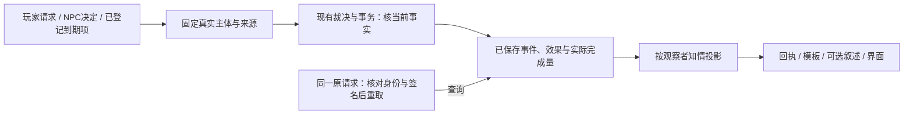

# 无限原野架构修订提案 · astra

撰写日期：2026-10-27。状态：独立提案，供主会话审议，尚未改写架构或派卡。

## 0. 主张与证据边界

保留八个世界概念、账户账本、持有与转移协议、统一义务、原语裁决、既有调度器和分层模拟。下一轮工作的单位应是“一个真实行为及其后果闭合”，而不是再建一套接口，然后宣布旧业务已经统一。优先补三件事：**行为发起和同意的真实来源；从提交到终态、回执和玩家可知投影的完整链；精确承诺与近似模拟的明确边界。** 市场、司法、NPC 日常、扩展包共同使用这些边界，不另造第二个内核。[产品原则:7–20；设计03:5–54；审计F053、F039/F061、F051、F065、F074、F081]

本提案引用的代码基点是 `F:/dnd-wt/S5A` 的 `f7cbd0172ff6bba56548c9193a14f6f8a2dd2d2f`，提交时间 2026-10-27 00:51:54 UTC；审计基点是 `314e5e3f50da18258164d615e7dc86d467b587be`。以下 `server-plugin/`、`extension/`、`tests/`、`tools/` 均相对该代码基点；设计、研究、审计与流程文档相对 `F:/dnd`。未运行测试、模拟玩家脚本或性能探测；“代码支持”表示静态调用链支持，不冒称本次复现或验收通过。后续合入的新修复应从工作包中扣除，不能照此重复派工。

阅读范围包括产品原则、现有设计01–15/目标/标准/附录、阶段登记、86条交叉审计、六份研究的启示与跨作品对照、三份流程终稿与 actions、相关当前代码。未读取另一份架构提案或 audit-private。研究中“未取得”“社区观察”“推断”的结论仍按该可信度引用；本提案不把纸上表达能力写成已实现优势，不以“没有找到别家做到”证明本项目已经世界第一。[logs/arch/brief.md:7–27；标杆标准:7–12、35；logs/research/xianxia-and-llm.md:793–802]

### 0.1 先纠正审计与阶段定位

86条合并结果为36条 CONFIRMED、39条 PARTIAL、7条 REJECTED、4条 DISPUTED。**不将86当作86个漏洞，也不将同根条目重复计费。** F005/F009/F020/F027/F030/F035/F041 已驳回，不纳入修复需求；没有据此升级出的 P0。PARTIAL 只接纳判词收窄后的部分。[logs/audit/xreview/merged.md]

对四条争议独立读代码后的判断：

| 编号 | 本提案判断 | 静态依据与处理边界 |
|---|---|---|
| F025 | 商号资产分离是 S5-04 尚待完成的义务；“注资计利润”“破产抹债”的指控不成立 | `business.mjs:26` 确实使用玩家资产；但 `:235–243` 利润来自成交收入减成本，`:265–271` 明确保留债务。复用 S5-04 独立柜台工作，不另开“破产套利”卡。 |
| F028 | 拍卖后规范义务并未完全失联，普通还款也不是永久被禁；剩余风险是当物处置与债务终态混用 | `finance-bank.mjs:318` 经 `holdingSet` 写债；`holding-sources.mjs:413–417` 同步规范义务；`credit.mjs:161–178` 普通还款支持 pawn。另 `finance-bank.mjs:401–403` 对未还清当债再次标流当，未区分当物已卖；`credit.mjs:92–93` 已处置当物不会再次交付。应修处置终态与剩余债追偿，不声称已证实复制当物或无法还款。 |
| F029 | 发行缺准备金校验的主张不成立；兑付不能套用可贷额限制 | `currency.mjs:124–126` 发行核准备金；`:137–143` 兑付核真实持币、发行余额和柜台现银。存款准备金与纸币偿付不能混为同一限额。外币库存交易是否侵占准备金须按所支付资源和银行章程另核；它与 F047 的确定价格错接分开处理。 |
| F044 | “不扫 ../”“magic-light 被误当 L1”不成立；现有基线债到 S8 仍须偿还 | `tools/import-graph.mjs:15–23` 扫所有点开头的相对路径；`tools/arch-layers.mjs:22` 将 magic-light 列为 magic 包；`import-graph.mjs:57–59` 明确只拦新增违例。基线不是零依赖的证据，也不是扫描器漏扫的证据。 |

S5A 相比审计基点已合 perf1：主要是 records 索引和 PatchCursor 热点优化及测试隔离，不能再把“实现 perf1”列成下一张卡。对有重叠的 governance/high-nobility/public-projects/promotion，差异是检索索引替换，未关闭审计所述司法消费者、军功顺序和到岗问题。已有通过报告仅按原报告范围复用；安静模式最终预算仍待阶段验收。[两基点 `git diff`；logs/review/actions.md:75–87]

状态文档开头仍写旧 A3 位置，后部已有 A3+S4 合入及 S5 进行中的记录。调度应以最新事实和 `logs/review/actions.md` 为准。S5-04/08/09/10 的未完成义务，不重复包装成“发现架构全坏”；S6 的传播、S7 的全规模等价、S8 的包加载与依赖归层，也不提前宣布已完成。[docs/当前状态.md:35–41；docs/归档/PROGRESS.md:462；logs/sessions/s5-plan.final.md:18–42]

## 1. 九个根因及后续影响

### R1. “是谁在行动”没有贯穿到所有入口

**实现偏离为主，设计缺少边界落点。** 设计已经要求本人、代理、紧急条款三种同意来源，并区分权能、同意、行为能力和事后法律效力；实际旧入口仍可把 `promisor`、`speaker`、`consent:true` 当成他人的决定。`openObligation` 默认 actor=debtor，`assertObligationAuthority` 在 actor===debtor 时放行，只证明“这个人有能力为自己签”，没有证明外部调用确实来自此人。不能靠把所有义务都加一次 NPC 同意解决：罚款、继承、法院执行和已签合同自动清偿不是新合意。[附录A:309–319、356–358；06:103–127；engine.mjs:1075–1083；obligation-runtime.mjs:102–123、205–213；F023/F053/F064/F066/F067/F086]

涉及 `index/engine/action-consent/primitives-runtime/obligation-runtime`，以及 promise、组织议案、许可、托养、授课、金融和运输适配器。修订：在现有调度/裁决上下文中固定每个行为的真实 actor 与来源，不接受外部参数替换；本人决定、代理权限和法定强制各带现有来源事件，消费者按类型核验。玩家发起请求后，NPC若自主接受，应由其决策路径产生NPC为主体的后续提案，并保留原请求起因；不能把整条因果链都强制记为最初的玩家。已有规则支持且实际条件成立的非法行为仍能发生并留下后果；“没权代人答应”与“能强行动手但要对抗”不能混为一个拒绝开关。未成年亲密保护独立保留，不随民事成年年龄一起放宽。[产品原则:18；05§5.2/5.3；06§6.5；F017/F053；magic-consent.mjs:45、96–98；engine.mjs:544–547]

不做的后果：S6 的人格与立场会被入口参数绕过；A4 学习出的动作继续复制假同意；S8 的数据包只要复用此调用便继承缺口；RW 的委托、监护和门派制度越多，伪造他人行为的范围越大。

### R2. 事务内部、时间推进和事务外呈现没有共享完成语义

**实现偏离与设计缺口并存。** 旧处理器推进后再用旧 player 对象扣费，通常被已有 `E-LEGACY-RECONCILE` 拦住，表现为合法行动整笔失败；不应误报“负钱成功”，更不该删掉这道保护。另一个方向是事务已经提交，UI 刷新失败却显示整个行动失败，再点产生新事件；长等待重试只返回第一段和计划段数。它们共同需要说明“尚未提交/已提交/部分完成/结果待确认”，而不需要新事务引擎。[F037/F040/F073/F052/F081；professions.mjs:62、88–91、121–124；legacy-primitives.mjs:168–177；index.mjs:180–217；extension/runtime.js:217–294]

涉及 `engine/storage/legacy-primitives/index` 与 `extension/runtime`。现有 CampaignStore、事件编号、记录查询和动作回执可复用：推进后重读事实；提交结果先确定，再派生叙述/UI；相同请求重取原回执，分段返回已完成的真实段与中断点。提交前失败不得残留付款，提交后展示失败不得暗示回滚。对程序错误保留可定位失败，不以裸 catch 假装世界内拒绝。[F008；engine.mjs:431–450；index.mjs:193–214]

这里还要区分“施法失败但已经耗时耗材”等**已发生的世界结果**，与存储提交失败；前者不能退款或重掷来当事务恢复。拒绝一个提案也不表示同刻本来到期的世界事务一并消失，F030正是这方面已被驳回的误读。`committed`回答是否保存，outcome回答世界中成败，`pending/partial`回答完成到哪，客户端`uncertain`只表示尚不知服务器结果；不把四个问题塞进同一个`ok:false`。已有 `CampaignStore.transact` 对同id不同input的签名保护也要沿分段重试保留，无须新建第二本请求日志。[06§6.5；14§14.2；F030判词；storage.mjs:609–631；index.mjs:181–202]

分段恢复的最小落点是既有事件记录：首段绑定完整原请求及其分段目标，各段沿同一身份记录实际回执，重取时汇总已保存段，而非仅凭`#1`存在或重新计算的计划段数报成功。`until`含相对当前日的偏移，重试不能以新的`now`把原目标重新向后平移；同id改了总等待目标也应被识别，不能只校验碰巧相同的首段。其他行动造成的时间流逝不算本请求履行量；若中间已有新行动/失能导致剩余等待不能继续，应返回真实停止点，不能为“自动补完”绕过当前状态校验。稳定的是已提交的事实与完成量；对外重取仍经过知情投影，不能把完整内部事件当成可公开回执。[index.mjs:182–202；action-gateway.mjs:18–36；storage.mjs:511–515、609–619；F081；02 I12/I25]

F006/F024需要单独说明：双写期的漂移记录可用于定位漏写，但不能成为生产行动的合法补钱来源。F076的零现金预付路径在现有适配核对中可能只留下被过滤的源账户借方；这与F073通常被拒绝的路径不同。先修真实接受报价的余额核验，再在现有提交边界阻断本次新产生的未解释漂移，保留开发对账诊断与合法开局/显式转换来源。不要按“src:drift也计入源，因此形式守恒”认定经济义务已经满足，也不把此处升级为本次已实测的P0。[ledger.mjs:180–189、245–254；money.mjs:142–146；legacy-primitives.mjs:168–177；logs/audit/xreview/fable-verdicts.md:271–272；F006/F024/F076]

不做的后果：S7 长时间推进和包批处理的“完成”无法向玩家可靠表达；A4 会把失败回执与成功状态一起学入；最终长流程试玩会出现重复付款、重复委托或误判失败，而底层单元测试仍绿。

### R3. 新生产者已经写出事实，旧消费者仍读旧终态或根本无人接续

**实现偏离为主。** 司法赔偿、罪刑取轻、无罪裁判、脱逃恢复；濒死与死亡、补选获准后的接受、战争结束后的军功、运单毁坏后的退款与劳工释放，均不是缺一个“通用生命周期框架”，而是既有规则的终态及消费者没有闭合。尤其 `judgment` 对象存在不等于有效定罪，`hp=0/濒死` 不等于已死，`wrecked` 不等于仍在路上。[04§4.1–4.8；05§5.2；F039/F061/F054/F055/F059/F060/F062/F063/F064/F069/F070/F074/F085]

涉及 `law/legal-appeal/bounty/governance/civic/notables/high-nobility`，`lifecycle-state/npc-life/magic-care`，`transport/settlement-trade/post`，`obligation-runtime`。将已有生命周期查询和领域终态定义作为唯一判别点；修生产者→消费→下一到期项→终止/清偿整链。不得靠同地点人全能当证人、玩家代 NPC 报案、直接造正确末态来验收。业务子类型 pawn/player_loan 与规范义务 kind 不同职责，适配回写不得覆盖前者。[F056/F085；obligation-runtime.mjs:71–79；finance-bank.mjs:401–417]

不做的后果：S7 只会更快地推进挂起状态；S6 传播不完整的案件和死亡信息；RW 的战争、家族、门派、阴间沿断链扩张。S5 收口先修既有责任内的金融/运输/生命闭环，司法及治理接线作为 S6 前置修复，不把整套司法重做塞进 S6。

### R4. 有账可对不等于经济承诺和生产资格正确

**两者都有。** `src:craft`、`src:issue` 能把错误产出记得完全守恒；在账本之外仍须回答谁有权生产、实际投入/工时是否发生、交易报价和兑付承诺是否匹配。F047 发行用贬值后的市价、兑付用挂钩面额，测试甚至固化低价领券后高价兑付；F050 自报配方可抬高产量；F083 午夜在名单里被当成干了一整天；F026 需求只读三家静态店而供给遍读持有者。[01§1.6；15:38–81、137–156；currency.mjs:122–145；market.mjs:105–108；F047/F050/F026/F083]

涉及 `market/currency/credit/finance-assets/business/manufacturing/labor-market/public-projects`，并连到配方研究与施法研究。分开四类依据：实际成交价、当前估值、签约时冻结条款、源汇资格及预算。生产要有投入和有效工时；转移批次保留来源、有效期与真伪，单件移交选的就是那一件；估值需覆盖现有真实消费者，不能全改成“目录基价×系数”便称统一。[F007/F043/F048/F049/F058/F071/F072/F075；15:56–81；stock.mjs:77–92]

同一作品每次再版重新获得固定需求、再拿一次贡献，是具体的重复激励问题；出版有印费、耗时、每日源预算，演出另有检定与有限听众钱袋，不能统称“无限免费造钱”。S5经营收口修作品需求与贡献的实际消费，RW的娱乐/授业再复用这一结果。[F014；works.mjs:107–129、168–189；civic.mjs:130–134；astra-verdicts:166–170]

F043则应收窄：超仓捐粮有明确的交割损毁账，不是凭空丢货；按全量记贡献是否错误，取决于受领方已接受整批、还是只承诺按入库量认可，不能从“有溢出”直接推出应扣贡献。补回执中实际接收、入库、毁损及责任的区分，并使同种交割遵守已定条款；不要凭此新增全局硬负重限制或把所有捐赠改成净入库计分。[agriculture.mjs:55–68、411–423；F043两份复核判词]

不做的后果：S6 信任系统只是给错误交易补台词；A4 会把错误产出当成可推广的动作依据；S7 长期放大价格偏差与生产缺口；RW 经营、修炼、保险和供奉会成为新的套利载体。**允许真实市场套利、合法赠与和有来源的高价值发现；禁止的不是一切赚钱，而是绕过同一承诺或重复结算的无代价收益。**[15§15.7/15.9；产品原则:10、20]

### R5. 知识真相分层已有，但披露出口和获知路径没有同一口径

**两者都有。** 代码把完整 NPC 决策 trace、同地点全员记忆、远方私事通知、静态名册站位送给玩家；设计又在08场景卡提出“TA不知道/TA以为”，在05与附录把公开持有视为人人可知，容易把“可公开查询”偷换成“所有人即时知道”。08的多人规划还把彼此私有的主观视图装入一条模型上下文，现有实现也如此；输出按人分行并不等于输入已经隔离。解释性和批量效率都不授权读心。[08:16、55；05:311；附录A:382；F034/F056/F065/F068/F078/F079/F080；npc-decision.mjs:10–28；index.mjs:49；npc-autonomy.mjs:263–270；tools/npc-autonomy-planner.mjs:17–19]

涉及 `subjective-view/npc-memory/world-events/npc-decision/dialogue/lies/scene-card/state-notices/chronicle` 及界面 state-read。先分开三件事：事实发生、某人获得某版本、此刻允许向某观察者披露。沿现有 witness/tell/records/seed 入口补来源，不另存一份“公共真相库”；公开信息仍需接触渠道，谎言不能靠累计条数自动变成真相。玩家回执只含对方公开答复及玩家可知依据，完整 trace 留在显式开发调试路径。[05§5.4/5.6/5.7；F078；lies.mjs:84–88、145–159]

不做的后果：S6 的传播复杂度越高，泄露面越大；A4 把 NPC 私密当成合法槽位；S7 聚合回场重新引入全知；RW 情报、冒名、异文化文书和妖怪传说失去玩法价值。

### R6. 玩家与 NPC 有公共数据模型，却没有足够的共同业务路径

**实现偏离为主。** 有 NPC 交易、典当和原语执行，不能笼统说 NPC 什么也不会；但还款、税务/职位履约、订单履行仍有 player 固定分支，某些规则只检查 NPC 应履行什么却没有实际生产履约事件的路径。人格字段再丰富也不能替代可执行候选。[F002/F013/F022/F064/F070/F083/F086；finance-bank.mjs:194–210；credit.mjs:163–180；transport.mjs:350–358]

涉及 `npc-autonomy/npc-decision/npc-schedule` 与经营、用工、司法、爵位、运输业务。按业务提取接受真实 actor 的已有操作，玩家/UI 与 NPC 候选共用，位置、时间、预算、能力同算；不要先把整个 `state.player` 改成任意 avatar 再开始修。候选可以失败、改期、放弃或找替代者，必须有世界内原因；“无人执行”不算世界自治完成。[05§5.7–5.8；08§8.8；研究roguelike-and-parser:1055、1112、1116]

不做的后果：S7 持续世界只是定时改数；S8 模组可声明动作却不被社会使用；RW 日常经营、婚育、学馆、宗教仍需要玩家逐个启动。修共同路径比新增一套深心理系统更靠前。

### R7. 精确性、近似性、随机性与规则归档的承诺互相挤压

**契约边界混写与实现偏离并存。** I14/B05允许生态、疾病、传播在层级步长之间近似，I31/B13.1要求同输入的逐日与一次推进事件序列完全一致；两者可以在不同对照范围内成立，不能把“调用分批”与“模拟精度改变”都笼统叫作改步长。B05.3又将不同精度演化后的持有集合要求为零差，而近似死亡/迁徙本身可能改变这些集合；负载降级也可能改变自治频率。代码市场用 Math.log/自适应 Simpson，库存用 Math.exp 且留连续锚点，不能从“最终钱是整数”推导跨平台演化完全一致。与此同时已有有理累计与货币精确运算，不应全盘推倒。[02:I14/I31；07§7.3/7.5；14:65–71；标杆B05/B13；market.mjs:141–169；stock.mjs:63–92；currency.mjs:19–25；F003/F016/F031/F038/F051]

涉及 `scheduler/advance-registry/advance-layers`、数值派生、世界加载/归档、事件回放。精确事务和同版本重放零容差；相同模拟配置的重算确定；不同 LOD 的生态演化另按声明指标对照，不能同时承诺其逐条事件完全相同。已签义务、持有、资金、已物化身份、准确到期项不因 LOD 丢失。先复用现有数值工具和到期堆，把具体非确定调用接回合同；存档分片和并行不作为第一步。[scheduler.mjs:19–32、71–97；advance-registry.mjs:83–147；研究grand-strategy-and-economy:680–683]

不做的后果：S7 无法知道失败是数值漂移、语义改变还是测试口径矛盾；S8 为过金快照不断更新“标准答案”；长期浸泡既算不完也解释不清。精确与近似的契约修订必须显式评审，不可在测试里偷偷放宽断言。

### R8. 声明、注册、展示与实际执行之间缺少可用性证明

**实现偏离，设计承诺也过宽。** 有标签、有目录项、有模板、有包清单，并不保证规则真的读取它。远方职位占位名、怪物定义与身体 id 混用、器物成精心智字段缺失、重复动作注册、发布遗留模块和上游规则表未归档，都显示静态存在与运行语义分离。另06章按近邻注册动作压开放动作收益、按开放签名衰减，可能把目录是否命中误当成世界规则；应按同一真实操作共享领域约束，而非因入口不同另算成本。[F004/F015/F016/F019/F021/F045/F046/F077/F082/F084；06:171–174、184；action-limits.mjs:128–160；logs/review/actions.md:75–87]

涉及 `world-loader/registry/action-registry`、领域种类/模板、内容流水线和发布清单。延用现有 schema、引用检查、目录导出与真实消费者测试：新词先找现有词，新增字段必须有本卡需要的消费者；可纯展示的作者字段不强行配一条执行规则。不能为每个可选字段再做“有消费者清单”校验器，也不能声称一般 RX 表达式的可达性或聚合正确性可以只靠加载期机械证明。[12:278–299、803–805；研究roguelike-and-parser:1118；产品原则:25–28]

窄缺口按窄范围处理：F033是修缮推进中数量缓存导致的顶层镜像错误，不是单件真值与所有维修流程坏了；F036只保留隔离目标/阶段检查与费用时序的问题，不采纳未证实的扣魔力组合；F042缺maxHp的伤者可达路径仍未闭合，纳入相关生命/治疗接点核实，不能靠测试删掉必有字段制造证据。分别落在S5物件/生命接点与后续修缮包，不建立三个新框架。[astra-verdicts:F033/F036/F042；fable-verdicts:F033/F036/F042]

不做的后果：S8 “零引擎改动”会变成作者背着实现约束写例包；RW 内容越来越多却没有行为差异；无模型界面与模型入口继续不等价。先从现有生产调用中消除死声明，再验证独立作者能否完成新包。

### R9. 阶段验收把局部测试、历史基线和完整产品结果混在一起

**流程与设计口径问题。** 断言可以准确保护错误规格：F047的领券套利、F060的刑罚、F078的自动识谎都有例子。选测遗漏显式验收、慢档无成功补跑、并发计时混入性能结论、候选未冻结、执行者自刷金快照，使“全绿”既昂贵又难解释。不能用取消断言、合进程运行或更多审查报告解决。[logs/review/astra-r3.md、fable-r3.md、argon-r3.md；actions.md:8–56、75–87；F011/F018]

涉及卡片编排、测试门禁、阶段退出和现有状态文档。卡片先写玩家可完成什么、闭环的责任到哪、相关保护与前置事实；验收分别报告机制、性能、实际入口试玩。明确本阶段负责的判据100%及后续归属，不沿用旧文档80%/85%来覆盖新决定。[docs/PLAN.md:174；产品原则:24–28；s5-plan.final.md:5–16、36–40]

不做的后果：剩余路线重复S5的机械返工，阶段之间转移真实缺口，最终才发现整个路线从未交付过一次完整体验。

## 2. 修订的共同规则

下面【渐进】表示复用现有概念、主调用路径和数据容器，分领域完成接点与消费者；不要求一次重放/转换所有存档。【需迁移】表示会大面积改变存储形状、主路径或存档布局，必须单列成本与替代方案，不能借“清理”“统一”名义混入普通卡。

所有修订保留：钱物来源与非负、真实权能、主观知情、同版本重放、事件幂等、既有原子保存、世界规模、无模型可玩、未成年亲密保护。对照实际失败路径证明重复的机制可以删；仍在拦住F073这类错误的对账保护不能先删。每一领域修复包含真实入口、内核/适配器、下游消费者、必要数据、相关测试和玩家回执；没有完整结果不能用接口或计划抵交付。[产品原则；02；Stop That Shit；本卡限制]

现有调用链应落实为下列责任关系；图中的每个提交段仍使用当前事务与事件记录，不新增服务或第二份账：

提交前的错误在当前事务中回滚；已发生的失败施法等世界结果可以正常提交。提交后的投影失败只影响呈现，不能改变已保存结果；长动作分段时分别承认已完成的段。这就是R1/R2/R5共同需要的接点，不能以多建一层包装代替真实调用者接入。[engine.mjs:431–450；storage.mjs:609–631；index.mjs:180–217；02 I12/I16/I25]

本提案本身不授权修改已审 W1 骨架、原存档、架构文档、dist 或部署。内容接点若确实需要改已审骨架，先给主会话列具体缺口，不能执行者就地补“测试前提”。

## 3. 按现有章节修订

### 目标架构：把目标写成可交付的行为约束

**【渐进】保留本体和分层，把“统一”分成三项验收：同一权威写入口、同一语义判定、真实消费者已接入。** 有适配器不是失败；只有适配器另造权限、重算合同条款或默默补差额时才违反目标。目标文档列出仍需接回的责任域，并以阶段退出结果更新，不再用模块搬家或原语覆盖率代替可玩性。吸收 Inform/TADS 的检查、执行、报告分离和 NPC 共用动作管线；不吸收 NetHack 逐物品特判，也不借 Qud 组件模式启动 ECS 重写。[目标架构:31–80；03；F001/F053/F085；研究roguelike-and-parser:1023–1032、1089–1091]

### 01 世界本体

**【渐进】明确事实、派生缓存和签约快照的判别。** 现金/数量仍在现有账户；当前估值由投影算；签定的金额、利率口径、当时法和已发生的实际工时是事实，不因“派生优先”删除。`category`、规范种类、业务子类型、定义 id、实体 id 各保原职责，修适配映射而非一轮改名。位置事实以实际移动结果为准；日程是行动意图与预期位置的来源，不能覆盖已经发生的偏离。[01:47、133–160、173、191–219；F004/F051/F071/F072/F077/F085]

**【渐进】把物资转移与物资变换分开。** 普通 transfer 保留批次 origin/taint/purports/入库与到期信息；加工、混合、净化等确有变换语义的动作，按其既有规则产生新批次并记录来源。放归选中的个体要沿同一实例链退出行囊、改变状态、计回种群，不能“扣第一条、标目标条”。保留已有批次和单件模型，不把所有资源个体化。吸收 CDDA 共享性状和 DF 通用材料/效果词汇，不吸收它们各自静默改变形态或无限补货的做法。[01§1.6；F071/F072；ledger.mjs:205；extraction.mjs:276；研究roguelike-and-parser:1026、1115；研究dwarf-fortress:729–739]

**【渐进】事件的 cause 解释真实发生关系，摘要不成为新事实。** 允许编年史用既有 causes 归并战争、案件、灾害链，不另建会参与裁决的“故事实体系统”。具名者可保留身份历史，但被叫过名字不自动永久保持最高模拟精度。采用 DF 事件集合的阅读方式，改造其历史人物筛选规则；保留本项目名册种子及已物化身份。[01§1.7；07§7.2；研究dwarf-fortress:701–703、721–723]

### 02 不变量

**【渐进】不新增一串无消费者的 I33+，先补齐 I1–I32 的适用范围。** I1 是账目闭合，不独自证明资源来源合理；I3/I20共同约束生产资格与幅度。I6/I7/I8 的主体悬空、重复权属、义务失端也是事务不得提交的错误，不能因14章只列I1/I2/I15而降成日志。I11明确推进后读取当前事实。I12/I25同时约束内部决策和面向观察者的披露；I25仍用双世界测试，固定该观察者的四域、随机键及其他决策输入。它不要求不同世界发生合法的新观察之后仍有相同答复：对方亲口报价、目击死亡等会改变知情；应禁止的是无观察渠道就读到秘密，而非禁止世界真实差异产生可见后果。[02；14:24–31；R1–R7]

**【渐进，需显式审定契约措辞】拆清三种“等价”，不更改守恒断言。**

1. **回放等价**：同版本、同存档快照、同记录事件，恢复相同持久状态；不重问模型，不重新掷骰。I16零容差。
2. **同配置重算等价**：相同规则、输入时间线、模拟配置、随机键，串行/分批/允许的并行得到相同规范事件与状态。I31零容差；批处理边界、日志分段等物理包装不参与语义哈希。
3. **不同精度演化对照**：只对明确允许近似的生态等过程使用I14/B05既定容差。每一侧自身账目仍精确；两侧种群可能不同，但不能因此重复借出人口、吞掉债务、取消到期项或重置已物化者。同一既存合同的条款与到期边界一致；若近似演化使一侧到期余额不足，偿付结果可分岔，不能为对齐结果补钱或删债。依赖近似世界状态的后续新决定，不虚称逐条相同。

I31已经把配置事件计入输入，并未明文要求两套不同配置的轨迹相同。修订应保留这一限定，明确API调用的分段不能擅自改变同配置的内部求值步长；B05.2则比较事先声明的不同精度。B05.3的“持有集合差0”也须分清：同一条世界线物化前后，原有身份、权属、义务及借出/并回守恒应零差；两条近似演化的世界线若已发生不同死亡/迁徙，不能又强求所有新持有完全相同。**这不是执行者可以自行放宽某个失败测试的许可**；先由主会话审定修订，测试逐处写出原意、适用类和依据。若用户坚持不同LOD也全事件完全一致，应选择精确求值/惰性补算路径并实测性能，不能同时保留不等价的概率见证模型。[02:I14/I31；标杆标准:109–114、245–246；07§7.3；研究roguelike-and-parser:1034–1045]

吸收 Factorio 式同输入确定性和分歧定位；不从“别家使用低频更新”推导本项目可以降低已承诺的契约正确性。[标杆标准:32；研究grand-strategy-and-economy:661、680–681]

### 03 分层与玩法包

**【渐进】保留 L0–L4；先归责任，再归文件。** L0维持事务、账本、存储与通用执行机制；L1保留转移协议、领域判定与只读视图；L2用当前公共入口提出业务效果；L3组合有观察者的投影；L4承接真实请求和提交。补 actor来源、同意证据、当前事实读取等必要接点，不以“L0不能懂领域”为由允许上层伪造已经审核的结果。现有 dependency injection/注册接口能表达的就用它，不引入事件总线或服务容器替换现有注册表。[03:9–18；obligation-runtime.mjs:105–110；primitives-runtime.mjs:374–412；F001/F053]

**【渐进】import基线只减不增，按当前修复碰到的真实跨层边偿还。** 旧反应速写中“违法即立案”改为“嫌疑/证据进入有权且知情主体的报案过程”，避免新包学到旧语义。包相乘先验证盐类税与货运、医疗与知情等现成连接，不要求包作者理解旧模块目录。吸收 Qud/CDDA 的共享词汇与数据组合，拒绝 Harmony 式绕过其他处理器的任意补丁。[03:94；05§5.2.3；F044/F062；研究roguelike-and-parser:1025–1026；研究colony-and-open-world:749–756]

**【需迁移，M2】“所有旧 handler 一次改写 RX/原语、所有目录搬成包”不是本提案默认方案。** 见第5节，不能把它藏在 S8 收尾里。

### 04 转移协议

**【渐进】保留两条协议，统一的是消费语义而非把所有状态都叫 gone。** 濒死、昏迷、拘禁、远行、失踪各按现定义处理；婚姻/孕育等需要“生存”判断的消费者不得用“能工作/能行动”代替。运输毁坏终态驱动交付失败、残骸归属、承运责任、托管处置与工时释放；物品已拍卖终态与余债仍未清分开。军功在遣返前从实际参战事实生成，每人有自己的事件身份。[04§4.1–4.8；F028/F054/F055/F069/F074；finance-bank.mjs:401–403；high-nobility.mjs:27–35]

**【渐进】继承保留份额与责任上限的真值。** 已有 equity 旧合同不能因最大份额继承人排序而整张转移；应用份额持有和真实资产估值，债务先按程序清偿，后分余产。失联、审批获准、无执行人等中间状态必须有下一实际消费者或明确暂停原因，不要求世界保证人人都获救、每个岗位总有人接。[04:188；F057/F058/F064；研究colony-and-open-world:791；研究grand-strategy-and-economy:683]

吸收 Kenshi 的死亡/被囚后果区别和 CK3 的继任链观察；拒绝“任务重要人不死”、离屏重生补位和取消债务来恢复可玩。可玩性要求可解释的失败、清算、继任或新机会，不承诺同一任务必然完成。[产品原则:10、18；标杆B06.6；研究dwarf-fortress:779–788]

### 05 统一模型

**【渐进】经济与工时：用实际占用区间结算。** 日程给计划，attendance/工作片段给履行事实；失能、离岗、路程、服务容量影响有效工时。工程、工坊、授课、诊疗共享该口径，现有 `labor-market` 已有到岗消费者，先接公共工程而非另建通用任务调度器。不得用删作息或钉死工人的测试证明真实履约。[05§5.1/5.8；F032/F083；public-projects.mjs:122–140；labor-market.mjs:207–209]

**【渐进】司法与治理：统一“已生效的有罪裁判”查询，补一条完整救济链。** 真相侧嫌疑→知情主体报案→证据与程序→有罪/无罪→罚款与赔偿核定→真实清偿/执行→上诉和终结。赔偿请求不是核定赔偿，判决对象存在不是定罪。罪刑取轻继续比较行为时法和当前法；诉讼结果影响任职资格时读同一判定。岗位接受同意发生在实际主体处，不以玩家所在位置代替 NPC 所在位置。[05§5.2/5.3；F039/F060/F061/F062/F063/F064；研究roguelike-and-parser:1112]

**【渐进】知识：保留事件引用、tell版本、文书与 belief，补“获得”和“披露”两道门。** `public`表示可通过公开渠道获得，不是全世界即时知晓；告示张贴与读到内容分开。引用包含来源、时间、通道和具体版本；纠正带新的证据，旧说法不改成历史真相。复用失真表与 recall；证言的时间、外貌等字段精度可在既有版本/投影中逐步衰减，不另存无界心智图。原件、代读、译本能不同，账簿签收以真实阅读/交易事件为依据。[05§5.4；附录A:339–362、382；A3后续登记:119；F056/F078；研究xianxia-and-llm:751–755；研究colony-and-open-world:782]

**【渐进】立场与决策：先保证性格进入真实选择，再考虑心理新玩法。** 当前多维立场继续从获知的事件派生，不能删掉细节记忆便消除全部仇怨；解释分“公开答复/可知线索/内部调试”。优先接 need→候选→当前能力/义务/成本→执行→下一次安排；无法满足的需求提供现有替代或暂停原因，不为每个需要创造新游戏系统。DF的压力和核心记忆、CK3违背性格的压力可以以后作为现有槽/候选的数据包试验，本轮不加一套必需情绪账。[05§5.6/5.7；F022/F034/F065/F070；研究dwarf-fortress:705–715；研究grand-strategy-and-economy:678]

**【渐进】首次补档不得重写已经参与因果的人物。** 当前人口服务已有“起草—检查—事务保存”和身份/钱物限制，应继续使用；但不能把整个profile称为纯描述：`subjectiveView`读取基础人物的personality，`npcDecision`实际按values、riskAversion权衡代价，goals也参与紧急性判断。凡已供决策使用的性格参数、目标、家庭身份和获知事实，补档须沿原值。开局前尚未确定的叙述背景可在已有身份、亲缘和时间线约束内补写，不要求先模拟一生；但补写不能改变战役内已发生的行为，也不自动授予财富、资格、技能或获知事实。无模型时，实际决策所需值由现有骨架/确定模板提供，不等首次谈话才得到可行动的人格；语言风格和背景润色可选。沿既有profile入口检查真正被消费者读取的叶字段；起草提示中的字符串goals，与自治中读取id/progress/urgency的目标不是同一承诺，需明确哪些只是描述、哪些进入已有目标机制。验收针对同一人补档前后的既有事实与行为依据，不另造一套“所有字段都必须有消费者”的校验框架。[population-service.mjs:5–12、61–81；population.mjs:347–434；subjective-view.mjs:95–96；npc-decision.mjs:17–24；npc-autonomy.mjs:78–79、226；PLAN:910–912；产品原则:9]

**【渐进】战争/组织：结算的输入是行为时参与者，不是结算后的空名册。** 军功、俸禄、职役和组织批准共用真实主体；首领可否自行决定按章程，不一概禁止自批，也不把单一首领视为默认拥有一切他人同意。吸收 CK3 的关系与制度相互影响，不吸收按玩家难度缩放 AI 惩罚。[05§5.3/5.10；F053/F069/F070；研究grand-strategy-and-economy:678–679、695–706]

### 06 动作层与开放动作

**【渐进】所有公开入口遵守同一真实发起者和裁决语义。** `world_act`、旧 `world_*`、无模型菜单、NPC自治和计划执行的来源不同，但效果不能绕过同意、权能、在场、幅度和当前余额判定。沿现有 action-consent/primitives-runtime/legacy adapter 收口；不先将全部 handler 重写一遍。对合同请求，拒绝意味着不成立；对有规则支持的强制身体/精神动作，无同意进入真实对抗并记违规来源；`force:true`不能只绕过许可后照常掷施者单方骰。[06§6.3–6.7；F023/F053/F066/F076；engine.mjs:544–547；magic-consent.mjs:45]

**【渐进】明确 scope、感知与触及三问。** 知道远方某物可以指称它，不等于看见内容或能把它拿走；隔墙可听见而不可看见；在容器里的已知物品依可达性操作。复用现有 resolver、感知和位置模型，对 physical_item 提前返回补同一约束。06所说“会被谁看见”的预览也只能给玩家可知的见证风险，不能顺便列出暗哨或隐蔽旁观者；实际见证在行动发生时按真实感知结算。失败给具体规则原因及可行下一步；拒绝或对抗不伪装成功。吸收 Inform/TADS 的阶段与具名失败原因，不照抄封闭动词表。[06:131、176、195；02 I12/I25；F068；environment.mjs:84–91、318–321；研究roguelike-and-parser:1110–1112]

**【渐进】创意兜底表达“实际留下了什么”，不冒充未实现效果。** mark可持久、可感知、可被既有规则响应；每个标签有订阅规则不等于每个实例都满足触发条件。若玩家写一幅无人看到的画，不能为满足7天反应指标凭空派人来。保留“可表达”和“真实效果”两份结果，反应验收须说明必要感知/消费前提；确有物理过程产生的后果可按其真实含义记录，但不能把创建日志再记一遍就算世界回应。原B07.2的无条件100%须在产品取舍里明示，不能执行者换分母自称通过。A4只把确有重复需求且能组成现有原语的簇转为候选卡；主审决定注册，不自动发布。[06:231、312、316；标杆标准:143、149；产品原则:17–18、24–28]

**【渐进】世界不允许、理解不清、实现缺口分别处理。** 缺材料、距离不够、对方拒绝等是有依据的世界结果；同名对象或做法不清可请玩家澄清；规则本应允许却缺实现，必须进入真实能力缺口，不能编一条世界限制来掩盖。留下一段愿望记录不等于完成原动作，无模型构造器也不能把所有组合都降成mark就称全部玩法可玩。A4记录这三类，旧题体检与未见新题评估均保留实际未满足意图。[产品原则:7、9、17–18、24；A3后续登记:12；研究roguelike-and-parser:1110–1112]

**【渐进】研发不得自授能力和生产预算。** 配方与法术研究仍用现有表/原语，但投入、工作场所、技能、工时、产出范围、阶段耗魔须同源裁定；降低法术stage不得保留高阶效果并领低阶成本。允许真正的高效发明，前提是规则已有材料/工艺/能力来源，不以“它是玩家写的配方”批准凭空增产。[F050/F075；spell-research.mjs:27–54；12:165–166；研究roguelike-and-parser:1115]

这里的产出约束不是“成品售价不得高于原料”，也不是所有配方件数相等：一根木料做出多件小物可以合理，前提是材料数量、单位、工具、工时与质量关系受规则裁决。生产时核“等于登记配方的产出”只能防重复生产，不能证明那张由玩家自报的配方本身有效；研究登记与实际制造两端都需接现有合理性/幅度规则，不让两端用同一份未经校验的自报数互相证明。[01§1.6；06§6.3；F050；产品原则:15–19]

**【渐进，先审定平衡口径】“不更划算”应约束同一操作，不能给表达方式定价。** 06:171按最近邻取成本最大、收益最小，:174又按开放提案签名衰减；当前`action-limits`确有近邻成本/幅度与重复reward裁剪，治疗来源也被标为reward。应先核手段、目标、数量/时长、能力及情境是否确为同一操作：若是，注册入口与开放入口用同一领域计算，不能绕过耗魔、材料、练习上限；若只是签名相似，不能让无关近邻成为真实效果的天花板。最近邻仍用于推荐和缺口诊断，可信来源/幅度规则仍是执行前提，不借此放开自报产出。重复衰减回到已有练习、印象、身体消耗、有限需求等实际机制；同一提案换说法也不能重置这些约束。典型日收入表可用于劳务参考与异常诊断，不能以当日实际售价高于工资基准为由截掉合法收入，更不能据同表即宣称不存在雇佣套利。B07.7相应改为同语义下无绕过与组合资源约束，保留原反滥用意图，逐处说明测试变化，不直接删除限制。[产品原则:15–20；06:161–174、184；标杆B07.7；action-limits.mjs:128–160、269–303；open-actions.mjs:237–253；研究R/IF:1110–1115]

### 07 离屏与性能

**【渐进】在现有到期堆、advanceRegistry、区域进度和借出并回上完成 S7。** 持续义务/许可/案件/既定抵达准确到期；其余系统按已声明周期、闭式或近似步长运行。进入、查询会影响交互的远方对象、跨区交付等入口先补算，再构建只读视图；派生读函数自身不偷偷推进世界。跨区结算依赖边界在现有调度入口处理，不能靠递归查询边算边改、按碰巧访问顺序决定结果。[07§7.2–7.4；14:39；advance-layers.mjs:9–45；advance-registry.mjs:83–147；研究roguelike-and-parser:1113]

**【渐进】pin保留责任，不保留无穷活跃集。** 有有效义务、职位、受限状态、近期可交互关系者按定义保精度；历史接触过的人保持同一身份及历史可查，不必永久智能层。借出并回按原身份/账户/病例恢复，不能以重新生成消除偏差。死者、旧事件可归档但不能删活义务、亲缘、证据、来源链仍需的字段。吸收 DF/V3 的个体与聚合分工，拒绝研究中“被命名即永久钉住”的直接版本。[附录A:347–354；研究dwarf-fortress:701–703；研究grand-strategy-and-economy:682–683]

**【渐进】首次到访也要承接此前的世界，不能只测离开后再返回。** 当前`unfoldRemoteAt`在首次到访时从纲要和种子生成骨架，随后以genesis开库存；`remoteScheduleBatch`只遍历已在state.remote里的地区，主要合批静止骨架人物的日程。因此，07:7的“远方普通居民已改存聚合”不能等同于§7.3所承诺的跨域聚合已交付。S7须让地区在战役纪元拥有真实聚合余额、进度和已发生的外来影响；到访、托运到达、债务到期等触发细化时，从当时聚合量分配，不能再次领取开局库存。聚合账户只保存未借出的份额，地区总量从它与已物化账户派生，不能把总量和可用余量各存一份且同时花掉。继续使用当前账本、到期注册、区域进度和骨架生成器，不预先生成全部人物全文。冷启动十年后首次到访、先送货再到访、往返升降层分别检验，不能仅以同seed骨架相同证明世界持续运行。[remote-generation.mjs:563–598；advance-layers.mjs:38–67；07:37–47；PLAN:912；研究政经:305、313；殖民:799–805]

**【渐进】性能以安静模式的实际全规模负载测，不靠改世界规模或改时钟。** 延用 perf1，先量具体系统、对象数、到期项和感知成本，再去掉重复扫描/无变化求值。缓存命中率不是正确性；键至少包含实际依赖版本，主观缓存要区分观察者、时间与获知版本。当前P3预算与最终B14预算同时列明，不能把当前5秒/120秒当成最终2秒/60秒达标。`tests/scale`默认只展开2郡，`SCALE_FULL=1`才验31郡；短档通过可复用其正确性证据，不能冒充全规模结果。最终场景还应按已有定义报告142聚落、324住区、约3.5万居民及实际各层对象/到期项，不能只用郡数量证明全部负载成立。硬件忙时可以更晚返回计算结果，不能偷偷降低NPC决定频率并改变世界。[logs/review/actions.md:39、75–87；tests/scale.test.mjs:14–29；标杆标准:12、263–270；研究colony-and-open-world:768–777]

**【渐进】D1不能把法律事实的发现与计算混为一谈。** 延迟展开已经冻结的见证，与只在月底检查一次非法状态不同：某物月初持有、月中转出，月底看现态可能完全漏案。优先用已有持有/状态变更和到期边界产生可追溯事实，按需计算同一结果；若选择真实巡查低频，则它是世界中的执法规则，发现时间/时效/处置确会变，不得称D0/D1法律结果完全相同。D2每周自治、传闻截断也须按第2节声明近似范围，不能一边减少决定机会、一边保证全世界轨迹不变。[07:75–80；02:I14/I25/I30；05§5.2]

**【渐进】改正存档成本的量纲，先量现有表示。** 07:66估“每日约一万个地点刻、每快照数百字节→每年数MB”不成立：仅按300字节、360天计算已是1.08GB/年未压缩；不是已测结果，但足以否定该算式。压缩率、重复片段与索引大小必须实测，不能把归档移出所统计目录就说十年存档≤64MiB。分别报告核心快照、历史/感知归档、规则包及总战役体积，同时按B13.6原口径判硬门；活跃内存稳定不等于总历史体积稳定。已有索引、相同快照去重、日志压缩先用；依赖的历史证据和因果引用不能为省空间删掉。[07:66、85–94；标杆标准:245、250–251；storage.mjs:500–507、624–630]

**【需迁移，M1/M5】核心分片或重写历史存储，不作为 S7 无条件前置。** 现有设计已排分片，但必须先有体积/加载/计算瓶颈证据，见第5节。原每秒RX吞吐和分项耗时仍可作待标定估算，不能当已经达到2秒的证据；精确模式与近似模式按02章修订分别验收。[07:63–96；研究grand-strategy-and-economy:681；研究xianxia-cn-sources:345、358]

### 08 叙述与界面投影

**【渐进】三类输出分开：玩家所知、NPC私有决策输入、开发调试。** 玩家场景卡可以说“他回避回答”“你听说……”，不能因为引擎知道对方秘密，就输出“他不知道你已发现他欠债”。`why()`同样先过可知边界；给玩家公开价格、实际付款、本人合同与公开拒绝理由，完整心智trace不混入 `/execute` 的普通回执或模型上下文。所有相关投影共用既有知情判定，不能只从JSON顶层删 `privateState`。[08:16、34–51；F065/F079/F080；index.mjs:49；研究xianxia-and-llm:742–755]

**【渐进】批量调度不等于把多人的秘密混进同一决策上下文。** 08:55提出8–20人的主观视图批量给模型；当前`npcPlanningContext`收集各人的钱物、目标、近期记忆、关系，`npcPlanningRequest`将整个people数组放进同一用户消息，只在系统提示里要求“不借用别人的秘密”。静态调用链能确认输入混合，尚未做真实模型泄漏复现；但逐人输出schema、已知配方/记忆id校验只能限制可提交的动作，不能证明选择没受另一人的秘密影响。按主体生成真正隔离的决策上下文；仍复用现有规划、预算账和冻结提交，人数与调用分配留在已有额度内，额度不足者沿原规则决策继续。全局stateFingerprint保留在服务端的计划信封与提交校验中，不作为人物信息输入模型；不能为缩提示而删掉过期计划校验。检验A的输入时只改变B的私密事实，A的可知内容与随机条件不变，且不要求模型在不同合法观察后作同样选择。不另建多代理平台，也不把一条提示里的“请隔离”当成结构保证。[08:55–57；02 I25；npc-autonomy.mjs:260–270；tools/npc-autonomy-planner.mjs:8、12–38、54–71；npc-planning-service.mjs:20–24]

**【渐进】先结算再叙述，失败呈现不改事实。** 长等待、部分完成、已提交但刷新失败都显示已经发生的后果；重试找同一请求结果。无模型模式使用同一事件模板、同一动作入口；模型只改文字，不裁决未来、补同意、补钱或补成功。删掉叙述文本后规范状态应相同；有模型/无模型比较必须固定同一提案，不能只固定seed却让模型做不同动作再要求事件一致。[08§8.1–8.6；F052/F081；研究xianxia-and-llm:741–749、781]

**【渐进】多币种与文书呈现贯通到真实交易资源。** UI显示单位、账簿、柜台报价和结算币种同源，不在仍付coin_river时只换成别国货币文字。既有人物/事件/地图面板追加实际闭环信息，避免另建“审计面板”当作玩家功能。[08:50–51；15§15.3；A3后续登记:123]

**【需迁移，M3】全面统一player/NPC持久状态单列。** 死后接续能力本身不预先判为必须迁移：先查逐域actor接入能否覆盖现有消费者，局部足够就按渐进完成；只有选择全面换形状时才进入M3。普通NPC业务共规则照常推进，不以死亡续玩功能为理由现在全改 player 存储与UI。[08§8.9；第5、8节]

### 09 走查 run-001

**【渐进】把纸上可表达与实现后完成分开记。** 对旧案例只修与当前设计冲突的推导：违法先有嫌疑和报案；传播需获知；赔偿需核定并实际支付；继承用份额和责任上限；远方变化有到期与返场证据。旧题作回归，新阶段用未参与设计者的新题发现问题，设计者不预先提供期望实现路径。沿真实prelude建立前提，不增加只供测试的世界内容或特判。[09；产品原则:24–28；F018/F060/F062/F083；标杆标准:11、382–385]

吸收 DF“能从实际时间线看出系统相互影响”的评价方法；不采用“故事链数量越多越好”驱动游戏制造灾难，也不把一张新的覆盖表当成完成。[研究dwarf-fortress:751–752]

### 10 现状映射与迁移路线

**【渐进】路线不另起一轮S1：S5收口→S6→A4→S7→S8→RW→最终。** S5已明确的柜台/用工/运输/资源义务先交完；S6先修发起与知情边界，再扩传播和认知；A4用正确裁决沉淀新动作；S7做持续世界与性能；S8做公开契约、依赖债和独立作者验收；RW接内容和余下社会玩法。工作包见第6节，每项写出实际玩家链与前置，不以一张“自治总回归卡”包掉六个不同领域。[10:89–123；PLAN:174、179–184；研究后的判词fable-verdicts:316]

**【渐进】删除开发历史版本兼容的无期限义务，保留同版本确定性和发布后契约。** 10章“旧别名永久/旧规则分支”等旧条文按10-24用户决定修订；已签条款快照、当前世界规则归档、事件原语重放不能一并删。这里要分开三种变化：未发布的旧程序实现不必永久兼容；同一战役里的改法/改约按自身生效时点处理；公开契约所承诺的包安装、升级、卸载按纪元记录。后两者是当前玩法，不是为了开发旧档保留历史实现。发布到用户酒馆时另处理应用版本迁移，先在副本启用；本提案不动原存档。[10:151；A3后续登记:121；docs/当前状态.md:15–35；12:413、449、534–551；AGENTS内容发布规则]

### 11 取舍与风险

**【渐进】增加四条明确不做：**不建第二事务/账本/心理内核；不为阶段验收引入并行模拟框架；不以无限静态校验承诺证明任意规则语义正确；不以“最自由”为理由让模型生成任意程序或世界事实。保留战斗、寻路、选举、天气等有实际职责的专用求解器；保留现有作者数据、effectSpec适配、无订单簿/无零钱找零/无导演/不多人等边界。[11:7–38；12:745–769；研究roguelike-and-parser:1121–1128]

对研究新增的压力、复杂身体、全套文化层知情、宏观经济月报等，只有当前消费者或玩法明确需要时才进入对应卡；其余是可选后续方向，本次不写进必做队列。尤其不把研究报告每一条启示都变成一个新子系统。[产品原则:26；研究colony-and-open-world:784；研究grand-strategy-and-economy:684]

### 12 开放扩展接口

**【渐进】公开契约以当前真正可调用的接口为准，一方与第三方共加载语义。** 保留命名空间、依赖、共享词、受控补丁、槽冲突、注册冻结和现有RX。把“静态检查保证可玩”改为“静态结构校验＋运行时事务约束＋真实组合用例”；错误一次报同阶段必要信息，不为每个历史章节新增专用校验器。`provides`与实际注册差异可由已有注册结果导出，避免手写第二份事实源。[12:7、142、278–299；F016/F019/F044；研究roguelike-and-parser:1118–1119]

**【渐进】收窄 auto 的承诺。** `aggregate:auto`和闭式自动推导只接受能证明可加、可组合且无未声明交互的现成模板；“有transfer和数值fact.set”本身不够——它可能读共享库存、遇阈值、争夺名额或受别的规则改变速率。每日源预算也必须按原归属日计算，不能将一个月的合法产出全部记成补算当天的额度，或反过来因批处理清空同一天已用额度；这沿用现有预算语义，不新增配额制度。超出模板的表达式要求作者声明既有聚合变体/容差并过对照，不能悄悄改成个体值×人数。运行时拒绝与熔断区分：条件不满足是业务结果；程序错误可隔离可选规则，但不得暂停债务/协议的必要结算后继续声称世界完整。[12:170、757、785–805；附录A:352–354；ledger.mjs:173–177；14:24–31；F008/F074]

**【渐进】CPU上限不能成为免法律、免守恒的通道。** 07:65“熔断最耗时无守卫条目”若用于实际必需的罪名/权限/结算规则，会让同一行动因机器负载得到不同合法性或债额。复杂度上限在加载/提案准备期可拒绝未进入世界的坏声明；已装世界的必要规则求值失败，则该事务不提交，并给可恢复的具体错误。正常缺钱、NPC拒绝、没有候选目标也不按12:790的“连续拒绝”计为程序故障而永久关闭规则。[07:65；12:776、788–791；02:I1/I3/I24]

**【渐进】包安装失败、缺包、禁用与卸载必须各有实际状态。** 修正12:340“坏包未启用、其余正常”与12:553–557“缺包不得静默载入”的歧义：新包未成功注入可以不启用；已有存档依赖包缺失必须恢复该包或执行已确认的卸载处置，不得当未安装跳过。隔离不得消灭活义务；需要的条款定义在已签快照/退役数据中继续可解释。自描述历史回放只读记录效果及所需定义，不重跑旧规则；因此包仓保存规则与保留退役定义的用途分开，避免404与540两种回放解释冲突。[12:340、403–404、449–551、553–557、790–791]

**【渐进】退役的是新建能力，不是一概抹掉旧权益。** 12:548“快照里已没有退役定义的存活实例”应收窄为按卸载策略处置完成；否则与12:475、542明确保留的认证快照及被动表矛盾。仍有效的历史认证可读退役被动表，已转换/承接的义务可由当前core动作履行，不能被“新提案不得引用退役词”误拒；新增旧包法术、重新授予已卸载认证等仍拒绝。墓碑、被动权益、休眠能力和已关闭实例分开解释，沿既有持有/义务字段完成，不另造第二套存储。[12:473–482、511–520、540–550；04§4.3]

**【渐进】原生包的信任声明说实话。** 默认数据+RX；现有一方JS可继续作为受测试的可信实现。普通worker、import扫描、时间限制不等于不可访问宿主的安全沙箱，不将“原生包绝对隔离”写进开放承诺；未经独立权限隔离实现和验证前，原生包视作用户明确运行的本机代码，S8开放保证仍只覆盖数据包。此项不另开沙箱工程。[12:81、214、765–771]

**【渐进】先交最小作者闭环，仍保完整最终验收。** content包从人物/对话/传说开始；rules包从现有修正项、反应、规范、时钟模板开始。作者工具共用引擎loader/registry，不复制另一套裁决。N6–N8及run-005–007列出的规则档包最终仍须由未参与实现者盲写，发现接口缺口后由主会话审必要性，修好换新题/作者验证，不教作者绕开缺口。[12:587–608、803–834；研究xianxia-and-llm:775–778]

**【渐进】示例必须先符合公开契约。** 寒潭例的有条件答复不应当场让申请人背上三个月挑水义务；先给条件、由申请人实际接受，再开义务。叙述按真实outcome选模板，不能所有结果都套“收下了你”。示例试玩不使用“强制success”替代真实裁决；低层隔离检定测试另说明其对象，不能冒充完整入门试玩。统计层招收同样从实际可用人口借出，不能只增加组织人数标量。修这些示例比增加一份作者检查清单更有用。[12:709–741；产品原则:18、25；02:I1/I28]

### 13 超自然与文化圈

**【渐进】先让现有异类通过普通生命、同意、义务、位置、知情和经济路径。** 器物成精初始化与普通灵智生灵一致；物种/定义和实际身体实体分清；弱点按真实目标和共享标签裁决；传说不是弱点真相，亲历/鉴定可纠正。仪式先诊断、分阶段耗时耗材、有中断后果；不因“魔法”允许无限生产或无对抗改记忆。[13:46–66、72–95、99–128；F045/F066/F075/F077/F084]

**【渐进】修炼、神职和阴间沿已有社会机制接入。** 灵脉有存量、工时/场所与占用；神职是可继任职位；亡魂是有来源的新实体，不能回滚已经清算的财产。先做已有系统能承载的异兽/宝物/安抚/知识条目，阴间仍最后。维持用户已经决定的出处、敏感条目排除、原创宗教、活动实体配额和宁合不拆；不让AI按标签组合自动制造一批无出处生灵。[13:5–20、138–199]

改造吸收 ACS 的环境与修行相互作用、DF 的共同效果词汇；拒绝太吾式玩家击败指定首领后全世界统一解锁、NPC隐性保送修炼、导演投灾与按玩家等级长怪。研究建议的“压力→天灾”也必须有已声明世界物理或文化规则，不为惩罚玩家凭空加天谴控制器。[研究xianxia-and-llm:764–772；研究xianxia-cn-sources:354–363；研究dwarf-fortress:729–731]

### 14 确定性与时序

**【渐进】保持现有同刻阶段、争夺与键控骰值，限定并行安全范围。** 仅无相互依赖的只读计算可并行，提交、争夺、反应全序仍确定；不能因分桶改变顺序键或共享修改字典。给同一输入重复生成不同seq会改变骰值，因此重试复用原事件身份；修规则故障后不得删掉某条必要规则、重跑整刻并将新的骰值当作原世界。[14:15–31、65；scheduler.mjs:19–32、120–216；研究xianxia-cn-sources:345、358]

**【渐进】数值按实际语义归口，不做全仓Number→BigInt替换。** 账户最小单位和时间仍整数；已有 `decimalFraction/fraction` 与累计余数继续用；价格积分、生态指数和成长阈值的非确定路径逐域替换成固定算法与明确舍入。表中精确比例可保有理数，不强行把极小再生率截成四位零；需持久化的计算余量有确定编码。显示数允许近似，但不得被写回裁决。候选算法须用价格边界、极小速率、长时间、批次拆分等实际域验证，不预承诺一个统一四位精度适合一切。[14:71；market.mjs:141–169；stock.mjs:63–92；currency.mjs:19–25；F051]

**【渐进】归档真正决定当前战役的全部规则输入。** `load-world` 的 balance 当前不可枚举，只有六张 primitiveTables被明确快照；economy等消费者还可能回退代码旁的表。将本战役实际读取的表纳入现有world hash归档并使消费者从它读取；不需要新配置中心。现有currencyRules、marketRules、对话模板、法域绑定、部分动作定义已经进入世界对象，不把“某模块读取world目录”一律判成缺归档。核对重点是同一战役的暖缓存、重启冷读和导入后是否取到相同规则输入。已签合同条款另保冻结，不因归档修复重算旧承诺。不承诺跨未发布旧程序实现重算，但保留当前程序内按已记录规则输入/纪元重放的能力。[tools/load-world.mjs:49–58、78–122；world-registry.mjs:8–27；currency.mjs:14、26；F016；12:534–551]

**【渐进】节奏是世界输入，不能与机器性能混用。** 义务、路程、公告期、有效工时不缩放；延迟起意与预兆按已有paceable槽和输入事件处理。把“各档每一自然年事件数相同”改为对既定年率参数/风险过程的声明及长期分布核验；延后越过年界、因新世界条件取消的事件，不可能同时保证每年实发计数完全相等。这是原文逻辑修正，须先审定，不以调整期望值使测试变绿。[14:80–108；研究grand-strategy-and-economy:680；第8节]

### 15 经济与货币

**【渐进】在现有value/quote/settle和credit上补清四个价格角色。** 当前估值服务抵押、遗产、损失与议价；成交由当前库存、数量、品质、对手方和承诺产生；固定债务/存单/兑付依签定条款；欺诈时各方主观估值可错但真实转移仍守恒。不能用实时value重估一切承诺，也不能用目录basePrice绕过统一估值。利息在本金/利率变化边界结息，支取本金后已欠利息仍是债。[15:3、38–81、137–156；F007/F047/F049/F058]

**【渐进】把计价单位、支付资源与合同资源接到真实账目，不能只换界面后缀。** 15:89允许用羊、谷、布计价，15:111要求合同保留资源种类和数量；当前`purse/vault`及`market_trade.totalCoins`仍以coin_river为基础，`currencyValue`也以它换算近期成交额。账户键已经含资源，无须全仓换账本schema：报价带单位，付款沿真实双方账户和所接受资源转移，回执保存实际成交量与当时约定；成交统计不得把不同币种的裸数量直接相加。旧铜钱字段只表示铜钱，不能改名后承载任意货币。一羊计价也不意味着可转移0.01只活羊，须保规范最小单位与实际接受的支付方式；兑换服务仍受现钱、容量、费率约束，不能在显示层自动造出零钱。已有债务继续按签约资源履行，改币只有明确法典/合同事件才能换算。[money.mjs:3–15、24–46；market.mjs:170–182；currency.mjs:83–102；15:85–111；A3后续登记:123]

**【渐进】合同历法保留原锚点，不把每次补算日变成新的签约日。** 已有 `obligationAccrued` 用签约起点的累计函数作差，能复用到相同语义的分段结息；金额变化与计息期边界分开，保留余数，总额按合同舍入。附录A:294的“跨网点按锚/按日差额最多一个小月”只适用于相应的单期，不能推广到任意时长：按缺省非闰年30/29交替，600文每锚×12=7200，而20文每天×354=7080，差额120，不是20。这个纯算术反例不是玩家套利复现；不同计息口径的合法价格差应明示条款并按真实期限累计，不靠错误上界宣称所有跨期限组合绝无价差。[附录A:289–294；obligation-calendar.mjs:36–58、75–98；obligation-state.mjs:52–68；finance-bank.mjs:373–392]

**【渐进】修发行/二级交易/兑付的错接。** 有固定兑现承诺的“领新券”应按声明发行条款收取对应准备资源并记本金承诺，不能直接套贬值后的二级市场收购价；兑付兑现原承诺、受真实现金和发行余额约束。二级折价交易可以存在，也可以被有资金者套利，但亏损有具体承担者；发行不能无限以折价自行买入面额负债。额外补贴、债务融资折价发行若要做，必须是显式有限预算的制度，当前不凭空加入。[currency.mjs:122–145；F047；15§15.3/15.5]

**【渐进】供给、需求与运输都来自同一批真实主体。** 派生商店需求接入现有库存/补货与生产计划；不能一边把所有人余货算供给，一边只有三家静态店算需求。承运风险失败要消费终态，资金远程转移须实际载体/保管人/网点结算；缺货减产而不是自动从进口源补齐。原有零售阈值、积分与总额一次舍入保留设计意图，校验拆单/合单差异是否来自显式零售制度及有限预算，不能用“每次都合规”忽略组合收益。[F010/F026/F032/F048/F074；15:10–54；研究grand-strategy-and-economy:673–689]

**【渐进】经济观察先作为现有账本的开发投影。** 用已经记下的源汇、成交、收入成本发现无来源产出和吞吐失衡；玩家只通过世界内公开账簿、钱庄报告或个人记录获得相应信息。暂不引入交易量重置篮子权重、新中央银行控制器、订单簿或全局平衡商队。EVE提供的是观察经济与识别机制漏洞的经验，不是随时改所有人钱袋的授权。[15§15.4/15.9；研究grand-strategy-and-economy:673–677、684–705]

### 附录 A：保留唯一定义处，减少手工复写

**【渐进】先修真的冲突：**生存与职能有效、实际位置与日程、actor/actedAs/actorAs、规范种类与业务子类型、公开可获取与已经获知、同意来源与强制后果、精确/近似语义。核心枚举从现有注册表导出展示或交叉检查，文档解释业务含义；不要为所有行内code造一套新的文档语言解析器。阈值事件的幂等身份要包含实际跨越发生的上下文，不能只用“阈值×实体×方向”使一生只能上穿一次；优先复用起因事件/既有时刻编号。[附录A:7–11、263–386；F004/F059/F085；附录A:331–333]

**【渐进】对自动聚合与公开持有的定义同步修订。** 与02、05、12统一，不留正文修了、附录还旧的两套合同。研究中的“每字段有一条规则读取”只用于本卡新增的可执行声明，不扩展成所有描述字段必须有消费者的门禁。[附录A:352–354、380–382；研究roguelike-and-parser:1118]

### 标杆标准：保留目标，纠正论证和测量对象

**【渐进】保留既定性能、规模、守恒、发布硬门；不拿同行宣传数字作等量比较。** 每项附本项目可重复的测量条件、阶段责任与已测/未测；“追平/超越”必须有可比证据，现阶段只称设计目标。删除或降级未经来源支持的Suck Up多采样、GlobeBench、历史人物平方成本和书目误署名论据，不据此降低工程目标。[标杆标准:7、18、30、33；logs/review/actions.md:52–56；研究dwarf-fortress:850–855；研究xianxia-and-llm:798]

**【渐进】保留具体硬保证，修正容易自我欺骗的指标解释。** 规则注册覆盖不等于有可玩消费者；缓存命中率不等于延迟/正确；故事链数量不等于乐趣；不同LLM提案不能仅凭同seed要求轨迹相同；“最终叙述错误0”不能靠确定性关键词扫描证明全部自然语言语义无错。用规则事件与模板兜底保证事实边界，保留真实模型盲评与错误统计；无法机械判定的趣味/人设问题明确人工判断范围，不新增一轮全仓证明文档。B01.4的“世界内起因≥85%、允许15%投放”与11章不设导演冲突，应删除隐藏投放额度；天气等有明确世界过程的随机输入仍可用，不能把随机与导演混为一谈。[标杆标准:51；设计11:22；标杆B01/B08/B09/B14；研究xianxia-and-llm:704–709、742–749、781；产品原则:24–28]

**【渐进，明示口径冲突】**B13.1按02章三类等价修订；B07.2按第8节产品决定修订；旧80%/85%阶段线按PLAN:174的新决定覆盖。本阶段负责的明确判据必须100%，后续依赖逐条归属，最终全部已承诺题100%。不把旧门槛当“技术上默认允许少做”。[标杆标准:143、245、383–386；PLAN:174]

## 4. 标杆取舍：采用方法，不照搬整套游戏

研究文件简称：DF=`logs/research/dwarf-fortress.md`；仙/AI=`xianxia-and-llm.md`；中源=`xianxia-cn-sources.md`；殖民=`colony-and-open-world.md`；政经=`grand-strategy-and-economy.md`；R/IF=`roguelike-and-parser.md`。以下行号均在相应文件。

### 4.1 吸收（已有设计的，重点是落实）

| 做法 | 吸收位置及具体结果 | 依据 |
|---|---|---|
| Inform/TADS 检查、执行、报告分离；NPC共用动作管线 | 06/08：同一次行动的来源、拒绝理由、实际效果和叙述分别有责任点，玩家/NPC不另算规则 | R/IF:1055、1089–1091、1110–1112 |
| DF/Qud/CDDA 共享材料、效果、性状词汇 | 01/06/13：药物、魔法、日常制造消费同一身体/材料/位置事实；不新增ECS | DF:729–731；R/IF:1025–1026、1115 |
| CK3 分项解释与制度关系相互作用 | 05/08：解释玩家可知的价、费、资格、拒绝依据；继任和秘密有真实社会后果 | 政经:655–663、678–679 |
| CDDA 闭式补算、NetHack绝对到期、DCSS延迟事件 | 07/14：复用既有due与区域进度，抵达前补齐真实后果 | R/IF:1034–1045、1113 |
| V3依赖与对象成本、太吾并行失败教训 | 07：测实际对象数/扫描量；14：只读计算并行、确定提交，先不动存档布局 | 政经:653–654、681–683；中源:345、358 |
| Qud/CDDA契约静默失效反例 | 12：未知字段/冲突明报；新增声明接真实消费者，实例与定义不混 | R/IF:1097–1098、1118–1119 |
| AI Roguelite/AI Dungeon 的反面经验 | 06/08：引擎裁决，模型不得从自己写出的故事倒推成功；摘要不是状态 | 仙/AI:688–709、742–749 |
| EVE经济观察与固定参照套利的教训 | 15：源汇、实际成交和承诺分开核；发行/兑付闭合，有成本收益可解释 | 政经:673–677 |

### 4.2 改造后吸收（明确删掉不适合的部分）

| 原建议 | 本项目版本 | 不照搬的理由与出处 |
|---|---|---|
| DF抽象人口＋具名者，接触即钉住 | 身份/历史持久；活跃精度随当前责任与联系变化 | 永久最高精度会使3.5万人目标退化；DF:701–703、793；附录A:349 |
| DF有限情绪记忆/核心人格变化 | 先保事件、来源与已有立场投影；需要人格成长玩法时由有来源事件改变慢变事实 | 不用8+8硬槽删除有效证据，不新建核心心理账；DF:705–715 |
| Talk of the Town证据与信念、SoD记忆衰减 | 来源/版本/时间＋现有recall/失真；证言字段可模糊，事实日志不改 | 不能全员无界心智图，也不能直接按记忆概率删除合同；仙/AI:751–755；殖民:782 |
| DF事件集合/Legends | 按真实causes归并可知故事与返场摘要 | 不预模拟数百年，不为凑故事数投放事件；DF:721–723、751–755 |
| Kenshi无主角和世界难度 | 世界势力按真实资金、运力、知识行动；允许失败、失去机会与继任 | 不复制离屏冻结、加载清城和手写领袖生死替换；殖民:739–756、791、798–800 |
| ACS环境与功法相互作用 | 场、材料、工时、资格经现有槽影响修行，成本与风险真实发生 | 不加玩家进度锁全世界或重置场增殖；仙/AI:764–772；中源:363 |
| 太吾行动配额/优先级 | 预算以真实时间、能力、义务和主观目标为输入；候选选择可解释 | 不补发NPC钱粮、不借“月配额”免除应履行义务；中源:342–344、355、362 |
| EVE负载下时间处理 | 安静模式先满足预算；墙钟慢可等待，世界义务计时不变 | 不把硬件负载转换成游戏内变慢，也不把TiDi当离屏等价证明；政经:680 |
| V3短缺的数量后果 | 缺投入会减产，缺口回灌真实生产/采购计划 | 不采用双层价格或全局自动平衡商队；政经:676、687–689 |
| 自动检测声明无消费者 | 检查本卡新可执行声明的实际注册/调用，相关闭环测试覆盖 | 不要求每个描述字段被规则读取，不证明任意RX可达性；DF:763–765；R/IF:1118 |
| 可见规模/难度旋钮 | 只保已批准的节奏和明确世界规则选项；全规模默认不缩水 | 人口上限调低不是本项目性能优化；中源:343、354；产品原则:8 |

### 4.3 拒绝（包括研究报告自己的过度推论）

| 不采用什么 | 原因 | 依据 |
|---|---|---|
| RimWorld式导演、财富/人口触发袭击、NetHack按玩家等级长怪 | 冲突于世界因果和固定世界难度；财富吸引敌人须通过对方获知与动机 | 殖民:746–747、797；R/IF:1124；DF:747–749 |
| NPC无限补货/补钱、玩家专用保送和精英NPC剧情盾 | 冲突于守恒、同规则与真实后果 | 中源:362–363；仙/AI:772、786–788；R/IF:1125 |
| 为反刷取消卖货、饥饿、日常玩法 | 冲突于最自由及日常与传奇同等重要；修来源、成本与终态 | R/IF:1064、1126 |
| 把静态价值、价差或有限现金当作充分防套利保证 | F047已显示有限现金也能被错误承诺抽走；有账不等于机制正确 | 政经:689；殖民:774；F047 |
| “所有回购、赔付、军需券、赏格都必须实时value” | 未签报价可估值；已签面额/赔偿不能被行情随意削减。否则修套利却毁了承诺 | 政经:673–675；15:79；01§1.4 |
| “AI内部量不可见违反可解释性” | 玩家可问公开拒绝理由，不能直接读对方隐秘现金、记忆与计划 | 政经:699；F065；I12/I25 |
| “删除全部叙述仍同状态”进一步推成“有/无LLM只要同seed就同轨迹” | 模型可能提出不同动作；应固定提案再比较裁决，不能要求不同输入同输出 | 仙/AI:742、781；I16/I31 |
| “只含transfer/fact.set就自动乘人口/推出闭式” | 共享资源、阈值、竞争、速率交互破坏线性；需限于可证明模板 | 12:805；附录A:354；R7 |
| Harmony/任意原生代码修改他包执行流程 | 破坏明确冲突和可验证事务边界；保数据包公开契约 | 殖民:755–756；12:765–771 |
| 一次全量换身体模型、全量换人格模型、重做开局历史生成 | 有研究趣味，无当前必要性证据，属于另一轮迁移/新游戏范围 | DF:833、838–840；R/IF:1074–1079；产品原则:26 |
| 以实现未公开的性能或公式证明“架构领先” | 研究空白仍是空白，社区栈追踪不是官方完整算法；自有目标需自己测 | DF:848–855；仙/AI:793–802；中源:399–405 |

## 5. 迁移边界与替代方案

**默认方案没有必须先做的大迁移。** 修当前缺口可以在已有数据容器和调用接点内完成。是否大迁移按实际影响判断，不按卡名判断：即使只叫“S8清理”，若要重写主路径或大面积换形状，也必须按本节处理。[brief:5]

下表的天数为工程量粗估，不是交付日期：以每天约4–6个历史执行会话计，包含相关集成，外部审批、长测排队、模型费用和首次探索造成的额外停顿另算。先交可测的渐进结果，再判断迁移是否有不可替代收益。

| 项目 | 迁移影响与粗估 | 是否非迁不可 | 默认替代与不迁后果 |
|---|---|---|---|
| **M1【需迁移】按郡拆核心快照、跨分片提交** | storage、载入/保存、导入导出、世界升级、回放、按需实体读取接点、跨郡转移及故障恢复；约12–20会话，3–5工程日。仍可由单一CampaignStore提交一个一致版本，不预设分布式事务/多写者 | 只有安静模式实测把保存2秒/载入5秒/峰值内存等瓶颈定位到整体快照布局，且索引、活跃集、现格式增量处理不能解决时才成立；当前无此证据。若消费者仍每回合拼回全量文档，只拆文件并不能获得预想的内存收益（现`engine.scoped`沿完整created枚举，`:581–583`）。分片也不减少历史信息总量，不能仅因总档超64MiB就宣布它能解决 | 先用现有原子快照与事件文件，补归档和重建索引。不会因此放弃全规模；若最终硬门确实不达标，发布被阻塞，不能改门槛冒充完成。完整体积问题另看M5的条件，不以移到更多文件伪达标。 |
| **M2【需迁移】一次删除全部旧状态字段、重写所有handler为RX/原语并搬包目录** | 横跨273个server-plugin模块、246条导出动作的现有接点、UI和大量测试；并非每个模块都需重写，但足以说明不是小清理。预估25–45会话，5–10工程日，范围须先按真实写者细分 | 不是修F053/F073/F085、保账本权威或公开数据包的必要条件。原S8“旧账本删除、全部一方包同loader”目标要拆清语义与物理整理，不能隐去这份差额 | 先清真实双权威：严查对账、回写映射，逐领域将旧字段变成可重建投影，已无消费者的字段再删；用现有adapter进入共同注册/校验。未完成实际写者归口前不得说S8旧账本清理完成；若坚持一次物理清空/全量RX改写，另批准该迁移。 |
| **M3【需迁移】为角色接续而全面统一player/NPC持久状态** | player/NPC状态、权限上下文、角色UI、输入、存档、死亡接续；若采用这套全面迁移，约15–25会话，3–6工程日。`character.mjs:22–31` 将人物、位置、职业、技能、法术分存于玩家专用字段；`revival.mjs:42–60` 固定恢复player；`entity-view.mjs:168–175` 也有角色分支 | 普通NPC共规则不需要它；原08§8.9的死后接续已属设计承诺，但这些分支只证明有接线工作，尚未证明必须全面换形状。若本轮保留能力，先查逐域actor接入能否覆盖实际消费者；局部足够就不做M3 | 先提取现有actor-aware业务，修NPC还款/履约/接任。既有死亡/复活玩法保留；死后换人接续仍是未完成产品能力，是否延后由第8.3节决定。功能义务与全面迁移分别审定，不能以“只改指针”低报，也不能以“必须迁移”虚增范围。 |
| **M4【需迁移】全仓数值换固定整数对象或新数值schema** | 状态、内容表、RX、序列化、UI、全部数值消费者；约18–30会话，4–7工程日 | 当前不必要。账户已有整数，货币与库存累计已有有理实现，可限定具体非确定计算路径 | 复用现有有理数/余量编码，保持外部字段职责，逐域固定算法与舍入。若某领域确需改变持久形状，单独列该字段的转换影响；不以保留旧类型为由放弃跨平台确定性。 |
| **M5【需迁移】改成只存外部输入、按需重建内部事件的历史存储** | 改事件保留、回放、分叉、因果检索、快照索引、导入导出及包纪元解释；约12–22会话，3–5工程日，与M1部分重叠。还须保留重算所需的冻结模型选择与各纪元主动规则，12章仅供读已记录效果的退役被动表未必够用 | 只有实际完整战役体积超硬门、原格式去重/压缩/归档仍不足，且用户坚持全历史要求时才讨论。07的体积算式错误说明需要量测，不等于已证明必须换存储 | 默认保留现有事件与补丁语义，归档仍可读、可追源。若最终全历史仍超64MiB，应如实阻塞该门，不能默默只计核心档或删除历史；输入日志化也必须证明旧事件可精确重建，不能只说“反正有seed”。 |

这些估算有重叠，**不得相加当作必做总价**。尤其M2与M4同时做会共享大量接点但也扩大风险；本提案均不推荐现在实施。S8既定的“零新增依赖违例→最终归层”和公开契约验收仍需完成，不能靠重命名层级或扩大白名单消掉债。[tools/arch-layers.mjs；tests/metrics/import-graph.baseline.json：513条既有边；docs/actions.json:counts；12§12.9]

以下通常是【渐进】，但执行时仍要审实际diff：为既有回执增加完成状态；复用现有事件登记真实同意来源；保留业务kind的映射修复；补规范表归档；更新只读知情投影；修货币发行公式；补到期终态消费者。若任何实现转而要求全局新schema、新事件存储或整套actor搬迁，应停止该扩展，按M项重新报影响，不能沿原卡继续扩大。

## 6. 实施路线与工作包

### 6.1 估算口径与顺序

**以下是待主会话审定的工作包，不是已经派出的卡。** 按本卡指定的剩余路线 **S5收口 → S6 → A4 → S7 → S8 → RW → 最终验收** 安排；表内并行只表示同一阶段中依赖已满足且写入文件不重叠时可并行。公共接点 `engine`、`primitives-runtime`、`transition`、注册表、`index`、客户端回执各设一位当期所有者，其他包提交具体接点需求，由主会话安排串行落地，不等所有业务做完再拼接。[brief:40–43；PLAN:174–184；s5-plan.final:9、38]

会话以原S5计划的“约65分钟执行，不含长测等待”为单位，不等于本次240分钟架构研究卡。历史S5十卡原计划合计35；已完成五卡计划18、实际22，约1.22倍；信贷原计划4，已用6仍未完，因此按1.2–1.4倍给余量比报一个总日期可靠。下表区间**已包含这一返工余量，不再整体乘一次**，包含局部测试、接点与必要数据，长测排队、正式内容模型审核及用户等待不折成零成本。它们不是逐文件工时报价；首个完整工作包结束后用实际记录更新剩余估计。[logs/sessions/s5-plan.final.md:16、18–36；logs/review/fable-r3.md:9、30]

所有实现包共享三项验收，表中不反复抄命令：

1. **机制**：卡片写出的行为结果、原保证和直接受影响路径；CORE、同步四件套、显式验收与同名测试按第7节执行。原始失败断言保留；有意修设计的先审设计，再逐条说明断言的改变。
2. **性能**：涉及推进、查询、投影、存储的包，先核真实热路径是否新增全表扫描；合入性能门按玩家安静模式、空闲机器、相同世界/输入/日志等级配对测量，沿用不慢于基线10%的合入线。最终还必须满足绝对预算；相对旧版变快不能代替达标。只改非热路径展示的包不强加十年仿真。[PROGRESS:460；logs/review/actions.md:39]
3. **试玩**：表中的链必须通过真实公开入口和普通世界前提跑通，至少有无LLM的确定性入口。付费提示栈试玩集中在阶段收口，沿当前预算与模型槽运行；局部卡不能为了省事制造测试专用人物、地点、权限或可调用的后门。[产品原则:24–27；s5-plan.final:9]

### 6.2 S5收口：先把已经承诺的经济与资源链交完

| 包（均【渐进】） | 交付内容与责任 | 前置、并行 | 关键机制与试玩验收 | 会话 |
|---|---|---|---|---:|
| G0 接点与规格审定 | 将本提案采纳的actor来源、完成回执、终态、精确/近似、价格四角色、开放动作同语义约束写回现有设计与v3指南；核当前活动卡所有权、已合修复；不是再写一轮全仓审计 | 主会话审定；无代码并行冲突 | 每项矛盾有唯一采用口径；不重派perf1、已完成S5-01/02/05/06/07；迁移项仍隔离 | 1–2 |
| S5-A 提交与回执 | 收紧F053相关的真实发起接点；修F073/F081推进前后快照、部分完成与重试；服务端和客户端返回真实提交状态 | G0；占用engine/index/extension公共接点，先于经济终态集成 | 交易成功后投影失败不能再扣一次；两段动作第二段失败仍显示第一段已发生；同request重复提交得到原完成结果；真实菜单再试可恢复 | 2–3 |
| S5-B 信贷与货币收尾 | 接原03剩余：发行与兑付错价、储户权利与准备金、利息结清、典当处置终态、规范kind与业务子类型；存单挂失、失效与补发按现有票据程序补接 | A的接点；与经营包共享documents/义务适配时串行 | 存→部分取→付息→挂失补发→旧单拒兑；典当拍卖后仍欠差额能清偿且不能再售同物；普通发行的收款与兑付承诺匹配，不能靠错接二级折价反复领券兑付挖空网点；真实二级套利另按风险与资金承担者判断 | 2–4 |
| S5-C 商号与真实工时 | 完成原04：独立柜台、进货定价、NPC招工/辞工、工资条款与实际attendance、制造投入、工程工时、收据账簿；收F025/F050/F083 | B金融接口稳定；与D可并行，npc-autonomy公共文件预约 | 注资不算收入；雇员迟到/缺勤不产出全天；有货、有工位、在岗才生产；玩家能开店、调拨、雇人、看真实利润与欠薪 | 3–5 |
| S5-D 生产与生态剩余缺陷 | 沿已合05/06/07修生命周期、源汇预算、批次取用/保质期和种群状态，并完成原09的钱物/病例借出并回；收季节迁徙及w4回归；不重写已有生态/水文内核 | G0；与C可并行；触世界数据先核所属内容锁 | 指定批次被实际取用，捐粮不刷新原寿命；取用/再生/放归只记一次；长期缺粮、污染、老化沿实际账户与身体状态推进；不同步长按第2节口径比较 | 2–4 |
| S5-E 运输与远期终态 | 完成原08并接F039/F061/F074：承运发车、容量、风险、货款位置、截断/货损/违约后续、可靠度；承运网络更广覆盖留RW | B义务与终态口径；与D可并行，原语共享接点串行 | 托货→出发→滞留或被截→货损/赔偿/欠款→收件人获知；不能既显示失败又最终全额送达，不能重复赔付；远期无真实履约基础不压价 | 2–3 |
| S5-F 计价与支付接线 | 接原10/登记123的多法域计价：报价单位、实际币种付款、合同资源、成交额统计与钱袋/库银显示；沿现有多资源账户，不整体改账本格式 | B与C交易接口稳定；占money/market及相应UI接点，不和B并写 | 同一商品跨法域报价可不同；实际扣的是双方接受的币种和数量；用羊计价不产生小数活羊；不同币成交统计不直接相加；旧债不随当前汇率浮动改写本金 | 2–4 |
| S5-Z 原10接线与收口 | 完成未迁价格调用、服务排队/负重/威慑等余接点；关闭当前action-registry重复id、ledger-price及已确认S5回归；兑现本阶段登记todo | A–F与活动卡成果合入后；独占公共接点 | 原S5题组按本阶段100%；四条原计划试玩链从界面到叙述闭合；全量/基线/build:release按阶段跑；慢档相关项必须完成并归因 | 2–3 |

S5小计约 **16–28会话**，不是重新执行35会话。F把原先容易被当成文字显示修改的跨币接线显式列出，Z不再重复算它。代码基点以后已经交付的03/04/08/09或回归卡从对应行扣除。原计划的“军力/战役可后移”继续保留，进入下方RW治理军事包；不能把这个后移扩大成经济链也不必收口。[s5-plan.final:5–7、22–42；A3-后续阶段登记:111–123；logs/review/actions.md:76–85]

### 6.3 S6与A4：信息、司法、NPC以及自由表达闭合

| 包（均【渐进】） | 内容 | 前置、并行 | 关键机制与试玩验收 | 会话 |
|---|---|---|---|---:|
| S6-A 权能、同意与目标 | 原生旧动作接actor/authority/consent/capacity；修代替NPC承诺、强制施法缺目标对抗、实体定义混用；法域规则决定法律后果，物理能力决定能否行动 | S5-A；先收共享裁决接点，再允许B/D各自业务接入 | 玩家不能把NPC填成发起者；NPC能自己签约/拒绝/还价；合法委托与法院强制仍能执行；精神、治疗、学艺与受限状态均覆盖；未成年不进入恋爱亲密，民事能力不作这一安全底线的替代 | 3–4 |
| S6-B 司法与任职闭环 | 接现有案件、判决、执行、上诉、通缉、拘禁、赦免和代理消费者；补白石可达法院及可真实取得的审理席位内容；保行为时法/程序从新、原告债权 | A；与C可并行；内容走既有审核 | 失窃→报案→受理→审理→实际执行→上诉改判冲回；逃脱回追捕并重登记；赦免不抹民事债；玩家任职后可审有权之案，NPC主官自行决定；无法院须有真实上级去向而非假成功 | 4–6 |
| S6-C 获知与传播 | 五来源知情、tell/阅读/译本/失真、身份链接、主观报价、belief与记忆；修“反驳两次全知”“持有即全知”、秘密会籍与原始trace泄漏 | S5市场/运输报告与A；与B/D可在不同文件并行 | 同一真相两种知情世界得到不同且有据的决策；无人目击不传播；亲见、信件、假消息、纠错、翻译分别有来源；玩家来回远方只能得知实际传来的消息 | 4–6 |
| S6-D NPC与组织的共同业务 | 把已有自治计划、日程、同意、义务和组织提案接共同动作；修下车/离开/停止/清偿等终态消费者；首次人物补档保留已用决策依据；私有模型规划按主体隔离上下文，冻结校验留服务端 | A；C主观API稳定；与B可分文件并行；planner与npc-autonomy接点归本包 | NPC能招工、赴约、付款、违约、求医；阻断资源后计划会失败/调整；同刻争夺不因player身份优先；死亡有真实接续；零模型/补档不改既有因果；改变B私密不进入A提示，规划仍守原预算及过期提交保护 | 3–4 |
| S6-E 投影与可解释性 | scene/why/编年史/返场/动作目录与回执统一使用已知、实际应用事实；退役立场平行权威，缓存可重建；修客户端已知渲染竞态 | B–D；UI可早做静态准备，最终接线串行 | 名称、标题、报价、失败理由都不泄漏；“为什么”能到已知证据或明确不清楚；按钮/工具/自然语言同一结果；真实提示栈与浏览器链通过 | 2–3 |
| A4-A 构造器与同语义裁决 | 补无LLM构造器的实体摘要、方位、幅度/抗性与组合输入；收窄近邻裁剪与重复衰减到真实领域约束；还价、歧义、请求、待决不能投影成完成 | S6投影与A3现有能力；占action-limits/router/affordance及构造器接点 | 零模型能提出跨属性的新组合；同一操作经菜单/开放提案使用同一手段成本，换说法不重置练习或源预算；不同操作不因签名近似丢真实效果；保材料、权限、幅度与反滥用保证；还价须再接受 | 3–5 |
| A4-B 学习回路与三档 | 从真实提案日志归类未满足意图，产候选动作卡，经设计审定再入规则；完成三档配置验证与独立新题评估 | A4-A；报告生成可与其并行，规则修改在后 | 报告能定位缺能力/缺数据/理解错误，不能自动改规则、偷补成功；旧题回归、新题只测不背；三档均保守恒、权限与无LLM完整可玩 | 2–3 |

S6约 **16–23会话**，A4约 **5–8会话**。这不是把原S4已验收内容全部重做：S6-B只接交叉审计所见遗漏与明确登记的内容缺口；已闭合前提和有效测试证据复用。A4-A除既有构造器缺口，还计入06章同语义裁决的接线与原断言逐处对齐，不把这项规格修订当成只改说明文字。模型/供应商选型属于技术实验，使用现有额度与真实输入离线比较，不能以“换更贵模型”代替上述入口、完成状态和投影修复。[设计10:104–105、112–116；A3-后续阶段登记:8、97、106–120；当前状态:31–34；F034/F053/F060/F065/F067/F078/F080/F086]

### 6.4 S7与S8：全规模运行和可用扩展契约

| 包（默认【渐进】） | 内容 | 前置、并行 | 关键机制与试玩验收 | 会话 |
|---|---|---|---|---:|
| S7-A 确定推进与数值 | 补尚存全扫的到期/阈值消费者、真实跨区补算；归档实际规则表；固定价格积分/生态等算法与累计舍入；保五阶段与序号 | S5/S6终态稳定；公共scheduler/advance接点独占 | 同配置相同输入按日/长推进、重启续推、注册顺序变化的精确轨迹一致；两区互读不递归补算；逾期债、反复阈值和长期小额累计不丢 | 3–5 |
| S7-B LOD与物化 | 聚合账户、公共知情、身份pin与活跃层分开；首次物化接战役以来的聚合进度；补犯罪、见证、自治、信贷、传闻的已承诺聚合变体；限制auto聚合适用条件 | A；与C在文件不重叠时并行 | 1年/10年等价按三类口径；十年后首次到访承接此前变化，先寄货后到访不丢货；升降层往返不增人钱货、不丢合同与身份；已有精确经济与法律承诺不纳入近似容差 | 5–8 |
| S7-C 存档与故障 | 现有原子快照、事件文件、规则hash/包锁继续用；补归档、重建、缺包处理、完成回执耐久性；无强制分片 | A；和B分开storage与物化所有权 | 同版导入/导出/重启/回放；保存中断后只能得到完整旧状态或完整新状态；缺已装规则不能默默换世界；投影缓存删掉仍重建一致 | 2–4 |
| S7-D 全规模安静性能与节奏 | 九省31郡、142聚落、324住区、约3.5万居民及实际各层人数、活动/账本增长下量测；治理热路径和归档；D0–D3与节奏输入分开；兑现用户选定的预兆语义 | A–C；安静测试独占机器窗口 | B14绝对预算、第30年回合/日推进≤第1年的1.2倍及内存≤1.3倍、1年/10年等价同时达标；默认档不靠常驻降级过门；不同机器负载不偷偷改变未记录的世界规则；真实长离开返场可读 | 3–5 |
| S8-A 同一加载与包生命周期 | 先让现有原生一方包经共同注册/公开验证；完善数据/RX加载、冲突、升级卸载、纪元与退役表；不要求所有handler重写为RX | S7存档/回放；接注册表与包锁，其他业务不并写 | 新安装坏包不启用且档不变；已装缺包明确阻止不完整载入或按既定显式流程处理；卸载真实清算、继承、墓碑、休眠/转换；重装不复制注入资产 | 4–6 |
| S8-B 作者工具与盲接包 | pack check/test/doc及最小模板；N6–N8和run-005/006/007的规则档包用公开契约接入；源、敏感、预算、冲突诊断；工具面≤16 | A接口稳定；文档示例可与A准备，但盲测在稳定版后 | 未读源码的作者零引擎改动接入；三类典型包各≤4小时/300次调用目标；坏包不破不变量；安装、运行、同装、卸载/回放有真实效果，不以“JSON收下了”充验收 | 3–5 |
| S8-C 旧权威与依赖收尾 | 按真实写者清旧平行账本和差分推导；旧枚举由目录取代；逐域清向上/跨包依赖；不另创一套控制平面 | A与各领域消费者稳定；分领域可并行，公共接口串行 | 旧账实际无写者且可删除；所有消费者读规范入口；import图零违例、黑名单零命中，不能通过挪层名/扩白名单伪过；最终若触发M2边界另报迁移 | 5–8 |

S7约 **13–22会话**，S8约 **12–19会话**。S7-B的增量不是再次优化已完成的日程合批，也不重算S5-09的钱物/病例借出并回工期：它接这些成果，完成首次到访前的地区推进、跨区同步和其余已承诺的多域聚合。当前代码只覆盖其中小部分，不能按“已有advance-layers”扣成零工作；默认增加未物化地区的聚合账户并逐域接转换，保留现有个体账户形状，不能借此整批改写所有NPC持久状态。S8的原“规模M”已不能代表当前剩余全部承诺：第12章经过多轮扩充，盲作者、冲突、卸载、知情边界、归层必须单列成本。数据/RX是第三方默认能力，native仅属信任扩展；不把“Worker内执行”称为宿主安全保证。S7若证实整体快照布局使加载、保存或峰值内存不能达标，且现格式内的修复无效，才进入M1论证；总存档体积则按M5的触发条件另查，不能把“分片已写在旧计划”当本次免审迁移授权。[设计10:106–107、112–116；12§12.5/12.8/12.9；s5-plan.final:34；标杆B12/B13/B14/B16；brief:5]

### 6.5 RW：扩大世界闭环，不把旧功能再造一遍

下表接的是已经批准的RW与后置缺口，不借此次研究新添一个“模拟一切”的范围。先复用S5/S6/S8的规则、公开动作和内容管线；其余部分以包接入。原RW-04/06已合的内容和S5完成的资源、诊疗接点直接复用，不能再次按完整项目收费。[PLAN:139–152、184、214–219]

| 包（均【渐进】，头像接续例外见M3） | 内容与前置 | 可并行性 | 玩家结果与验收重点 | 会话 |
|---|---|---|---|---:|
| RW-A 用工与承运网络 | RW-01/02剩余，依S5商号/运输和S6自主计划 | 与C/E可不同模块并行 | NPC商旅真实购买车船/邮递；多节点接力、班次、座/货容量、护送、滞留追查都有实际行程与合同；无复制运力 | 3–4 |
| RW-B 设施、修缮与灾害 | RW-03、更多灾害、NPC自建；依资源/工时/法域 | 与E/F可并行；与A共享路线condition时串行接点 | 桥坏路断、修复再通；火烧库存/建筑停产、重建恢复容量；灾害由天气/设施/行为产生，耗材工钱真实 | 4–6 |
| RW-C 授业与技术扩散 | RW-05；依工时、文书语言、learn、共同动作 | 与B/E可并行 | 开课、缺课、结业、认证、书本传播与迁居带艺闭合；技能来自实际课时，秘密知识不自动全世界普及 | 2–4 |
| RW-D 诊疗与公共卫生余项 | RW-06剩余；依S5生态/药材与S6服务容量 | 与C共享预约处串行，疾病模块可并行 | NPC主动求医、缺药/排队影响真实病程；义诊支出可追，污染暴露和治疗写回同一疾病，不以送药任务代诊疗 | 1–3 |
| RW-E 家族、监护与财产争议 | RW-09、PR-02b；依司法/继承/知情 | 与A/B可并行 | 真实族谱、成年自愿婚姻、分产诉讼/冻结/上诉、托养与监护；未成年继承不变成亲密玩法，债与共有财产不复制 | 3–5 |
| RW-F 信仰、门派与修行 | RW-07/08；依组织、公库、生态、S6传播、C1已审内容 | 与A/E可分包并行 | 香火去向、救济、改宗冲突、师承、稀缺修炼席位、突破与宝物归属；神迹有限、代价可查、影响真实地区，不按玩家等级投放 | 5–8 |
| RW-G 牧业剩余 | RW-10，沿S5已有家养/野生/种群 | 与F可并行 | 饲草、繁殖、挤奶剪毛、缺草减栏与雇牧工；个体/群体切换一次转账，不能靠反复领养造物 | 1–3 |
| RW-H 阴间与超自然后果 | C1阴间、亡魂、追债、祭仪、转生等既定后置；依F、司法与包生命周期 | 独立子树内容可并行，gone/restore公共接点串行 | 死亡后亡魂、遗产和义务各走声明路径，祭仪/安息/还阳产生真实后果；不是另造鬼物货币/任务内核；SX-1与来源/敏感度审核兑现 | 3–5 |
| RW-I 监狱、情报与秘密结社 | 受限玩法扩充、情报、秘密结社；依S6真实认知/权能、S8规则包 | 与H分包；共用文书/身份接点预约 | 探监、通信、申诉、买通、脱逃等有空间与权限；情报可伪造可追源，秘密会籍不外泄，失败仍给可继续的世界后果 | 4–6 |
| RW-J 语言与娱乐 | 后置语言演化/娱乐场景；基本跨语言读写已在S6，不后移重算 | 与I共享文化/语言数据时串行 | 习得/通译/流传按已知文本与交流发生；游戏、演艺等活动有时间、押注/费用、胜负和社会后果；不为每种娱乐另造专用引擎 | 3–5 |
| RW-K 治理、军事与余PR | S5明确后移的军力/战役、组织议案、PR-03/04/05剩余；依经济/法域/共同NPC动作/设施 | 大业务文件与B冲突时串行；独立军力求解可先行 | 任免、授爵、叛变、议案、征发、战争消耗与军功真实闭合；战后先取参战快照再退役；不自动重置物价；NPC犯罪同路径而不远程越境执行 | 4–6 |

RW约 **33–55会话**。这是剩余机制与必要接点的区间，不含把全部未审人物/世界条目重新生成。31郡与九省规模保留；按最新决定，省郡纲要先确定、聚落按前往生成、完整人物首次交谈起草并固定，旧“预先500个LOD1 full”不再计入待做。无模型时仍必须有稳定、足以完成所有玩法的骨架/模板与关系、财产、权限数据；不能把“等模型生成人物”变成开玩法的门槛。[产品原则:8–9；PLAN:910–912；设计10:108]

### 6.6 最终验收与总体量级

**【渐进】F-A：最终规则与内容集成，4–6会话。** 前置为上述阶段已验收、正式内容线交齐当前有效要求。以指南第3–9章每小节的真实入口和现有R16清单核未完项；run题集、日常题、无LLM全部玩法、公开包契约、31郡规模、B类硬门分别交结果。150法术、400物品、200配方、150怪物、40首领等既定内容要求由当前内容线核对完成度，未交不能算系统包通过就全项目结束；不恢复已撤销的500个LOD1 full要求。[PLAN:924、932]

**【渐进】F-B：最终提示栈与发布前构建，3–5会话，加真实运行窗口。** 前置F-A。按R17执行五人格×300回合的真实提示栈、召回/矛盾/语义/时间/费用/延迟/缓存与长记录负载；预算沿原账，不拆run清零。再按R18跑全量、baseline保留23项预期失败、build:release/build:final；用户30分钟体验和实际酒馆/原档迁移仍是各自独立授权事项。本提案不部署、不碰原档，合成档或已授权副本的验证也不冒充用户酒馆发布验收。[PLAN:928、932]

T75–T83的主题、消息、面板、地图、素材和环境音乐已有交付，不因旧R11/R12/R13仍标“待细化”而整套重做；S6及最终集成只补新投影、地点映射与真实消费者的缺口。T83尚缺实际试听，放进既有最终体验：已有信号输出与切换测试不能证明听感、音量和手机启用正常。T84语音按用户决定继续搁置，不进入默认预算或最终必交项。[PLAN:110、876–906；PROGRESS:170、173–192]

上述默认机制路线合计约 **102–166个执行会话**（S5 16–28，S6 16–23，A4 5–8，S7 13–22，S8 12–19，RW 33–55，最终7–11）。这是默认渐进范围的预算，**不含第8.3节待决的完整角色接续**，也不含M1–M5；用户若保留本轮完整接续，需加相应实现，不能称此数已经覆盖原设计所有能力。相较只报剩余S5，区间显著增大，原因是把S6/S7/S8经过多轮增加的公开契约、后置RW和最终真实试玩列出了成本。长期题集/内容审核可能占更多墙钟，不能据此承诺3–4周；代码基点后的已验收成果应逐行扣减。

**只允许有证据地缩小工作包。** 若某行行为、接点与原保证已经由当前有效结果覆盖，就删去那段估算；若新发现必须整体改数据或主路径，停在M边界让主会话评估，不能把额外迁移藏进这个总数。不会为了压总量把完整世界、日常玩法、无LLM入口、权限/私密/账本或最终验收删掉。[产品原则:7–11、26–29；brief:5、39–43]

## 7. 流程与规则修订

### 7.1 卡片验收集合与运行分档必须是两件事

**【渐进】保留交卡前置，并补到实际选择器输入。** 执行卡明确写CORE、先导出actions再跑同步四件套、本卡测试、直接改到模块的同名测试、具体跨模块消费者。它们全部进入已有门禁的 `requiredFiles/mandatory`；“s5-*必跑”不能代替卡片逐项声明，覆盖率地图或静态依赖也不能删除这些文件。同名测试不是完整影响面：改storage还有save-roundtrip，改义务还有advance/transition的真实消费者；由变更负责者给出这几个必要接点，不为每张卡维护一份泛泛全仓清单。[logs/review/astra-r3.md:28；fable-r3:18；argon-r3:23、40；actions:8、15]

**【渐进】快慢档只决定排程和时限，不决定是否验收。** 保留已上线的60秒中位分档与slow-tests并集；显式验收即使很慢也不能被裁掉。只有FAIL记录只能说明未通过，不能据此猜它慢；TIMEOUT/INCOMPLETE要记录是执行超时、环境阻断还是没跑完，不能写成PASS。受影响慢测必须有完成结果；阶段收口必须兑现全量，不得仅凭“已排队”放行相关未归因改动。[actions:4–19、83–85；astra-r3:27–28；fable-r3:19]

**【渐进】每个测试文件单独Node进程，复用结果而不混进程。** 保留用户10-23后的单文件命令与摘要过滤；两个文件共同预加载会掩盖循环导入，因此不能为了提速合并 `node --test` 的文件参数。固定候选上的已通过验收复用；主会话合并前只核diff与疑点，合并后跑CORE。若合并改了有关接点，再定向补受影响项，不把“合并后只CORE”解释成可以无视真实冲突。[当前任务测试规则；AGENTS分工验收规则；s5-plan.final:11–16]

只读提案、纯报告这类卡按卡头明确豁免，不为了满足统一表格去导出动作或跑生产测试。本卡即属此类，本文没有生成测试通过记录。

### 7.2 固定被检对象，兑现慢档与性能窗口

**【渐进】候选快照冻结从“可选”改为验收前提。** 已有调度器记候选提交/基点、实际测试文件、运行结果；沿这些记录绑定world/profile与环境模式，测试期间不向同一候选混入新改动。必要时在已有隔离工作区跑，不新造发布系统。测试期间源码或正式世界变了，原结果不能代表新候选；确认无关的旧结果也不必全部作废重跑。[actions:19；三轮审查的候选/基线争议]

本地现有`F:/dnd-tools/perf-gate.sh`会把共享BIS0直接checkout到运行时的master，再测候选路径。保留其配对比较思路，但应让现有门禁接收已经冻结且分配给本任务的两个工作区/基点；不能在性能任务里切换其他会话的工作区，也不能让移动的master在两次比较间换了基线。这是修现有辅助脚本的责任边界，不另建性能平台。[该脚本:2–6，本文只读未执行；actions:19、39]

**【渐进】给慢档实际运行机会，先解决饥饿再谈选测“应该只剩几十个”。** 已有选测静态闭包接近全仓是共享加载结构的事实；先用真实已合卡做地图漏选比较，不按想象缩到40–90个。每若干卡/既定周期的全扫沿现规则保留，调度器必须给它容量或独占窗口。并发遵守当前批准上限及内存准入；性能任务独占安静窗口，不与内容模型、覆盖率采集、多路推进抢机器。不能以提高单卡进程数来掩盖总资源不足。[actions:30、39；fable-r3:29、34；当前状态:40、43]

所有长任务记录本会话亲启PID与结果位置，只结束自己那条任务；不按进程名批杀Node。超时后先确认是否仍运行，不能新起同等任务让机器更拥堵。浏览器/子进程EPERM作为环境阻断报告，由有权限的主会话补跑；禁止把它归“旧失败无需管”。[AGENTS与当前卡头进程/环境规则；PROGRESS:446]

**【渐进】安静模式是玩家实际配置，不能凭测试名称认定。** 先把用户所用安静入口对应到真实运行选项，固定种子、世界规模、输入与配置；可省略哪些输出/模型环节沿实际产品设置，不能为过门额外关原生运行时、自治、守恒、反应或长期规则。具体反例是`advance-registry.test.mjs:13–15`的quiet夹具会删除NPC的schedule与tier：它可保留用于原隔离测试，但不能冒充玩家安静模式的全规模性能证据。功能测试里耗时失败保留记录，在有竞争负载时不据其宣判性能回归；用安静独占配对结果裁定性能。基线已有超预算只代表归因，不代表最终允许继续超预算。[actions:39；当前状态:28–34；标杆B14；tests/advance-registry.test.mjs:13–15]

### 7.3 失败、金快照与阶段收口

**【渐进】失败按“行为差异、基线同败、环境阻断、尚未完成”分开记录。** 基线缓存按实际基点复用；同败仍需相同用例/断言及相关条件，不能只按文件名判断。现有两次独立基线核验规则继续执行；缓存只能按现规则替一次，不把同一日志复印两份。重跑只为具体环境波动或已修原因；“再跑到绿”为止不产生可靠证据。runtime渲染竞态已有产品端迹象，不能靠延长测试等待或固定幸运种子关闭。[actions:16、34、83–85；argon-r3:39]

**【渐进】金快照的被动更新改成主动审差异。** 执行者不设置 `UPDATE_ADVANCE_GOLDEN`。有意行为改变时列实际字段“旧→新”、涉及起因和设计条款；主会话核交易、时间与终态为何改变，才统一重生成。保留阶段起点对照，按10§10.5进行阶段一次基线更新；阶段中已批准而尚未重建的差异须显式记为待收口，不能标“全部测试已过”。一次“结果符合预期”不能同时批准无关字段漂移，更不能把十进制锚点写回测试就证明满足定点规范。[设计10:123；actions:8、26–28；astra-r3:9；argon-r3:16、27、33]

**【渐进】阶段过关由完整责任清单决定。** 本阶段所负责的判据100%，依赖后续阶段的逐条登记到现有A3登记/PLAN，含具体阻塞接点与接收阶段；todo不能靠挪到更晚阶段失踪。阶段末才跑规定全量、baseline、构建和真实提示栈，不每张局部卡反复做发布验收。未完成慢档、真实入口、必要正式数据或关键后续消费者，不能以CORE绿色、题库平均分或“新增测试全过”代替交付。[PLAN:174；产品原则:24–28；s5-plan.final:36、40]

**【渐进】v3指南要写当前合同，而不是把历史追加成新的阅读迷宫。** 主会话在用户审定后，将本提案采纳项并入现有开发指南；明确九省31郡、按访问生成、单套规则、无旧档兼容的现授权边界和最终验收。已撤销的20省100郡、预先500个LOD1 full等标历史，不让执行者从不同年代条款各挑一个。状态文档恢复“当前位置/下一步/阻碍”的短交接，原依据保在历史记录，不另造证明报告。[actions:70；PLAN:910–912；当前状态:29、35；AGENTS会话与文档规则]

同一块两种实质修法仍失败就保留已完成部分、交主会话规划一次；仍不行标卡住，继续独立包。新名称、新nonce、换分支不是新的条件。规划产出先由主会话审必要性再派工；第三轮审核不能把一个没有实际消费者的理想抽象变成全项目必须依赖。[AGENTS Stop That Shit与分工规则]

## 8. 真正需要用户拍板的设计取舍

以下是供主会话汇总的产品问题，本次没有向用户发起额外审批，也不因此阻塞已经确定的修复。账本接口、索引、定点算法、门禁分档等技术选择由主会话负责。五项M迁移目前均不建议直接开工；只有下面的角色接续和今后经实测证实不可达的硬预算会触及用户的迁移决定。[brief:5、45；actions:72–73]

### 8.1 在无人处留下创意，要保证哪种回应？

**需要明确的承诺**：北极星要求任何创意能留下痕迹并引起系统反应；B07.2写的是每个兜底实体七天内至少一次“系统反应”，06:312举出印象、转述、立案、宗教或精怪回应。这些社会反应依赖实际获知，有订阅规则不足以保证触发；06:174还明确规定超过数量上限的新mark不再引起反应，与全称保证直接冲突。若记号藏在无人经过的地洞，不能既要求七天内一定有社会回应，又禁止泄漏和导演安排；若只要求自然风化等物理后果，也须有真实适用过程，不能把创建日志或空转计时当成回应。[产品原则:17–18；标杆B07.2；设计11:22；06:174、227–233、312]

| 选项 | 玩家会得到什么 | 代价 |
|---|---|---|
| **推荐：保证真实尝试有记录，能留下的痕迹真实存在，回应依实际传播** | 有材料和动作条件时摆出物件、字迹或仪式痕迹；有人看见或收到消息才按其性格/利益回应。玩家可主动展示、告知、托人传播；双手被绑又无工具时，不能凭空刻出字 | 独处或藏得很好时可能长期无人回应；测试改测“在合格获知/接触条件下反应路径完整”，不是所有场景七天必发生；实现缺口仍须另记，不能被尝试记录抵销 |
| 仍保证每次七天内有人或组织作出回应 | 创意总有即时以外的社会回响，反馈更密集 | 必须安排发现者、信息渠道或特殊超自然机制；无条件安排会冲突于当前真实因果与不设导演的原则，不能暗中实现 |

推荐第一项，并在失败/留痕回执里让玩家理解“这件事已经发生，尚无迹象表明他人知道”。不新增安慰性的假成功，不把物理不存在的材料或没有施成的法术写成痕迹效果。

### 8.2 “慢节奏”要减慢哪些事，预兆需要保证到什么程度？

**现有矛盾**：原设计既让计划、传闻、预兆延后，又要求节奏不改年事件数、义务到期序列和大多数重大事件事先可感知。若婚谈因延迟错过、合同晚签、信息来不及送到，世界轨迹必然不同；强行给玩家预兆还可能泄漏无人知晓的事实。[14:80–108；标杆B01.6/B17.2；附录A:221]

| 选项 | 玩家体验 | 对世界的含义 |
|---|---|---|
| **推荐：保留“世界中的慢节奏”，固定契约和物理时间，允许因行动时机不同而分岔** | 已有债何时到期、走路多久、做工多久不变；人物较晚起意、消息较慢传来；有可信渠道时出现预兆，但会有未知或突发事件 | 同一节奏重放精确，不同节奏比较规则与长期分布；不能保证两条世界线同年同数量、同一批新合同。预兆不自动送达全知玩家 |
| 只改变玩家观看/确认节奏，世界事件时间完全不变 | 界面可分批讲、暂停阅读，离开回来有更清楚的见闻 | 因果最容易保持相同，但不能实现原设想中“离开时让世界少发生些事”；这是改玩法，不是纯性能优化 |

推荐第一项继续现有方向，但将B01.6的“全部义务到期序列相同”收窄为同一签约快照/同一产生时刻的契约规则不受pace缩放；由不同行动产生的新义务自然不同。B17.2的90%预兆目标应在有合法预兆渠道的重大事件类型/场景中测，并保留全场景实际覆盖率报告；若用户坚持全部重大事件90%，就要明确接受哪些世界内的预警设施或神通覆盖，不靠后台透视补数。

### 8.3 本轮是否仍交付“死后任意接管一个在世人物”？

这不是新加的愿望：08§8.9已经写了继承人、转生者和任一在世NPC接续，且新角色只拥有自己的财产、身份与记忆。当前不少玩法直接读player专用状态，完整兑现可能触及M3；最新“不要再做一次迁移”不能自动理解为删掉已承诺的接续，也不能自动理解为仍准大迁移。[08:89–91；M3；brief:5]

| 选项 | 玩家体验 | 范围与建议 |
|---|---|---|
| **推荐的本轮取舍：先保既有主角的完整玩法与已定死亡/复活机制，死后换人接续明确延后** | 已有角色不会因一次界面改造丢财产/知识；死亡按已实现世界规则处理；暂不能承诺任选NPC接着玩 | 默认渐进路线不增加该能力的实现；08§8.9须明记未交付，不能冒充最终全部原要求已完。这是范围变更，只有用户可决定 |
| 本轮完整兑现08§8.9 | 人物死后世界继续，玩家可换继承人、转生者或其他NPC，身份和记忆真的改变 | 先做具体消费者与局部接入评估，再定实现和成本；只有局部方案不足才进入M3。15–25会话、3–6工程日仅是全面迁移的粗估，不是已证实的最小实现成本；不能以复制player对象假装完成 |

若用户坚持完整接续且仍不迁移，应先用现有真实角色路径确认是否能局部逐域接入；在没有覆盖所有面板、技能、权限、财产与知情的证据前，不承诺“只改一个avatar指针就行”。普通NPC的签约、付款、求医、继任等共规则修复无需等这个决定，仍按S6推进。

## 9. 最可能使方案失败的五件事

| 风险 | 早期可见信号 | 处理方式 |
|---|---|---|
| **渐进变成长期双权威** | 一个金额/终态仍有两个可独立写入的位置；规范表与老业务投影分别被消费者信任；修一种债务使另一种债务反复回归 | 每个业务包沿真实写者与消费者收尾，对账失败阻塞；旧字段只在确实可重建且无独立写者后称投影。若达成单权威必须整体搬迁，按M2显式报，不继续堆兼容层。[F004/F019/F085；10:87、122] |
| **规模、长时间与等价承诺同时达不到** | 短期很快，记录增长后全扫；钉住人物随接触只增不减；30天/10年差异不是声明的近似而是漏结算 | S7-A/B先用原场景检真实复杂度与边界，再做安静长测；精确合同和守恒不进容差。无法同时达硬门就记录具体瓶颈，先优化已有结构，只有证据要求才按第5节选择相应迁移。[F006/F012/F016；B05/B14] |
| **“规则可表达”又被当成“玩家能玩”** | 新名词进注册表、测试直接写记录，但没有普通角色能签、执行、完成；菜单承诺动作而运行总拒绝 | 每包交一条普通世界的完整链和真实拒绝/失败链；缺正式法院、材料、日程或权限数据与代码同卡负责。外部盲作者只能用公开契约，发现缺口不能私下给其特例。[F039/F054/F060/F074/F082；A3登记:102–120] |
| **信息边界在解释与模型输入处漏掉** | 内核主观决策正确，但回执trace、标题、模板或失败理由暴露隐藏关系；多人私有卡合并进同一提示；纠错直接授予真相 | S6按相同观察前提用双世界检查公开出口及逐人模型输入，合法新观察另记来源；保留开发者全知调试但隔离玩家/模型。人不知道时允许明确“不清楚”，不为解释覆盖率造来源。[F034/F065/F078/F080；02 I12/I25；08:55] |
| **流程绿色替代实际完成，估算再被返工吞掉** | 必跑慢测不断排队、候选边测边改、每轮改金快照、靠再试消掉竞态；历史卡新增会话却不更新剩余 | 冻结候选、显式mandatory、兑现慢档和安静窗口；按实际已交行为扣工作量，按具体失败更新剩余；两修法停止规则照常。不要用第三轮全面审核再无限展开，审议通过的工作包完成即收。[review三终稿；actions:8、34、39、83–85] |

本提案的判断范围是设计与静态调用链；没有执行测试、浏览器、模拟玩家脚本、真实模型调用或性能测试，也没有部署、改源码、更新金快照或改写架构目录。上述验收均是后续实施要求，不是本次已通过结果。迁移选项、产品取舍和未完阶段明确保留，供主会话独立审定后形成v3指南与任务卡。
