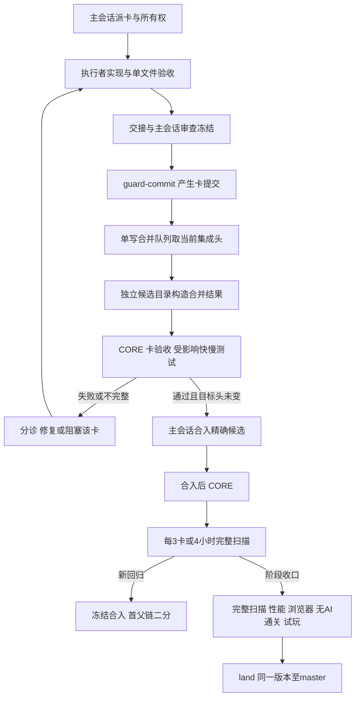

# 无限原野开发流程设计

日期：2026-10-26。状态：待主会话独立审议的设计稿，不是已实现能力。范围：单台 Windows 主机、Claude 协调、Codex 沙箱执行、阶段集成分支；不引入云 CI、数据库服务或付费模型调用。本卡只写本文和交接报告，不修改游戏、测试、world、docs 或外部工具。

## 1. 决策与边界

先把“长任务有截止时间、整机只有一个资源调度入口、失败绝不被解释成通过”做好，再优化选测。采用**单写者本地合并队列，队首一张卡一个候选提交**；禁止四张卡各自开一个测试池。覆盖率是有失效条件的提速缓存，不是正确性证明。慢测试不再无条件略过：受影响的慢测仍是这张卡的合入前置。

完整交付链是：需求与所有权 → 实现和局部验证 → 审查冻结 → guard 提交 → 当前集成头上的候选验证 → 合入 → 定期完整扫描 → 阶段可玩验收 → land master。CORE、卡片验收、账本/存档/权限/私密/兼容保证保留；23 项历史预期失败单列；EPERM、超时、地图缺失、解析失败均不能成为绿灯。不减少断言，不为流程提速删测试。

当前项目约 453 个文件、单进程 0.5–2GB、空闲内存常低于 5GB，这些是输入估计。本文所有时长是初始目标或硬截止，不能写成已经测得的吞吐。先采集五个工作日，再调整资源估计；调整不得把失败改名为成功。

现行 AGENTS 的“全量仅阶段末”与近期“每 3–4 卡扫描”有冲突。目标流程采用本卡明确要求的定期集成扫描；实施上线时由主会话同步规则，本文不改 docs。当前卡不提交，交由主会话处理。

## 2. 现有工具审计：保留、替换、删除

以下结论来自本工作树的副本，不能假设外部 `F:/dnd-tools/` 已与其同步。

| 位置 | 观察及后果 | 决策 |
|---|---|---|
| `card-gate.mjs/runOne` | 收集整个 stdout/stderr 到字符串，按人类摘要正则解析；未使用退出码/信号，未监听 spawn error。文件无摘要时 fail=null。若分支与基线均无可解析 cases，`newCases()` 可为空，最终归为同败 | 改流式结构化事件与独立进程终态；任何缺失/损坏结果为 INCOMPLETE；有回归或基础设施错误须非零退出 |
| `card-gate.mjs` 尾部 | 发现新回归仍无 `process.exitCode`；报告仅文字，调用者无法据退出码阻断 | 保留人读报告，机器判定读结果 JSON 和退出码，不读“新回归 0”字符串 |
| `card-gate.mjs` 基线段 | 所有门禁 checkout 同一个 BIS2；base 可以是移动分支名；执行期间工作树可能被另一门禁切换 | 删除共享可变 BIS2；任务绑定 base SHA，基线按 SHA 使用独立、独占执行目录 |
| `wait-cards.sh` | 每卡后台 `w`，交卡直接同步启动一个门禁；多个等待者可重复启动；`.last.txt` 或日志 `tokens used` 被当作完成 | 变成薄兼容入口，只提交幂等请求；ENDED 只代表会话结束，需有效交接、冻结内容后才 READY |
| `watch-progress.sh` | 用日志 mtime 判断卡死，缺失文件跳过；首个失联即退出，没有持久告警和确认机制；安静的计算误报，持续刷日志的死循环不报 | 删除其运行调度职责，替换为统一事件/心跳与外部 watchdog；保留临时兼容提示后退役 |
| `card-gate.mjs/pool` | 默认 jobs=3，未校验参数；每个门禁各开池，无全局内存额度；基线复跑也另建池 | 全部交给同一调度器。不存在“每卡 2 × 四卡”的并发 |
| `slow-tests.tsv` | 按文件永久剔除；数值多为 1800/1801，可能是截尾超时，不应当成真实耗时 | 改为历史耗时与显式超时状态；慢只是调度类别，不能取消必要验收 |
| `affected-tests.mjs` | 根目录无 `extension/`；正则不包含普通副作用 import；虽匹配 readFileSync JSON，却不使用 m[3]；world 只搜测试正文 loadWorld 字样 | 不再把它叫安全回退。合并到一个选择器，无法解释的数据、动态加载、扩展入口回退全量；删除两份不同的反向图实现 |
| `test-impact/common.mjs` | 修了副作用 import，但仍缺 extension 根和非字面加载/文件读取依赖 | 保留可复用函数，明确静态图只提供已知依赖，不宣称完整 |
| `test-impact/collect.mjs` | 副本已有 20 分钟单文件 kill、每十文件原子保存、逐文件 catch、1–2 jobs；已有纯函数测试 | 保留，不把背景旧版“四小时无超时、整轮才保存”误当现状；升级到统一 runner 的有界终止、每文件持久化与可恢复状态 |
| 同上采集身份 | 只检查 HEAD 未变；脏文件不变性未验证；同 HEAD 即跳过旧记录，包括失败记录；固定 map.tmp 并发写有冲突 | 只采冻结快照；每文件状态和输入指纹决定复用；单写者发布新地图代次，失败不标完成 |
| `test-impact/select.mjs` | 已处理未采测试、源码混合快照、偏移与 CRLF、顶层、增删回退，值得保留；但 map 存在即启用，测试/夹具/环境变更未使其他记录失效 | 加地图资格与运行身份；先 shadow；保守回退，不能仅检查被改源码的 hash |
| 同上函数选测 | `unused` 函数 tests=[] 被认为可以不跑；仅看最内层函数的历史执行，改分支后可能有新消费者 | 空集合是覆盖缺口；增加调用者/加载者与显式新回归验收；高风险路径不使用纯函数裁剪 |
| `tests/system-map.test.mjs`、`tools/system-map.mjs` | 测试调用生成器后从 docs 读取；在沙箱 EPERM 时有进程内 fallback | 后续专卡增加输出根，仍检查同样生成内容；真实 CLI 必须在沙箱外验收，fallback 不算 CLI 证明 |
| `tests/runtime.test.mjs`、`tests/m6-01.test.mjs` | runtime 写 docs/测试报告；m6-01 已默认 tmpRoot，仅显式更新开关写 docs | 只修实际污染入口，保留 m6-01 既有默认隔离，不全库重写 |
| `tools/run-baseline.mjs` | 同一 node 命令带两个测试文件，写 docs 报告 | 后续适配为两次独立进程，结果仍要求原 23 项预期失败精确匹配 |

还应删除“测试超时后换名字重新跑”“用重试直到绿替代分诊”“报告缺失当没有失败”三种运行习惯。当前 `test-impact/test/impact.test.mjs` 有模拟覆盖与 Git 的有效单测，工具链不是完全无测试；缺的是实际 Windows 子进程、竞态、崩溃恢复和最终放行路径测试。

## 3. 状态、身份、进程与目标流程

### 3.1 唯一身份与存放

代码与策略收敛到仓库 `tools/gate/`。运行数据放 `F:/dnd/logs/gate/`，临时执行目录放 `F:/dnd-tmp/gate/`，不进源代码。以上新增运行目录由后续主会话环境创建；当前沙箱不在这些目录写入。

一个 job 记录 `runId/cardId/kind/ownerSession/toolVersion/policyHash/baseSHA/candidateSHA/treeHash/nodeVersion/lockHash/environmentClass/testList/createdAt/deadline`。未提交卡由主会话冻结文件清单和内容摘要（包含未跟踪文件、删除项），审查后 guard 提交；记录提交后的 treeHash。忽略项中的依赖以 lockHash 和安装版本记录，不能把 node_modules 的存在等同输入一致。

每个测试结果含文件、完整 suite/case 路径、重复名称序号或参数 ID、断言位置、error code/稳定栈位置/实际与期望摘要指纹、退出码、信号、超时、开始结束时间、峰值工作集、重试父 ID。行号漂移可映射，无法可靠映射则人工判定；不能仅以名称或 error message 归同败。取消的父 suite 不重复计为新的断言失败，但文件状态仍不完整。

`jobs/<runId>/request.json` 是请求，`events.jsonl` 是追加事件，`results/<file-id>.json` 是每文件原子终态，`result.json` 是聚合结果，`summary.md` 是人读摘要。调度器单写 `queue.json` 和 `overview.json`；通过临时文件原子 rename 发布。只用本机文件系统，不先造数据库。用户源码不会进入事件日志；失败详情限定单个失败最后 30 行，日志禁止密钥和完整环境变量。

### 3.2 一卡全流程



| 步骤 | 触发/执行者/进程位置 | 产物与失败处理 | 初始时限或目标 |
|---|---|---|---|
| 派卡 | Claude 主会话；不跑测试 | 文件所有权、依赖、验收命令、运行能力、预算与交接期限。核心共享文件串行 | 5–10 分钟完成卡片 |
| 实现 | Codex 工作树；允许的单文件测试经额度预约后在沙箱运行；Claude 子代理接真实子进程/浏览器任务 | diff + 单文件结果；EPERM 标 NEEDS_HOST，绝不标 PASS；临时调试文件清除 | 按卡时限，剩 10 分钟交接；同问题两种修法失败交规划一次 |
| 交接审查 | 主会话读 diff；核心卡另一家审一次；不盲目复跑已有效证据 | READY 或 CHANGES_REQUESTED；检查禁改路径、断言意图、输入指纹、遗留进程 | 普通 ≤10 分钟，核心 ≤20 分钟；无额度则排队 |
| 提交冻结 | 主会话宿主执行既有 guard-commit；执行者停止写该树 | guard 绑定精确内容；不通过不提交；提交≠合入 | 目标 ≤5 分钟（含已有 guard 时间另计） |
| 队首候选 | 宿主单写调度器 + 主会话 Git 操作；每次只构造一个候选 | 当前集成头 + 卡提交的合并树；冲突返回实现者，不运行陈旧候选 | ≤2 分钟，无冲突 |
| 门禁 | 宿主 runner；整机统一额度，文件独立 Node | 选测原因、所有必需测试结果。新回归 FAIL，超时/崩溃/无完整事件 INCOMPLETE，排资源 WAIT_RESOURCE | 快档执行 p50≤10、p95≤20 分钟；排队另计 |
| 合入 | 主会话；验证目标头仍为 baseSHA 后更新集成分支 | 精确候选 SHA；目标前移则重建候选，复用条件见下 | ≤2 分钟 |
| 合入后 | 宿主 runner，CORE 各单独进程 | 按现行要求跑一次 CORE。若失败立刻冻结队列，定位/回退该合入 | CORE p95 目标≤5 分钟，先实测 |
| 集成扫描 | 调度器在 3 卡或 4 小时阈值触发，取固定集成头 | 含慢测的全量结果，保留历史失败。未结束不能谎报阶段绿 | 首期维护窗 6 小时，目标后续≤2 小时 |
| 阶段/master | 主会话 + Claude 真运行子代理；串行性能、浏览器/构建 | 全量、性能、可玩验收、包与快照版本；land 使用同一候选，发生新修改则失效相关证据 | 计划一个维护窗；失败不发布 |

执行者已有结果仅在**同一测试、同一输入树/依赖/环境能力/策略**下复用；源码树没变可跨分支名复用。候选与已验证树不同：按候选变化重选测试，CORE 必跑；不能凭“文件不冲突”复用整个门禁。合入后 CORE 是明确现有义务，其余未变结果不重复跑。主会话摘要有疑点时只核对相关 diff/单个失败。

## 4. 先解决卡死与抢内存

### 4.1 一个调度入口，资源额度分开算

全机只启动一个长驻 Node 调度器，它也直接做 runner；CLI 使用短命 PowerShell 提交文件请求。初始**全机最多 2 个执行 Node 额度 + 1 个调度 Node**，每卡最多 2 个执行额度。Codex/Claude 客户端本身不属于测试池，也绝不按进程名称查杀。worker 再起 Node 子进程必须占额度：已知有一个 Node 子进程的测试独占两个执行额度；数量未知的宿主测试先串行测量，不允许偷偷超额。浏览器是额外内存消费者，独占测试通道并计总工作集；性能任务也独占通道。

所有门禁、基线重跑、全量、覆盖率采集、性能、构建和试玩登记同一队列。Codex 沙箱不能启动调度子进程时，由主会话预留带期限的外部执行额度，执行者报告亲自启动的 PID/起始时间；没有额度就继续编辑或等待，不能自行起第二套池。外部额度失联保持占用并告警，先由原执行会话核实退出，再回收；不能因租约过期就假设进程已死。

优先级：事故定位/合入后 CORE > 队首门禁 > 卡片局部验收 > 定期扫描 > 地图刷新。相同优先级 FIFO；扫描到期后不再开始下一张候选，避免一直饿死。采集只在空闲窗口运行，不能与受限内存的门禁争抢；已在跑的文件不强杀，文件边界让出资源。

每 10 秒通过 Windows 可用内存与已登记进程工作集采样。普通文件初始预留 2GB，浏览器 3GB，覆盖采集 3GB；有 ≥5 次成功数据后改为 `max(1GB, 1.3 × 最近20次峰值的p95)`。启动条件：可用内存减拟启动预留仍 ≥2GB，且包括已启动尚未兑现预留后的余额也满足；双检可用量与全局预留避免瞬间双启动。可用内存 <2GB 连续两次则暂停启动并告警；≥3GB 连续 30 秒才恢复。等待 5 分钟告警，等待超过 30 分钟标 RESOURCE_BLOCKED，不自动提高并发。机器长期不足时减少同时活跃 AI 会话/安排维护窗，这是协调者的容量决策，不杀客户端来挤空间。

### 4.2 单文件截止、活性与恢复

每个新进程启动后立即登记 PID、创建时间、runId、启动会话、命令摘要与 cwd；只能由亲自启动它的会话/原 runner 终止。先请求结束，10 秒内未退出再对该确切已登记 PID 强制结束；先核对创建时间防 PID 复用。禁止 `Stop-Process -Name node`、批量 taskkill。子测试拉起的服务/浏览器必须由它自己的 teardown 关闭，真实宿主验收要覆盖超时清理。后续实现可使用 Windows Job Object 约束本次创建的进程树，但不能以此为由终止未登记、非本次创建的外部服务。

进程级 hard timeout（从启动算，排队不算）：快档默认 5 分钟，慢档 `max(10分钟, 3×已测p95)` 上限 45 分钟；未知文件默认 10 分钟；覆盖采集默认 20 分钟，上限 45 分钟；构建 15 分钟、浏览器文件 10 分钟。历史 1800s 超时样本按 censored 记录，不拿来算 p95。确有超过上限的长模拟须有具名 owner 和独立夜间任务的明确 60 分钟截止，不能以“慢”无限等待。

runner 每 15 秒发心跳，记录文件、耗时、最后用例事件、CPU 累计、内存、截止时间；测试不输出也能看见。日志静默本身不判死。单文件超过 `2×p95` 或默认 5 分钟发 SLOW；CPU 长时间不变且无事件仅为 STALL_SUSPECT，最终以硬截止结束。CPU 一直增长的死循环同样会被硬截止拦住。

外部非 Node watchdog 每 30 秒检查调度心跳，90 秒失联写持久告警；其职责是报警，**不接管杀进程**。调度器/原会话崩溃后，继任者将 RUNNING 标 ORPHANED/INCOMPLETE，保留额度并通知主会话恢复原会话处理；无法验证退出前不重跑、不抢占 PID。正常重启只恢复已终态的结果与 QUEUED 任务。机器重启使旧 PID 全失效时，通过启动时间/开机身份确认再回收，记录恢复原因。

每个文件结束立即原子落结果与覆盖 shard；损坏/超时只影响该文件。全量可继续其余文件，但总状态保持 INCOMPLETE/FAIL。只重试有明确新环境条件的基础设施失败一次；已知产品失败不自动重试到绿。两次仍失败停止该块，已完成文件保留。

## 5. 门禁分档与测试影响分析

### 5.1 集合与时长

必跑集合 = CORE（engine/storage/plugin）∪ 卡片声明验收 ∪ 新增/修改测试 ∪ 最近失败但未解决测试 ∪ 保守选中的受影响测试。重复文件去重，每文件独立进程。不得因为“不是快档”从必跑集合剔除。

| 档位 | 条件与安排 | 是否阻塞当前卡 |
|---|---|---|
| 快档 | 成功 p95≤120 秒，无专属宿主资源；先跑 CORE/最可能失败，再跑其余；执行目标 10–20 分钟 | 是 |
| 受影响慢档/宿主档 | >120 秒、浏览器、子进程、长推进；在快档后同一队列串行或按额度执行 | 是；20 分钟先给 FAST_PASS/SLOW_PENDING，绝非门禁通过 |
| 全量维护窗 | 所有当前发现的测试（包含慢测、隔离用例、基线与专用目录），逐文件执行 | 到扫描阈值后阻塞继续合入；阶段必须完成 |
| 地图维护 | 对固定快照采集；可抢占的最低优先级任务，逐文件保存 | 不阻塞已具备完整回退路径的卡；无图则更慢，不绕过验证 |

没有地图时中枢改动仍可能选出约 430 个测试，不能承诺立即降至 20 分钟；先可靠排队并给出估计。慢测未优化前完整扫描可能超过 6 小时，报告超窗并安排专卡/减少派卡率，不能把 6 小时作为截断后绿灯。

### 5.2 从零建图

1. P0 runner/资源控制到位后，由主会话创建固定集成 SHA 的专用快照；禁止在仍编辑的卡树采集。锁定 Node、依赖、选测策略和测试清单，不拷贝真实存档或 secrets。
2. 首轮 jobs=1，先 CORE/短文件，慢文件单列队列；使用每测试独立 `NODE_V8_COVERAGE` 目录。每文件 shard 含源码、测试及其 fixture/helper 的指纹、运行环境、退出状态、完整结束标记。采集失败的部分覆盖可以诊断，不能用于排除测试。
3. 地图 v2 从成功 shard 构造；快照源 hash 去重和 UTF-16→UTF-8、CRLF 处理复用现有代码。每文件提交 shard，聚合地图可每十文件更新；单写发布 generation，读者固定 generation，不边读边更新。
4. 首轮即使只有 50/453，也发布 PARTIAL 状态；所有无可靠记录测试强制入选。未齐不能因文件存在自动开启函数裁剪。
5. **影子期**至少五个有代表性的候选（函数体、测试夹具、world、扩展入口、共享核心各一类）及两次完整扫描：记录“若选测会选什么”，实际仍跑保守集合；比较未选集合中新增失败。全部无漏选才允许低风险函数体使用裁剪；没有已知回归样本时还须用工具夹具验证漏选反例，不能仅凭一周全绿声称安全。

### 5.3 选择规则与失效

先发现差异：队首候选树对当前集成 baseSHA，包含新增/删除/重命名；预交接使用冻结的脏文件与未跟踪清单。选择器给每个入选文件原因，退出时打印总数和回退原因，不吞 stderr。

| 变化/证据 | 选择策略 |
|---|---|
| 可信低风险函数体修改；旧源码与地图精确匹配；相关记录未过期 | 历史函数执行者 + 新增/修改测试 + CORE + 卡验收。函数边界/闭包/调用关系有变则不用此路径 |
| 未执行函数、空选集、新函数或 V8 省略的懒编译函数 | 加加载者和静态消费者；仍无法证明集合完整则全量；实现者需提供覆盖行为的新验收，不默许空集 |
| 顶层、导出、注册器、动态调用、加载器、schema/枚举、storage/ledger/engine 调度/权限私密等共享契约 | 全量。此处覆盖图主要用于排序，不能裁掉慢测 |
| world/、未知数据读取、package/lock/Node/启动参数、未支持文件类型 | 全量；已明确仅人读文档且无生成消费的变更可只保留 CORE/卡验收，不能笼统排除全部 docs |
| extension/ 或浏览器绑定 | 显式相关浏览器 + 保守全量；将 extension 纳入静态根，未来有数据证明后再缩小 |
| 测试本身变更 | 必跑该文件；该测试旧覆盖记录无效，重新采集后替换，不能沿用旧执行边 |
| test helper/fixture 变更 | 反向消费者记录失效；动态/无法完整枚举则全部测试记录失效并回退 |
| 源码 hash/环境不符、混合旧快照、地图格式不支持/损坏 | 相关加载者并集与静态闭包；不能证明范围完整则全量；生成诊断而非报空集 |

静态图含 `server-plugin/extension/tools/tests/world/compat`，支持字面 import/export、动态 import、已识别 JSON 依赖。普通 fs 读取、注册副作用、环境分支不是正则可证明的；遇到这些差异以全量兜底。新增/删除节点要看旧、新两版依赖图，不能只在新树找已经消失的边。

地图**使用 TTL 24 小时**（每个有效记录时间，不是聚合生成时间）；超过 TTL 不能用来排除测试。每日完整窗口刷新；按合入变化失效相关记录，候选运行时有资源可顺便采集选中文件，但覆盖模式的耗时不参与无覆盖性能基准。任一 testcase/fixture/环境失效也必须处理，不能仅给源码打 stale。

增量更新由 immutable shards 重建当前 generation：删除测试移除旧边；更新测试替换旧边；模块变动后旧偏移不可迁移到新源码，重新采集其所有旧加载者及新静态消费者；没完成的部分维持 stale/unknown。避免以“最新 commit”给旧 shard 改标签。全局核心变化后允许重建代价，不编造精准地图。

对随机种子测试，成功一次的覆盖不足以排除其他合法路径；在完成固定种子控制和路径集合前用保守档。夜间未选集合出现新回归，即刻禁用相关裁剪类别，保存 map generation/候选选单/失败签名，修选测规则后重新走影子验收。

## 6. 失败、偶发与慢测治理

### 6.1 判定不能靠“基线也红”

文件 PASS 必须同时满足：进程 exit=0、无信号/超时/启动错误、事件流完整、所有预期用例已终结、无未授权 skip/todo。spec 输出只给人看。工具使用 Node 自定义 reporter 的事件接口输出 JSONL，至少消费用例开始/完成、pass/fail、最终 summary；锁定并验证本机 Node 版本事件结构。异常发生在 reporter 加载前时仍有 runner 退出状态，判 INCOMPLETE。0 用例只有明确的工具 fixture 才合法，游戏测试默认不合法。

新断言失败先阻止合入。仅对该失败文件在固定 baseSHA 快照顺序复跑两次；候选需要验证偶发时再跑一次同文件，不重跑全部集合。基线两次都出现**同一用例路径与断言指纹**只得到 BASELINE_REPRODUCED，不自动放行：需与既有已登记问题/预期失败匹配，并审查本卡是否触及该路径；同名不同断言、新参数、不同实际结果仍是回归或 UNRESOLVED。基线缺文件、启动失败、超时都不能证明同败。

历史 23 项保持 `test:baseline` 的 E1–E19、M3a–M3d 语义与精确匹配；unexpected fail 和 unexpectedly pass 都进入核查，不删预期、不补名单来过门。其他已知缺陷单列 owner/根因/到期，不能混进这 23 项。功能断言失败和资源超时分别统计。

### 6.2 偶发登记与隔离

`tools/gate/policy/flakes.json` 仅登记已复现的特定用例签名：owner、issue、首次发现、相同树下 pass/fail 证据、环境/种子、根因猜测、到期（默认 7 天）、允许影响的验收阶段。一次重跑绿只能标 FLAKY_SUSPECT；至少同一树三次运行内有 pass 和 fail 才可申请登记，仍须主会话审查。不得自动把一次基线失败加入名单。

隔离含义是独立资源/稳定夹具下运行并单列结果，不是 skip。隔离文件仍每次被选中时执行、全量必执行；CORE、账本/存档/权限/私密、卡片显式验收不得豁免。非核心已知偶发可由主会话在未改相关路径、精确匹配登记签名时允许“带已知缺陷合入集成”，记录责任人；stage/master 不自动沿用此豁免，需要该用例稳定通过或明确产品决策，不给绿色标签。到期或超过 5 个活跃隔离项，暂停新功能派卡先修。

治理顺序：隔离文件/端口/生成目录 → 固定种子与时钟 → await/关闭资源 → 不把机器负载当产品性能结论。修复后同一提交连续 10 次独立运行且两次完整扫描无复现，关闭登记；测试仍存在。随机复跑只用于该问题，不能成为所有门禁的常态成本。

### 6.3 慢测治理

按文件累计 wall time、峰值 RSS、CPU、启动加载时间、覆盖模式与无覆盖模式分别记录，列前五名及超时截尾样本。优先处理 `farm-pests-*`、wildlife、agriculture 等现有高成本文件，但先实测，不根据 TSV 的 1800s 宣称谁最慢。

Claude 宿主子代理在空闲独占窗口对一个热点做一次无覆盖基准和 CPU profile；Codex 根据热点改实现或拆测试，另一家审语义。拆分按独立场景/种子拆文件，保留全部断言、跨日/跨月长期守恒与真实调用链；不能把三年模拟缩成三天。共享昂贵准备可使用只读 fixture 快照，但须证明与真实构建状态等价，不能共享可变引擎进程。逐文件进程规则保留。每个慢测治理卡验收同时比较断言集合、确定性结果和独占 wall time/RSS；目标热点≥30%提速或单文件≤10分钟，未达成则如实记录，不加大硬超时遮掩。

## 7. 可观测性与告警

`overview.md`/`overview.json` 是同一状态投影，主会话读一次就能知道：card/owner、分支与输入版本、EDIT/REVIEW/QUEUED/RUNNING/WAIT_RESOURCE/SLOW_PENDING/FAIL/INCOMPLETE/MERGED、当前文件、已完成/总数、排队与运行时间、估算剩余及置信度、占用额度、可用内存、最老告警、下一步责任人。没有历史耗时就显示未知，不假装 ETA。每 15 秒更新，任务完成即更新。

事件必须包括 queued、admitted、test_start、test_end、checkpoint、timeout、resource_pause、heartbeat、alert、ack、job_end；终态不得被迟到事件覆盖。每个 runId 有明确截止，主会话自己起的 scan/collect 也走同一入口，杜绝“只有执行卡被监控”。

告警写 `alerts.jsonl`，以 runId+类型去重；主会话宿主的等待适配器订阅事件并以后台任务完成通知返回主会话，不调用付费模型、不发外部消息。适配器上线验收必须真的让主会话收到一条测试告警，文件存在不算送达。未 ack 5 分钟再通知一次并置顶；若会话关闭/连接断开，持久保留，恢复后的第一个 status 自动展示未确认项。桌面通知只作可选辅助手段。

告警阈值：runner 90 秒失联、资源等待 5 分钟、队首等待 30 分钟、单文件软/硬截止、扫描超过 4 小时未开始、完整扫描超过 6 小时未结束、任务终态存在遗留 PID。SLOW 是提示，TIMEOUT/ORPHANED 是阻塞。绝不以增加日志频率让 stalled 变为 healthy。

保留策略：结构化结果/指标 90 天；失败局部诊断 14 天；成功临时目录结束清理；覆盖 shard 只保留当前与上一代及正在使用的版本。清理仅针对登记且已结束的 run 目录，解析绝对路径确认在 `F:/dnd-tmp/gate/` 内，不扫描删除其他会话文件。

## 8. 合并队列、完整扫描与回归定位

推荐单队列、每组一张卡，兼顾“一卡可追溯”和“基于最新集成头验证”。不做四个推测合并构建，不一次打包 16 张卡。共同文件的卡串行；有显式依赖的卡只有依赖 MERGED 后才入队，冲突解决是新的内容，必须重新审 diff 和相关验收。

主会话持 Git 写锁，候选在 `F:/dnd-tmp/gate/candidates/<runId>`；测试污染留在候选目录，不污染执行者树。提交/合入前检查允许路径与精确摘要，越界改动退回作者，不自动 restore，不能丢掉有效成果。源码冻结后有修改即撤销 READY 和旧证据。guard-commit 仍是唯一卡提交入口，land 是唯一 master 合入入口；调度器不自行绕过这两个边界。

基线目录按 `<baseSHA>/<runId>` 分配，不能 checkout 正在运行的目录；可复用不可变源码缓存，但测试输出必须每 run 独立。基线与候选用同 Node/依赖/运行参数且串行对照。master、集成头、候选各有 SHA，不能用“BIS2 当前是什么”代替身份。

完整扫描：每合入 3 张卡或距上次完整扫描开始 4 小时（有新合入时），先到者触发。到阈值冻结下一次合入，编辑/审查继续；固定被扫描 SHA，不边扫描边改它。每天本地 01:00 若有新提交安排全量并刷新地图；无变化可复用有效扫描，不为打卡再跑一次。阶段末若已有同树、同环境、完整覆盖的扫描证据则复用，仍执行阶段独有性能/构建/试玩义务。

新回归出现：保留失败文件与签名，冻结队列；从最后完整绿集成 SHA 到失败 SHA，沿 first-parent 合入序列二分，只跑复现所需文件（必要时同文件三次辨偶发），每步仍单进程。基线两端必须先验证同一失败；不稳定或不可复现则标 INCONCLUSIVE，不把 exit 0 的偶然一次当 good。工具/环境变化也属于候选原因，记录工具版本。确定坏合入后由主会话用 revert 保留历史，修复卡从当前头继续；若是交互回归，二分定位的是首次触发组合，保留相邻依赖卡，不直接指责最后作者。修后跑失败集合 + CORE，恢复扫描未完成部分仅在输入未变时允许。

## 9. 工具链自身的版本与验收

不再让散落的 `F:/dnd-tools/*.sh` 成为事实唯一源码。源码与测试都入 `tools/gate/`；兼容壳只定位已发布工具版本。发布副本为 `F:/dnd-tools/releases/<toolVersion>/`，每个 job 启动时解析一次 `active.json` 并固定版本；运行中的任务不读移动指针。策略 hash 同样固定。

工具测试分两类：纯状态机/选测/解析 fixtures 可由 Codex 沙箱单进程运行；真实 Windows spawn、timeout、PID 清理、并发请求、Git 候选、浏览器 teardown 必须由 Claude 子代理宿主运行。前者成功不能替代后者。工具包默认不 import 游戏引擎，缩短自测成本；另有小型真实测试 fixture 验证完整调用链。

必须覆盖已发生故障：同文件不同用例红、同名不同断言、baseline 一次偶发、无摘要崩溃/exit非零、reporter损坏、spawn EPERM、挂住且无输出、持续输出死循环、多个门禁同时请求、BIS2式切换冲突、采集到一半中断、脏树变化、map并发发布、测试改写目录、告警接收、升级时旧任务继续。用可控短 fixture 验证，不在每次工具单测里真的等 45 分钟。

发布流程：工具 diff 审查 → 单元+宿主集成 → 一个非关键任务 canary（绑定旧/新结果比较，不双倍跑游戏全量）→ 主会话切 active 指针。失败切回旧版本，新任务用旧版；已经运行的继续原版到文件边界，结果不混用。队列协议首版固定 v1，后续不兼容升级须排空队列后迁移，禁止两个版本同时写同一 queue；部署不 kill 旧任务。保留上一版本直至其全部 job 结束且新版本稳定一天。

测试工件隔离优先使用现有 tmpRoot，增加 `FIELDS_TEST_ARTIFACTS` 输出根（拟新增），默认临时目录，只有显式文档更新任务才写 docs。修 runtime、system-map 和 baseline runner 的真实入口及消费者；不要只在门禁结束后 reset docs 掩盖污染。过渡期间全部宿主测试在可丢弃候选工作树跑，并比较前后源树摘要，生成物不进入卡提交。

## 10. 阶段可玩版本与职责

### 10.1 可玩验收

每个阶段选择 3–5 条玩家可执行的新能力链，用已有 `tests/probes/run-001.test.mjs`、阶段 run001 测试和真实 API 驱动器复用可用动作。无 AI 通关必须从新建角色/隔离存档副本、真实公开 API 出发，走“前置条件→动作→状态/回执→存读档→继续”，包含一条失败恢复路径；不能直接注入最终结果或按题号改规则。跨阶段长期守恒照常保留。无 AI 只证明机制和 UI/接口可走通，不宣称自然语言理解合格。

拟新增 `tools/gate/stage-playable.mjs` 和 `tools/gate/scenarios/<stage>.json`：场景描述只存测试动作/目标，世界内容仍放 world。一次执行输出实际动作、状态差异、断言、存档副本位置和可复现种子；运行本地服务与浏览器的动作由 Claude 宿主执行。阶段场景列表由主会话按产品能力选，禁止只选容易过的题。

收口顺序：固定候选 → 完整扫描（含 23 项历史期望核对）→ 独占性能（现有相对 master 不退化 >10% 门槛，原绝对门槛保留）→ 浏览器相关场景 → `npm run build:release` → 无 AI 通关 → 小规模真实提示栈试玩。性能配对 master/候选相同配置、无覆盖，先各一次；若临界或环境有争议，最多补到三对并报告中位比值及全部原值，不能挑最好一次。构建只在阶段末，生成 dist 是构建产物，不手工改 dist。

小规模真实试玩建议每阶段 2–3 条链、每条 8–12 回合、单并发，覆盖新能力和一次偏离预定流程。使用既有 `tools/playtests.mjs` 的 run-id/card/increment/budget-proof 机制接入已授权预算，不另建付费客户端或默许默认额度；其现有 `--only` 只支持已有场景，新阶段脚本需专卡扩展并保留原验收。无授权则标 PLAYTEST_PENDING，继续免费的验证，不能写“试玩通过”。本设计卡绝不调用模型。费用、未知请求预留、失败复测沿同 run 记账，不能换 nonce 重领。

主会话人工读关键回合（每批≤10分钟）并给产品经理一页“现在能玩什么/怎么进入/已知限制”，附版本和可复现路径。账本、存档、越权、私密泄露当场阻塞；叙述问题按既有规则登记，不能把编造事实当纯文风放过。land 前确认 master 未前移；如需重合，重做受影响验证。只合代码/产生候选包，不等于部署到用户酒馆；实际发布仍须明确授权、先在存档副本启用。

### 10.2 Claude/Codex 分工

认同“按能力分工、核心卡另一家审”，但不应把所有工具代码都判给 Claude，或要求所有普通卡付双重审查成本。

| 工作 | 默认负责 | 理由/交叉边界 |
|---|---|---|
| 小型独立游戏/内容实现 | Codex luna；复杂状态/存档/账本用 sol | 沙箱可写、可单文件验证；两种修法失败升级规划，不无限消费 |
| 设计、难题拆卡、规则审计 | Codex astra | 输出草案，Claude 主会话审必要性再派；不直接写 PLAN/开新代理 |
| 纯工具算法、选测、状态判定、reporter | Codex sol | 可用注入依赖和 fixture 验证；Claude 做真实 Windows 集成验收 |
| 调度器进程生命周期、浏览器、扫描、Git/发布接点 | Claude 子代理 Sonnet，疑难再 Opus | 宿主能力是必要条件；必须实际运行，不能只代码推演 |
| 核心游戏卡 | Codex 实现，Claude 子代理审 | 覆盖账本/存档/权限私密/调度/迁移和断言改动；审真实调用路径与反例，不能只看作者摘要 |
| 核心流程工具 | Claude 实现，Codex sol/astra 审 | 审错误终态、并发、超时、基线误放行；真实进程证据由宿主提供 |
| 普通低风险卡 | 主会话审 diff + 既有门禁 | 不另开跨家审查，节约上下文与调用成本 |
| 合入与对产品汇报 | Claude 主会话 | 保持协调者责任，不亲写大块功能；负责资源预约和失联处理 |

“另一家”增加独立视角但不保证正确；审查者先读卡目标和调用路径，再读作者说明。审查只产生具体修复项，未变成果不反复审核。最多 3 个执行会话是编辑上限，不代表 3 个测试池；内存压力时主会话降低到 1–2 个活跃会话。付费模型选择遵守既有预算，本卡不启动任何代理或模型。

## 11. 度量与是否有效

机器事件自动聚合到 `F:/dnd/logs/gate/metrics/daily.json`、`weekly.md`，不让执行者手填另一套日志。取上线前能可靠重建的最近 10 张卡作基线，缺失数据写 unknown；上线后按 7 日窗口和最近 20 张卡同时看。样本不足不报有意义的 p95 改善。

| 指标 | 定义/初始目标 | 触发动作 |
|---|---|---|
| 门禁等待/执行 p50、p95 | 分开统计；快档 p95≤20分钟，队首排队 p95≤30分钟；慢档另列且纳入总交卡周期 | 连续两天超标先查内存与慢测，不盲目加 worker |
| 无人发现卡死时间 | 失联到持久告警≤90秒，告警到主会话通知≤再30秒；硬超时从启动起有界 | 任一漏报是 P0 流程缺陷 |
| 回归逃逸 | 门禁通过后由完整扫描发现的新回归/已合卡数；master 逃逸单列 | 目标 master=0；任何选测漏检立即停相关裁剪 |
| 首轮失败/重试转绿 | 同输入第一次结果与最终结果分别计；基础设施、产品、偶发分开 | 不允许用最终绿掩盖不稳定 |
| 选测效果 | 选中/总文件、加权预计时间、回退原因、未选集合新失败、有效地图占比 | 没有实测节省则保持保守方案，不为维护地图而维护 |
| 卡周期/返工率 | 派出到 MERGED；审查或门禁退回次数；等待资源时间 | 目标两周总周期中位降低30%，回归不增加；慢卡单列 |
| 资源/污染 | 峰值内存、低内存暂停、超额度次数、遗留PID、源树污染 | 超额度/误杀/污染进入提交均目标0 |
| 可玩交付 | 每阶段机制通关、真实试玩状态、预算、玩家可复现阻碍 | 不以测试文件数替代可玩结论 |

## 12. 实施卡与迁移顺序

以下是**拟实施卡**，不是本卡已授权的实现；主会话审议后派出。源码所有权默认硬互斥；测试 fixture 放各卡子目录。以下命令是拟新增接口，当前不可直接执行。外部壳、docs 或游戏测试的必要接点由主会话在派卡时授权所有权；不隐含本设计卡可修改它们。

所有实施卡保留 CORE 各跑一次、卡片验收各跑一次。模板（每个文件分别执行，替换 `<文件>`，不能放多个文件）：

```powershell
$env:TEMP='F:/dnd-tmp'
$env:TMP='F:/dnd-tmp'
node --test --test-isolation=none tests/<文件> 2>&1 | Select-String -Pattern "^ℹ (pass|fail)|^✖|^not ok" | Select-Object -First 40
```

CORE 文件分别为 `engine.test.mjs`、`storage.test.mjs`、`plugin.test.mjs`。工具自测同样一文件一命令，路径在 `tools/gate/test/`，输出沿用上述过滤；宿主集成结果标 HOST，沙箱 EPERM 列 NEEDS_HOST。不使用当前 `npm test` 的多文件调用作为新流程入口。以下表中的用例均要求真实断言，不能只检查生成了一个报告。

### P0a：有界执行与可恢复采集（先解决问题4）

- 执行：Claude Sonnet；Codex sol 交叉审终态。所有权：`tools/gate/runner.mjs`、`reporter.mjs`、`watchdog.ps1`、`test/runner.test.mjs`、`test/runner-host.test.mjs`、`test/fixtures/runner/**`、`test-impact/collect.mjs`。依赖：无。
- 接口：`runFile({cwd,file,deadline,runId,ownerSession,env}) → terminal result`，回调事件与逐文件持久化；先让 collect 调用该接口，保持旧命令可用，jobs 默认1。
- 验收：两个测试文件分别单独运行；host fixture 分别模拟挂起、刷屏死循环、启动失败、崩溃、外部未登记存活进程，证明有界结束且不碰外部进程。采集五个 fixture、第二个卡住、第四个崩溃，其他仍保存；恢复只补缺失项，失败不被标成功；心跳丢失90秒内产生告警。全部时钟阈值在测试中注入缩短，真实宿主至少一次验证。
- 可先上线：旧 collect 入口换 runner，未完成资源队列前只允许一个长任务。

### P0b：整机队列与内存准入（紧随，解决问题5）

- 执行：Claude Sonnet；Codex sol 审资源状态机。所有权：`tools/gate/scheduler.mjs`、`submit.ps1`、`policy/resources.json`、`wait-cards.sh`、`card-gate.mjs` 的调度入口、`test/scheduler.test.mjs`、`test/scheduler-host.test.mjs`、`test/fixtures/scheduler/**`。依赖：P0a 接口冻结；可在接口冻结后并行写纯状态机，集成串行。
- 验收：四张卡+采集+基线同时提交，全机执行额度≤2、每卡≤2；内存模拟和实机暂停/恢复均验证；重复交接只产生一个 job；任务超时/取消不泄漏额度；孤儿额度不自动重用。使用真实4个短 fixture job，不启动4个游戏重测池。已有 wait-cards 变成 enqueue，禁止旁路 spawn 测试。
- 上线门：新旧入口都接入；剩余手工扫描由主会话停在文件边界迁入，不能新旧各开一池。

### P1：可信结果与基线分诊

- 执行：Codex sol，Claude 宿主验证。所有权：`tools/gate/verdict.mjs`、`policy/known-failures.json`、`test/verdict.test.mjs`；P0b 完成后独占修改 `card-gate.mjs` 的聚合段。依赖：P0a、P0b。
- 验收：同文件基线A失败/候选B失败必须红；同名不同断言红；无摘要/exit非零/取消/timeout 均不能绿；基线偶发一次不能放行；两次同败只能 BASELINE_REPRODUCED，未登记仍阻塞；23项期望列表不变；退出码与 result.json 状态一致。命令：独立 `test/verdict.test.mjs`，宿主候选/基线小 fixture E2E 一次。

### P2：总览与告警送达

- 执行：Claude Sonnet；Codex luna 审投影与去重。所有权：`tools/gate/status.ps1`、`observe.mjs`、`notify.ps1`、`watch-progress.sh` 退役壳、`test/observe.test.mjs`、`test/notify-host.test.mjs`。依赖：P0a/P0b 的事件协议；与 P1 可并行，不改 runner/scheduler。
- 验收：所有卡/门禁/扫描/采集在总览；缺日志也告警；长时间正常 CPU 无日志不误杀；失联≤120秒通知主会话；断开会话再恢复能读未确认告警；ack 后不重复轰炸。实际宿主通知演示为必需项。

### P3：运行产物隔离与历史基线适配

- 执行：Codex sol；Claude 执行浏览器/子进程。所有权：`tools/system-map.mjs`、`tools/run-baseline.mjs`、`tests/system-map.test.mjs`、`tests/runtime.test.mjs`、`tools/gate/test/artifacts-host.test.mjs`，必要时 `tools/tmp-root.mjs`（主会话先核对所有权）。依赖：P0a，和 P1/P2 可并行。
- 验收：默认运行后 tracked/untracked 源树无新增污染；两并发临时产物根互不覆盖；system-map 原 JSON/HTML 断言逐条保留；runtime 原截图/账本证据仍生成于 run 目录；baseline 两文件两进程、23项匹配仍成立。每个被改测试单独跑，宿主再验证真正 CLI。m6-01 默认已隔离不无故改动。测试修改逐处记录设计依据。

### P4：版本化工具发布与兼容入口

- 执行：Claude Sonnet，Codex sol 审升级/回退。所有权：`tools/gate/release.ps1`、`tool-version.json`、`test/release-host.test.mjs`；外部 `F:/dnd-tools/` 壳仅本卡主会话负责。依赖：P0–P3 稳定，首次发布可先包含 P0–P2，P3 另版。
- 验收：旧 job 在旧版完成，新 job 使用新版；回退不改已有结果；不兼容协议拒绝双写并要求排空；包哈希、版本、策略进入 job；真实 canary 完成一次。未测试版本不能成为 active。

### P5：保守选测与地图生命周期

- 执行：Codex sol；Claude 宿主采集，Astra 只在规则争议时审一次。所有权：`tools/gate/test-impact/{common,select,collect}.mjs`、其 `test/**`、`policy/selection.json`、`affected-tests.mjs` 退役适配壳。依赖：P0a/P0b/P1；collect 所有权从 P0a 明确转交；与 P3/P4 可并行。
- 验收：保留现有 UTF/CRLF/混合快照/部分图测试；新增 extension、JSON/动态读取、测试helper变更、删除旧边、未执行函数、同HEAD脏树、Node/lock变更、TTL、失败采集不得排除、地图并发发布 fixtures。独立运行 `test-impact/test/impact.test.mjs` 及新增各文件。宿主首次采集可中断恢复，五类候选+两次扫描的 shadow 报告齐全才开函数裁剪；未完成保持保守模式，不延误 P0 上线。

### P6：合并队列与定期扫描

- 执行：Claude Sonnet，Codex sol 审状态/证据复用。所有权：`tools/gate/merge-queue.mjs`、`scan.mjs`、`bisect.mjs`、`test/queue.test.mjs`、`test/queue-host.test.mjs`；外部 guard-commit/land 接点本卡独占。依赖：P1/P2/P3/P4，P5 可未开启。
- 验收：两卡同基线，前卡合入后后卡重新构造候选；目标头移动不能用旧绿灯；冲突不合；guard 失败不提交；3卡/4小时触发扫描且不饿死；基线目录无串扰；植入fixture回归可沿首父链定位并保留记录。真实临时 Git 仓库验收，不在用户 master 演练故障。

### P7：偶发登记、耗时度量与首个热点拆解

- 执行：Codex sol 写统计与确定性修复，Claude 做真实 profile；主会话将两部分分成串行子项。所有权：`tools/gate/metrics.mjs`、`policy/flakes.json`、`test/metrics.test.mjs`、`slow-tests.tsv` 退役适配；热点子项文件须 profile 后另列为准确所有权，不能预先锁全 tests/server-plugin。依赖：P1/P2，热点验收使用 P3 隔离环境。
- 验收：首轮失败与重跑绿分列、截尾不计p95、到期隔离阻塞、核心不能豁免；热点只选一个，保留原断言/长期保证，独占前后性能与RSS对比，目标≥30%提速，达不到如实交接。不以修改 flaky 清单替代修复。

### P8：阶段可玩验收入口

- 执行：Codex sol 做场景/API动作适配，Claude 子代理执行宿主通关/浏览器/授权试玩。所有权：`tools/gate/stage-playable.mjs`、`scenarios/**`、`test/stage-playable.test.mjs`、`test/stage-playable-host.test.mjs`；既有 `tools/playtests.mjs` 若确需接点，由本卡独占且保留预算机制。依赖：P3/P6；可先起草场景，运行串行。
- 验收：一个当前阶段真实能力链从创建到存读档继续，并验证失败恢复；无 AI 模式模型调用数与费用均0；真实试玩缺预算明确 PENDING、不启动调用；已授权模式沿既有账本记录费用/未知预留；发布指针绑定已测候选，原存档不动。小样本不替代全阶段既有验收。

依赖图：`P0a → P0b → P1 → P6 → P8`；`P0a/P0b → P2`，`P0a → P3`，`P0–P3 → P4 → P6`，`P0/P1 → P5`，`P1/P2 → P7`。只有各自所有权不相交才并行；P5 接管 collect 前 P0a 必须结束。优先顺序 P0a、P0b、P1、P2，先止住四小时无人发现和并发内存争用，再谈覆盖图收益。

### 拟新增操作命令

以下供实施卡实现 CLI 合同，不是声称已经存在：

```powershell
# 宿主由主会话启动唯一调度器并记录其PID；此命令不是测试
node F:/dnd-tools/releases/<版本>/scheduler.mjs --root F:/dnd/logs/gate
# PowerShell入口提交请求，不另起Node调度池
powershell -NoProfile -File tools/gate/submit.ps1 -Kind card -Card S503 -Worktree F:/dnd-wt/S503 -Base <固定SHA>
powershell -NoProfile -File tools/gate/submit.ps1 -Kind collect -Snapshot <固定SHA> -Jobs 1
powershell -NoProfile -File tools/gate/submit.ps1 -Kind full -Snapshot <固定SHA>
powershell -NoProfile -File tools/gate/status.ps1 -Unacked
```

各 kind 都经同一 runner 展开为单文件测试，测试输出仅摘要；baseline、浏览器及子进程在宿主执行。老 `wait-cards.sh`/`card-gate.mjs` 接口只 enqueue 并等待对应 run，不能保留隐藏的第二个执行池。

## 13. 参考与取舍依据

GitHub 合并队列在目标分支和前序排队变更之上验证候选，并有构建并发与超时控制；本项目借用“验证最终组合”的原则，因内存限制采用单候选，不照搬托管 CI 或推测多组构建。[GitHub：Managing a merge queue](https://docs.github.com/en/repositories/configuring-branches-and-merges-in-your-repository/configuring-pull-request-merges/managing-a-merge-queue)

Microsoft 的 TIA 文档明确包含新测试、历史失败、未知变更全量回退及周期性全量对照；其现成实现面向特定 .NET 场景，不能直接用于这里的 Node/V8。本文只借用这些验证原则，v2 缓存规则是针对本项目约束的设计推导。[Microsoft：Test Impact Analysis](https://learn.microsoft.com/en-us/azure/devops/pipelines/test/test-impact-analysis)

非确定性测试的隔离需要有限期和持续修复，否则会侵蚀回归价值。本项目保留隔离测试的实际执行，并对关键保证禁止豁免。[Martin Fowler：Eradicating Non-Determinism in Tests](https://martinfowler.com/articles/nonDeterminism.html)

Node 提供 reporter 扩展，不必依赖人读 spec 文本的符号和格式。实际实现须按本机锁定版本验证事件接口，不凭在线最新版结构直接上线。[Node.js：Test runner/reporters](https://nodejs.org/api/test.html#test-reporters)

主要风险：单机内存不足会让可靠流程仍然排队；中枢依赖广、合法路径多，覆盖选测节省可能有限；Windows 进程树清理与通知链必须真机验证；另一家审查也可能共享盲点。应对是先交 P0 可靠性、量化收益后再开启裁剪、保留完整扫描和真实可玩验收；不能通过跳慢测或放宽断言实现漂亮时长。

## 14. 主会话审议修订（2026-10-26，优先于上文）

1. **并发由内存准入决定，不写死 2。** §4.1 的"全机最多 2 个执行额度"改为：硬上限初始 4（`policy/resources.json` 可调），每次启动仍按 §4.1 的内存预留与余额规则准入；有 ≥5 次实测峰值后再调硬上限。理由：32 核机器，内存才是约束；写死 2 会让无地图时的约 430 文件门禁长达数小时，等于用排队换掉卡死。
2. **受影响慢测不逐卡阻塞，改由集成扫描兜底。** §5.1 的"受影响慢档阻塞当前卡"改为：卡片显式验收、本卡新增/修改的测试、CORE 无论快慢都必跑并阻塞；其余受影响慢档测试不在逐卡门禁中跑，由 §8 的"每 3 卡或 4 小时"完整扫描覆盖，发现回归即冻结并首父链二分。理由：15 个慢文件占全量约 67% 时间，引擎是中枢，几乎每张卡都会"影响"全部慢测，逐卡跑会把合入吞吐压到每卡数小时；扫描+二分已能定位逃逸。代价：慢测回归最晚在下一次扫描发现。为此 P7 慢测治理提前，在 P0a 之后即可并行开工（只做 profile 与拆分，不改门禁）。
3. **P4 简化。** 工具发布 = 不可变版本目录 `F:/dnd-tools/releases/<版本>/` + `active.json` 指针，job 启动时固定版本，回退即改指针；不做 canary 双跑。
4. **执行顺序**：P0a → P0b → P1 ∥ P2 ∥ P3；P7（慢测 profile/拆分）在 P0a 后并行；P5、P4、P6、P8 随后。流程全部上线后做一次工作区清理：删除被替代的旧脚本、`.bak`、已合入或作废的 worktree，旧卡日志归档，只保留新版。
